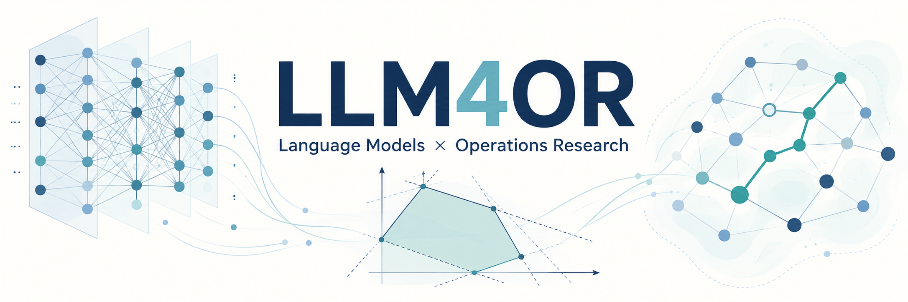

# Awesome LLM4OR

**English** | [简体中文](README.zh-CN.md)

A curated collection of papers, benchmarks, datasets, models, and tools for **Large Language Models for Operations Research**.

**Updated: 2026-10-25 · 235 papers.**

[Surveys](#surveys) · [Getting started](#start-here) · [Research methods](#research) · [Benchmarks](#benchmarks) · [Open resources](#resources)

## Contents

- [Surveys](#surveys) (10 papers)
- [Getting started](#start-here)
- [Research methods](#research)
  - [Optimization modeling and code generation](#modeling) (83 papers)
  - [Model verification, diagnosis, and repair](#verification) (21 papers)
  - [Direct solution generation and optimization decisions](#direct-solving) (15 papers)
  - [Heuristic and algorithm discovery](#algorithms) (54 papers)
  - [Solver components and configuration](#solver-enhancement) (17 papers)
- [Benchmarks and evaluation](#benchmarks) (86 papers)
- [Models, data, and tools](#resources)
- [Techniques and topic index](#techniques)
- [Application index](#applications)
- [Related research](#adjacent) (9 papers)
- [Authors and versions](#paper-info)
- [Classification guide](#classification)
- [Scope and contributions](#contributing)

## Surveys

Surveys, systematic reviews, tutorials, and research frameworks.

| Year / Venue | Paper | Contribution summary | Contributions | Resources |
|---|---|---|---|---|
| 2026 · ACM Computing Surveys | **Combinatorial Optimization Systematic Review** Large Language Models for Combinatorial Optimization: A Systematic Review | Uses a PRISMA review process to organize LLM combinatorial optimization studies by tasks, architectures, evaluation data, and application domains. | Survey | [![DOI][b001]][r001] [![arXiv][b002]][r002] [Details](#paper-lco2026review) |
| 2026 · ACM Computing Surveys | **LLM4AD Survey** A Systematic Survey on Large Language Models for Algorithm Design | Surveys LLM algorithm design through four roles: optimizer, predictor, extractor, and designer. | Survey | [![arXiv][b002]][r003] [![DOI][b001]][r004] [![Official resource repository (related)][b003]][r005] [Details](#paper-liu2024systematic) |
| 2026 · MIPRO 2026 | **LLMs as Optimizers Survey** Large Language Models as Optimizers: A Survey of Direct vs. Tool-Augmented Approaches and Their Performance Frontiers | Distinguishes direct optimization, tool-assisted optimization, and reusable-tool creation, comparing performance frontiers across the literature. | Survey | [![DOI][b001]][r006] [![arXiv][b002]][r007] [Details](#paper-llmasopt2026) |
| 2026 · IEEE CIM (journal record) | **LLMs for Evolutionary Optimization Survey** A Systematic Survey on Large Language Models for Evolutionary Optimization: From Modeling to Solving | Surveys LLMs and evolutionary optimization from modeling to solving, distinguishing direct optimization, internal assistance, and high-level algorithm design. | Survey | [![DOI][b001]][r008] [![arXiv][b002]][r009] [![Literature Collection (related)][b003]][r010] [Details](#paper-sysevo2025) |
| 2026 · arXiv preprint | **Smart Grids Agentic AI Tutorial** LLMs and Agentic AI Systems for Smart Grids: A Tutorial on Architectures and Applications | Surveys smart-grid agent architectures and demonstrates trusted tools and explicit checks in charging, power-flow, and fault-diagnosis cases. | Survey · Application | [![arXiv][b002]][r011] [![Case-study Code][b004]][r012] [Details](#paper-smartgrid2026) |
| 2025 · AAAI 2025 | **DOCP Research Manifesto** Enhancing Decision Making Through the Integration of Large Language Models and Operations Research Optimization | Sets out a business-user optimization-copilot vision and research needs in requirement clarification, model verification, and solving efficiency. | Survey · Foundational | [![Proceedings][b005]][r013] [![arXiv][b002]][r014] [Details](#paper-wasserkrug2024manifesto) |
| 2025 · IJCAI 2025 Survey Track | **LLM4OR Survey** A Survey of Optimization Modeling Meets LLMs: Progress and Future Directions | Surveys the optimization modeling pipeline, analyzes and annotates benchmark errors, and provides cleaned data and an evaluation portal. | Survey · Data | [![arXiv][b002]][r015] [![Official resource repository (related)][b003]][r016] [![Cleaned Benchmarks][b006]][r017] [Details](#paper-xiao2025survey) |
| 2025 · arXiv preprint | **LLMs in OR: Methods & Challenges** Large Language Models in Operations Research: Methods, Applications, and Challenges | Surveys LLM methods and applications in OR through automatic modeling, optimization assistance, and direct solving. | Survey | [![arXiv][b002]][r018] [Details](#paper-wang2025lor) |
| 2025 · arXiv preprint | **Teaching LLMs to Think Mathematically** Teaching LLMs to Think Mathematically: A Critical Study of Decision-Making via Optimization | Combines a systematic review and meta-analysis with comparisons of three prompting strategies on newly constructed network-optimization problems. | Survey · Evaluation analysis · Data | [![arXiv][b002]][r019] [Details](#paper-abedi2025thinkmath) |
| 2024 · arXiv preprint | **LLM–EA Automated Optimization Insights** Deep Insights into Automated Optimization with Large Language Models and Evolutionary Algorithms | Reviews automatic optimization with LLMs and evolutionary algorithms, analyzing representation, mutation, fitness, and prompt design. | Survey | [![arXiv][b002]][r020] [Details](#paper-yu2024deep) |

[Back to contents](#contents)

## Getting started

| Reading goal | Representative works | What to look for |
|---|---|---|
| Field overview | [LLM4OR Survey](#entry-xiao2025survey) → [LLM4AD Survey](#entry-liu2024systematic) | Explore the optimization-modeling pipeline and the landscape of automated algorithm design. |
| Tasks and evaluation | [NL4Opt](#entry-ramamonjison2023nl4opt) → [Mamo](#entry-huang2024mamo) → [EquivaMap](#entry-zhai2025equivamap) | Follow the progression from extraction and formulation to process evaluation, variable mappings, and equivalence checks. |
| From descriptions to models and solvers | [Chain-of-Experts](#entry-xiao2024coe) → [OptiMUS](#entry-teshnizi2024optimus) → [OptiGuide](#entry-li2023optiguide) | Compare expert collaboration, modeling–execution loops, and interactive decision support for users. |
| Model verification, diagnosis, and repair | [EquivaMap](#entry-zhai2025equivamap) → [SOVER / NLEquiv-150](#entry-bhattacharyya2026sover) → [ReLoop / RetailOpt-190](#entry-lian2026reloop) | Compare variable mappings, formal checks, and perturbation-based diagnosis to understand the conditions for equivalence checking and silent-error repair. |
| Direct solution generation and optimization decisions | [LLMCoSolver / E2E CO Solver](#entry-jiang2025e2eco) → [Starjob](#entry-abgaryan2025starjob) → [OPRO](#entry-yang2024opro) | Compare combinatorial solution generation, scheduling-model training, and feedback-driven candidate search. |
| Automatic algorithm and heuristic design | [FunSearch](#entry-romera2023funsearch) → [EoH](#entry-liu2024eoh) → [ReEvo](#entry-ye2024reevo) | Understand program search, joint evolution of ideas and code, and the role of verbal reflection. |
| Solver components and configuration | [Cold-Start Separator Configuration](#entry-lawless2024cuts) → [SAGE / formerly EvoCut](#entry-yazdani2025evocut) → [AutoSAT](#entry-sun2024autosat) | Compare separator configuration, discovery of MILP acceleration inequalities, and SAT heuristic replacement to see how component improvements integrate with existing solvers. |

## Research methods

Organized by research objective; a cross-task entry requires an independent contribution to that task.

### Optimization modeling and code generation

Turning requirements into mathematical models, structured representations, or solver programs, including interactive, CP, and dynamic-programming modeling.

#### Mathematical formulation and element extraction

| Year / Venue | Paper | Contribution summary | Contributions | Techniques | Resources |
|---|---|---|---|---|---|
| 2026 · ICML 2026 RLxF Workshop / arXiv | **AutoOR** AutoOR: Scalably Post-training LLMs to Autoformulate Operations Research Problems | Synthesizes training examples from standard optimization forms and trains natural-language modeling through execution feedback and curriculum RL. | Method · Data · Model | [Data synthesis](#tech-data-synthesis) · [SFT / distillation](#tech-sft) · [LLM RL](#tech-llm-rl) · [Execution / solver feedback](#tech-solver-feedback) | [![Paper][b007]][r021] [![arXiv][b002]][r022] [Details](#paper-autoor2026) |
| 2026 · arXiv preprint | **COOPA** COOPA: A Modular LLM Agent Architecture for Operations Research Problems | Iteratively compares formulation confidence, traces modeling-element provenance, and routes tasks to suitable solver agents. | Method | [Agent](#tech-agent) · [Multi-agent](#tech-multi-agent) | [![arXiv][b002]][r023] [![Code][b008]][r024] [Details](#paper-coopa2026) |
| 2026 · AAAI 2026 | **DeepOR** DeepOR: A Deep Reasoning Foundation Model for Optimization Modeling | Uses flowcharts to guide long-chain-of-thought synthesis and SFT, followed by RL with solver-feedback rewards. | Method · Data | [Data synthesis](#tech-data-synthesis) · [SFT / distillation](#tech-sft) · [LLM RL](#tech-llm-rl) · [Execution / solver feedback](#tech-solver-feedback) · [CoT / structured reasoning](#tech-cot) | [![Proceedings][b005]][r025] [![Code][b008]][r026] [![Official seeds and sample data][b009]][r027] [Details](#paper-xiao2026deepor) |
| 2026 · arXiv preprint | **DScheLLM** DScheLLM: Enabling Dynamic Scheduling through a Fine-Tuned Dual-System Large language Model | Synthesizes fast/slow-thinking demonstrations from solver schedules and LoRA-tunes a dual-system LLM for dynamic disruptions. | Method · Data · Model · Application | [Data synthesis](#tech-data-synthesis) · [SFT / distillation](#tech-sft) · [Execution / solver feedback](#tech-solver-feedback) · [CoT / structured reasoning](#tech-cot) | [![arXiv][b002]][r028] [Details](#paper-zhang2026dschellm) |
| 2026 · arXiv preprint | **EvoOpt-LLM** EvoOpt-LLM: Evolving industrial optimization models with large language models | Uses a 7B model and LoRA for industrial MILP modeling, new business-constraint injection, and variable pruning. | Method · Model | [SFT / distillation](#tech-sft) · [Execution / solver feedback](#tech-solver-feedback) | [![arXiv][b002]][r029] [![Code][b008]][r030] [Details](#paper-he2026evoopt) |
| 2026 · NeurIPS 2026 (accepted; publication pending) | **EvoOptiGraph** EvoOptiGraph: Weakness-Driven Coevolution via Graph-Based Structural Generation for Optimization Modeling | Evolves structurally diverse MILPs as attributed bipartite graphs, using compilation, back-translation, SFT, and RLVR to target model weaknesses. | Method · Data · Model | [Data synthesis](#tech-data-synthesis) · [SFT / distillation](#tech-sft) · [LLM RL](#tech-llm-rl) · [Execution / solver feedback](#tech-solver-feedback) | [![Paper][b007]][r031] [![arXiv][b002]][r032] [Details](#paper-evooptigraph2026) |
| 2026 · arXiv preprint | **MIND** Automated Optimization Modeling via a Localizable Error-Driven Perspective | Synthesizes targeted training tasks from localized modeling errors and applies DFPO to locally revise difficult examples. | Method · Data · Model | [Data synthesis](#tech-data-synthesis) · [SFT / distillation](#tech-sft) · [Preference optimization](#tech-preference) · [Execution / solver feedback](#tech-solver-feedback) | [![arXiv][b002]][r033] [Details](#paper-mind2026) |
| 2026 · ICML 2026 | **Opt-Miner** Opt-Miner: Empowering Information-Seeking Agent with Tree-Guided Data Synthesis for Optimization Modeling | Synthesizes optimization tasks with knowledge gaps in a tree structure and trains an actively retrieving modeling agent with R-GRPO. | Method · Data · Model | [Agent](#tech-agent) · [RAG](#tech-rag) · [Data synthesis](#tech-data-synthesis) · [LLM RL](#tech-llm-rl) · [Execution / solver feedback](#tech-solver-feedback) | [![Proceedings][b005]][r034] [![Reproduction Code (third-party)][b008]][r035] [![Reproduction Results (third-party)][b010]][r036] [![Demo (third-party)][b011]][r037] [Details](#paper-optminer2026) |
| 2026 · arXiv preprint | **OptiAgent** OptiAgent: End-to-End Optimization Modeling via Multi-Agent Iterative Refinement | Uses a dedicated modeling agent and layered feedback loops to extract variables and constraints and repair formulations and executable code. | Method | [Agent](#tech-agent) · [Multi-agent](#tech-multi-agent) · [Execution / solver feedback](#tech-solver-feedback) | [![arXiv][b002]][r038] [Details](#paper-optiagent2026) |
| 2026 · ICLR 2026 | **OR-PRM** OR-PRM: A Process Reward Model for Algorithmic Problem in Operations Research | Cleans existing synthetic data, builds OR-ProcessQA with MCTS and stepwise checks, and trains a process reward model for modeling reasoning. | Method · Data · Model | [Data synthesis](#tech-data-synthesis) · [MCTS](#tech-mcts) · [SFT / distillation](#tech-sft) · [Preference optimization](#tech-preference) · [Process rewards](#tech-prm) · [Execution / solver feedback](#tech-solver-feedback) | [![Proceedings][b005]][r039] [Details](#paper-wang2026orprm) |
| 2026 · AAAI 2026 | **OR-R1** OR-R1: Automating Modeling and Solving of Operations Research Optimization Problem via Test-Time Reinforcement Learning | Applies SFT with limited labeled data, then learns from unlabeled problems and solution consistency through test-time TGRPO. | Method · Model | [SFT / distillation](#tech-sft) · [LLM RL](#tech-llm-rl) · [Execution / solver feedback](#tech-solver-feedback) | [![DOI][b001]][r040] [![arXiv][b002]][r041] [![Code][b008]][r042] [Details](#paper-ding2026orr1) |
| 2026 · Artificial Intelligence for Transportation | **ORThought / LogiOR** ORThought: Benchmarking and automating logistics optimization modeling via structured LLM reasoning | Guides structured two-agent reasoning with expert modeling principles and introduces the logistics modeling benchmark LogiOR. | Method · Benchmark · Data | [Agent](#tech-agent) · [Multi-agent](#tech-multi-agent) · [CoT / structured reasoning](#tech-cot) | [![DOI][b001]][r043] [![arXiv][b002]][r044] [![Code][b008]][r045] [![Dataset][b012]][r046] [Details](#paper-yang2025orthought) |
| 2026 · ICML 2026 | **SAGE (Strategy-Aware Modeling)** Strategy-Aware Optimization Modeling with Reasoning LLMs | Generates and filters multi-strategy modeling demonstrations, combining SFT and Segment-Weighted GRPO for correct formulations and efficient solving. | Method · Data · Model | [Data synthesis](#tech-data-synthesis) · [SFT / distillation](#tech-sft) · [LLM RL](#tech-llm-rl) · [Execution / solver feedback](#tech-solver-feedback) | [![Proceedings][b005]][r047] [![arXiv][b002]][r048] [![Code][b008]][r049] [![SAGE SFT 100K][b013]][r050] [Details](#paper-strategyaware2026) |
| 2026 · International Journal of Production Research (online 2026) | **SMILO** An LLM-powered MILP modelling engine for workforce scheduling guided by expert knowledge | Combines expert modeling graphs, LLM information extraction, and templates to generate workforce-scheduling MILPs. | Method · Application |  | [![DOI][b001]][r051] [![arXiv][b002]][r052] [Details](#paper-li2025smilo) |
| 2025 · NeurIPS 2025 ScaleOpt Workshop / arXiv | **AlphaOPT** AlphaOPT: Formulating Optimization Programs with Self-Improving LLM Experience Library | Distills solver feedback into an evolving, retrievable modeling experience library without updating LLM parameters. | Method | [Memory](#tech-memory) · [Execution / solver feedback](#tech-solver-feedback) | [![Paper][b007]][r053] [![arXiv][b002]][r054] [![Code][b008]][r055] [Details](#paper-kong2025alphaopt) |
| 2025 · ICML 2025 | **Autoformulation** Autoformulation of Mathematical Optimization Models Using LLMs | Searches candidate optimization models with MCTS, guided by symbolic pruning and LLM estimates of partial models. | Method | [MCTS](#tech-mcts) | [![Proceedings][b005]][r056] [![arXiv][b002]][r057] [![Code][b008]][r058] [Details](#paper-astorga2025autoformulation) |
| 2025 · ACL 2025 | **BPP-Search / StructuredOR** BPP-Search: Enhancing Tree of Thought Reasoning for Mathematical Modeling Problem Solving | Introduces BPP-Search, combining beam search, process reward models, and pairwise preferences in tree-of-thought reasoning. | Method · Benchmark · Data | [Tree / beam search](#tech-tree-search) · [Preference optimization](#tech-preference) · [Process rewards](#tech-prm) · [CoT / structured reasoning](#tech-cot) | [![Proceedings][b005]][r059] [![Code][b008]][r060] [![Dataset][b012]][r061] [Details](#paper-wang2025bppsearch) |
| 2025 · arXiv preprint | **CALM / STORM** CALM Before the STORM: Unlocking Native Reasoning for Optimization Modeling | Revises reasoning traces with a small set of corrective prompts, then trains the STORM optimization modeling model through SFT and RL. | Method · Data · Model | [Data synthesis](#tech-data-synthesis) · [SFT / distillation](#tech-sft) · [LLM RL](#tech-llm-rl) · [Reflection](#tech-reflection) · [Execution / solver feedback](#tech-solver-feedback) | [![arXiv][b002]][r062] [Details](#paper-calm2025storm) |
| 2025 · arXiv preprint | **OptiMind** OptiMind: Teaching LLMs to Think Like Optimization Experts | Organizes expert error analyses by optimization problem class to guide training and inference and reduce common MILP formalization errors. | Method · Model | [SFT / distillation](#tech-sft) | [![arXiv][b002]][r063] [![Code][b008]][r064] [![Model][b014]][r065] [Details](#paper-zhang2025optimind) |
| 2025 · NeurIPS 2025 | **OptiTree** OptiTree: Hierarchical Thoughts Generation with Tree Search for LLM Optimization Modeling | Uses hierarchical modeling tree search to decompose complex optimization tasks adaptively into reusable simpler modeling ideas. | Method | [Tree / beam search](#tech-tree-search) · [Memory](#tech-memory) | [![Proceedings][b005]][r066] [![arXiv][b002]][r067] [![Code][b008]][r068] [Details](#paper-liu2025optitree) |
| 2025 · arXiv preprint | **OptiTrust** Toward a Trustworthy Optimization Modeling Agent via Verifiable Synthetic Data Generation | Synthesizes demonstrations from symbolic problems with known optima and trains modeling agents with cross-language voting and stepwise reasoning. | Method · Data · Model | [Agent](#tech-agent) · [Multi-agent](#tech-multi-agent) · [Data synthesis](#tech-data-synthesis) · [SFT / distillation](#tech-sft) · [Execution / solver feedback](#tech-solver-feedback) | [![arXiv][b002]][r069] [Details](#paper-lima2025optitrust) |
| 2025 · ICML 2025 | **OptMATH** OptMATH: A Scalable Bidirectional Data Synthesis Framework for Optimization Modeling | Synthesizes modeling data bidirectionally from mathematical models through problem data to natural language, filtered by forward modeling and rejection sampling. | Method · Benchmark · Data · Model | [Data synthesis](#tech-data-synthesis) · [SFT / distillation](#tech-sft) · [Execution / solver feedback](#tech-solver-feedback) | [![Proceedings][b005]][r070] [![Code][b008]][r071] [![Model 7B][b015]][r072] [![Model 32B][b016]][r073] [![Dataset][b012]][r074] [Details](#paper-lu2025optmath) |
| 2025 · Operations Research | **ORLM** ORLM: A Customizable Framework in Training Large Models for Automated Optimization Modeling | Trains optimization-domain models on OR-Instruct synthetic data and introduces the industrial benchmark IndustryOR. | Method · Benchmark · Data · Model | [Data synthesis](#tech-data-synthesis) · [SFT / distillation](#tech-sft) · [Execution / solver feedback](#tech-solver-feedback) | [![arXiv][b002]][r075] [![Journal][b017]][r076] [![Code][b008]][r077] [![Model][b014]][r078] [![IndustryOR][b018]][r079] [![OR-Instruct-3K][b019]][r080] [Details](#paper-huang2025orlm) |
| 2025 · ICLR 2025 | **ReSocratic / OptiBench** OptiBench Meets ReSocratic: Measure and Improve LLMs for Optimization Modeling | Synthesizes mathematical formulations and solution demonstrations before generating problems in reverse, alongside OptiBench and ReSocratic-29k. | Method · Benchmark · Data | [Data synthesis](#tech-data-synthesis) · [SFT / distillation](#tech-sft) · [Execution / solver feedback](#tech-solver-feedback) | [![Proceedings][b005]][r081] [![arXiv][b002]][r082] [![Code][b008]][r083] [Details](#paper-yang2025resocratic) |
| 2025 · Findings of EMNLP 2025 | **Step-Opt** Training LLMs for Optimization Modeling via Iterative Data Synthesis and Structured Validation | Progressively increases synthetic problem complexity, validates training data structurally, and fine-tunes optimization modeling models. | Method · Data · Model | [Data synthesis](#tech-data-synthesis) · [SFT / distillation](#tech-sft) · [Execution / solver feedback](#tech-solver-feedback) | [![Proceedings][b005]][r084] [![arXiv][b002]][r085] [![Code][b008]][r086] [Details](#paper-wu2025stepopt) |
| 2024 · ICLR 2024 | **Chain-of-Experts** Chain-of-Experts: When LLMs Meet Complex Operations Research Problems | Assigns OR expertise to agents coordinated by a conductor for forward reasoning and backward reflection on modeling and coding. | Method · Benchmark · Data | [Agent](#tech-agent) · [Multi-agent](#tech-multi-agent) · [Reflection](#tech-reflection) · [Execution / solver feedback](#tech-solver-feedback) · [CoT / structured reasoning](#tech-cot) | [![Proceedings][b005]][r087] [![Code][b008]][r088] [Details](#paper-xiao2024coe) |
| 2024 · INFOR | **LM4OPT** LM4OPT: Unveiling the potential of Large Language Models in formulating mathematical optimization problems | Adapts models to mathematical corpora before LP-modeling fine-tuning, using noisy embeddings for small models and comparing zero/one-shot prompts. | Method · Model · Evaluation analysis | [SFT / distillation](#tech-sft) | [![DOI][b001]][r089] [![arXiv][b002]][r090] [Details](#paper-ahmed2024lm4opt) |
| 2024 · Constraints | **Ner4Opt** Ner4Opt: named entity recognition for optimization modelling from natural language | Extracts variables, parameters, objectives, and constraints from optimization text, comparing lexical, semantic, fine-tuned, and language-model approaches. | Method · Model · Foundational | [SFT / distillation](#tech-sft) | [![DOI][b001]][r091] [![Code][b008]][r092] [![ner4opt-roberta-v1][b020]][r093] [![ner4opt-roberta-v2][b021]][r094] [![HF Demo (related)][b011]][r095] [Details](#paper-dakle2023ner4opt) |
| 2024 · EMNLP 2024 System Demonstrations | **To the Globe / TTG** To the Globe (TTG): Towards Language-Driven Guaranteed Travel Planning | Translates travel requirements into symbolic representations, then uses MILP to generate itineraries satisfying encoded constraints. | Method · Application · Model | [Data synthesis](#tech-data-synthesis) · [SFT / distillation](#tech-sft) · [Execution / solver feedback](#tech-solver-feedback) | [![Proceedings][b005]][r096] [![arXiv][b002]][r097] [Details](#paper-ju2024ttg) |
| 2023 · arXiv preprint | **AI-Copilot for Business Optimisation** Language Models for Business Optimisation with a Real World Case Study in Production Scheduling | Fine-tunes lower-cost LLMs to generate optimization formulations and evaluates them on a real production-scheduling case. | Method · Data · Model · Application | [Data synthesis](#tech-data-synthesis) · [SFT / distillation](#tech-sft) · [Execution / solver feedback](#tech-solver-feedback) | [![arXiv][b002]][r098] [![Training Data][b022]][r099] [![Generated Formulations (related)][b023]][r100] [![Industrial Case Data][b024]][r101] [![Industrial Outputs (related)][b025]][r102] [![LPWP Evaluation Data (related)][b026]][r103] [Details](#paper-alahakoon2023copilot) |
| 2023 · ICLR 2023 DL4C Workshop / arXiv | **CodeT5 Mathematical Program Synthesis** Synthesis of Mathematical programs from Natural Language Specifications | Augments training data with GPT-3 back-translation, fine-tunes CodeT5, and reranks and repairs candidates using LP rules. | Method · Model · Foundational | [Data synthesis](#tech-data-synthesis) · [SFT / distillation](#tech-sft) · [Execution / solver feedback](#tech-solver-feedback) | [![arXiv][b002]][r104] [Details](#paper-synth2023) |
| 2023 · arXiv preprint | **Multi-stage MILP Synthesis** Synthesizing mixed-integer linear programming models from natural language descriptions | Synthesizes MILPs through variable identification, constraint/objective classification, and templates, extending NL4Opt with logical constraints and binary variables. | Method · Data | [SFT / distillation](#tech-sft) | [![arXiv][b002]][r105] [![Modeling Data][b027]][r106] [Details](#paper-li2023synthesizing) |
| 2023 · arXiv preprint | **NL4Opt: Auto-Formulation Approach** A Novel Approach for Auto-Formulation of Optimization Problems | Combines pretraining, adversarial training, prompting, and ensembling for NL4Opt entity recognition and formulation generation. | Method · Foundational | [SFT / distillation](#tech-sft) | [![arXiv][b002]][r107] [![Code][b008]][r108] [Details](#paper-iflytek2023autoformulation) |
| 2023 · arXiv preprint; NL4Opt competition system | **OPD@NL4Opt** OPD@NL4Opt: An ensemble approach for the NER task of the optimization problem | Uses differential learning rates, adversarial training, and ensembles of pretrained language models for optimization-description named entity recognition. | Method · Foundational | [SFT / distillation](#tech-sft) | [![arXiv][b002]][r109] [![Competition results (related)][b028]][r110] [Details](#paper-wang2023opdnl4opt) |
| 2022 · EMNLP 2022 Industry | **Auto-formulation (2022)** Augmenting Operations Research with Auto-Formulation of Optimization Models From Problem Descriptions | Uses controlled generation to suggest optimization models from problem descriptions, with an interface for user validation and revision. | Method · Benchmark · Data · Foundational |  | [![Proceedings][b005]][r111] [![Code & Data (NL4Opt)][b029]][r112] [Details](#paper-ramamonjison2022augmenting) |

#### Solver code and domain languages

| Year / Venue | Paper | Contribution summary | Contributions | Techniques | Resources |
|---|---|---|---|---|---|
| 2026 · arXiv preprint | **Agora-Opt** From Soliloquy to Agora: Memory-Enhanced LLM Agents with Decentralized Debate for Optimization Modeling | Uses independent modeling teams and outcome-driven debate, with read/write memory to reuse solving experience and revisions arising from disagreements. | Method · Data | [Agent](#tech-agent) · [Multi-agent](#tech-multi-agent) · [Memory](#tech-memory) · [Execution / solver feedback](#tech-solver-feedback) | [![arXiv][b002]][r113] [![Code & Cleaned Data][b029]][r114] [Details](#paper-soliloquy2026) |
| 2026 · LION 19 / LNCS 15745 (published 2026) | **CHORUS** CHORUS: Zero-shot Hierarchical Retrieval and Orchestration for Generating Linear Programming Code | Supplies knowledge for Gurobi LP code generation through hierarchical document chunking, metadata retrieval, and reranking. | Method · Benchmark · Data | [RAG](#tech-rag) · [Execution / solver feedback](#tech-solver-feedback) | [![Proceedings][b005]][r115] [![arXiv][b002]][r116] [Details](#paper-lporch2025) |
| 2026 · arXiv preprint | **CIR / R2C** Canonical Intermediate Representation for LLM-based optimization problem formulation and code generation | Encodes complex rules in a canonical intermediate representation before retrieving knowledge and generating constraint implementations. | Method · Benchmark · Data | [Agent](#tech-agent) · [Multi-agent](#tech-multi-agent) · [RAG](#tech-rag) · [Execution / solver feedback](#tech-solver-feedback) | [![arXiv][b002]][r117] [Details](#paper-canonicalir2026) |
| 2026 · arXiv preprint | **EVOM** Execution-Verified Reinforcement Learning for Optimization Modeling | Trains modeling LLMs with solver execution outcomes and studies transfer across Gurobi, OR-Tools, and COPT. | Method · Model | [LLM RL](#tech-llm-rl) · [Execution / solver feedback](#tech-solver-feedback) | [![arXiv][b002]][r118] [Details](#paper-guan2026evom) |
| 2026 · arXiv preprint | **EvoOR-Agent** Co-evolving Agent Architectures and Interpretable Reasoning for Automated Optimization | Represents modeling–solving workflows as AOE graphs and co-evolves agent architectures with interpretable reasoning paths. | Method | [Agent](#tech-agent) · [Multi-agent](#tech-multi-agent) · [Program evolution](#tech-evolution) · [Execution / solver feedback](#tech-solver-feedback) | [![arXiv][b002]][r119] [Details](#paper-coevolve2026) |
| 2026 · arXiv preprint | **LEAN-LLM-OPT** Large-Scale Optimization Model Auto-Formulation: Harnessing LLM Flexibility via Structured Workflow | Builds modeling workflows dynamically and delegates data processing to tools for large-scale optimization and airline revenue management. | Method · Benchmark · Data · Application | [Agent](#tech-agent) · [Multi-agent](#tech-multi-agent) · [Execution / solver feedback](#tech-solver-feedback) | [![arXiv][b002]][r120] [![Code][b008]][r121] [Details](#paper-liang2026leanllmopt) |
| 2026 · arXiv preprint | **MiniOpt** MiniOpt: Reasoning to Model and Solve General Optimization Problems with Limited Resources | Connects modeling and code generation through structured reasoning, using hierarchical OptReward feedback on formulations and solutions. | Method · Model | [LLM RL](#tech-llm-rl) · [Execution / solver feedback](#tech-solver-feedback) · [CoT / structured reasoning](#tech-cot) | [![arXiv][b002]][r122] [![Code][b008]][r123] [Details](#paper-zhao2026miniopt) |
| 2026 · ICML 2026 | **NEMO** NEMO: Execution-Aware Optimization Modeling via Autonomous Coding Agents | Uses autonomous coding agents to generate optimizers and simulators, refining models through cross-execution, experience reuse, and candidate consistency. | Method | [Agent](#tech-agent) · [Memory](#tech-memory) · [Behavioral testing](#tech-behavioral) · [Execution / solver feedback](#tech-solver-feedback) | [![Proceedings][b005]][r124] [![arXiv][b002]][r125] [![Evaluation Artifacts][b030]][r126] [Details](#paper-nemo2026) |
| 2026 · arXiv preprint | **OptGraph** OptGraph: Large Language Models Enhanced Evolutionary Optimization Via Graph Retrieval-Augmented Generation | Organizes modeling patterns, formulations, implementations, and repairs in a typed graph, using neighborhood retrieval and execution-trace updates for modeling. | Method | [Agent](#tech-agent) · [Memory](#tech-memory) · [RAG](#tech-rag) · [Execution / solver feedback](#tech-solver-feedback) | [![arXiv][b002]][r127] [![Code][b008]][r128] [Details](#paper-xiu2026optgraph) |
| 2026 · arXiv preprint | **OptiDSL** Not All Problems Are Best Modeled as MILP: A DSL-Centric Framework for Flexible and Accurate Optimization Modeling | Maps natural language to domain DSLs and specialized solvers rather than forcing every problem into MILP. | Method · Benchmark · Data | [Execution / solver feedback](#tech-solver-feedback) | [![arXiv][b002]][r129] [Details](#paper-dslmilp2026) |
| 2026 · Findings of EMNLP 2026 | **OptSkills** OptSkills: Learning Generalizable Optimization Skills from Problem Archetypes via Cluster-Based Distillation | Clusters problem archetypes and distills, retrieves, and updates reusable workflow skills from successful modeling trajectories. | Method | [Agent](#tech-agent) · [Memory](#tech-memory) · [RAG](#tech-rag) · [Execution / solver feedback](#tech-solver-feedback) | [![Proceedings][b005]][r130] [![arXiv][b002]][r131] [![Code 1][b031]][r132] [![Code 2][b032]][r133] [![Official skill library (related)][b033]][r134] [Details](#paper-yang2026optskills) |
| 2026 · NeurIPS 2026 (accepted; publication pending) | **PEARL** PEARL: Solver-in-the-Loop Interactive Optimization Modeling from Natural Language | Executes, debugs, and revises optimization models through multi-turn tool use, training interactive modeling policies with solver feedback. | Method · Model | [Agent](#tech-agent) · [LLM RL](#tech-llm-rl) · [Execution / solver feedback](#tech-solver-feedback) | [![arXiv][b002]][r135] [![Proceedings][b005]][r136] [![Code][b008]][r137] [![Model][b014]][r138] [Details](#paper-lu2026pearl) |
| 2026 · arXiv preprint | **RLEA** Reinforcement Learning Enhanced LLM Agents for Complex Vehicle Routing Problems | Trains a lightweight planner with Soft Q-learning to coordinate LLM agents, memory, and retrieval for complex VRP modeling. | Method · Application | [Agent](#tech-agent) · [Multi-agent](#tech-multi-agent) · [Memory](#tech-memory) · [RAG](#tech-rag) · [Auxiliary / NCO learning](#tech-auxiliary-learning) · [Execution / solver feedback](#tech-solver-feedback) | [![arXiv][b002]][r139] [![Appendix (related)][b034]][r140] [Details](#paper-rlvrpagents2026) |
| 2026 · arXiv preprint | **SDRL** LLMs as Adaptive Meta-Solvers: Strategy-Diverse RL for Industrial-Scale Optimization | Uses correctness-gated hierarchical diversity rewards to train adaptive choices among solvers, exact combinatorial algorithms, and heuristics. | Method · Data · Model | [Data synthesis](#tech-data-synthesis) · [LLM RL](#tech-llm-rl) · [Execution / solver feedback](#tech-solver-feedback) | [![arXiv][b002]][r141] [![Benchmark Inference][b035]][r142] [![SDRL Qwen3 4B][b036]][r143] [Details](#paper-sdrl2026) |
| 2026 · arXiv preprint | **SOLID** Beyond Verified Answers: Solver-Informed Self-Distillation for Bootstrapping Operations Research Language Models | Clusters objectives from repeated solver rollouts into pseudo-references for ground-truth-free, solver-based self-distillation. | Method · Model | [LLM RL](#tech-llm-rl) · [Execution / solver feedback](#tech-solver-feedback) | [![arXiv][b002]][r144] [![Code][b008]][r145] [![SOLID-Qwen3][b037]][r146] [![SOLID-StepORLM][b038]][r147] [Details](#paper-solid2026) |
| 2026 · ICLR 2026 | **StepORLM** StepORLM: A Self-Evolving Framework With Generative Process Supervision For Operations Research Language Models | Co-evolves a policy model and a generative process reward model using solver outcomes and full-trajectory assessment. | Method · Model | [LLM RL](#tech-llm-rl) · [Process rewards](#tech-prm) · [Execution / solver feedback](#tech-solver-feedback) · [CoT / structured reasoning](#tech-cot) | [![Proceedings][b005]][r148] [![arXiv][b002]][r149] [![Code][b008]][r150] [![Policy 8B][b039]][r151] [![GenPRM 8B][b040]][r152] [Details](#paper-zhou2026steporlm) |
| 2025 · ICLR 2025 | **DRoC** DRoC: Elevating Large Language Models for Complex Vehicle Routing via Decomposed Retrieval of Constraints | Decomposes complex VRP constraints, retrieves documents separately, and dynamically chooses RAG or self-debugging to generate solver programs. | Method · Data · Application | [RAG](#tech-rag) · [Execution / solver feedback](#tech-solver-feedback) | [![Proceedings][b005]][r153] [![Proceedings][b005]][r154] [![Code][b008]][r155] [Details](#paper-jiang2025droc) |
| 2025 · ICLR 2025 | **LLMOPT** LLMOPT: Learning to Define and Solve General Optimization Problems from Scratch | Combines five-component formalization, multi-instruction tuning, and self-correction to generalize modeling and code generation across optimization tasks. | Method · Model | [SFT / distillation](#tech-sft) · [Execution / solver feedback](#tech-solver-feedback) | [![Proceedings][b005]][r156] [![arXiv][b002]][r157] [![Code][b008]][r158] [![Model][b014]][r159] [Details](#paper-jiang2025llmopt) |
| 2025 · NeurIPS 2025 | **MURKA** MURKA: Multi-Reward Reinforcement Learning with Knowledge Alignment for Optimization Tasks | Aligns Extractor, Solver, and Checker agents through multi-reward RL and knowledge distillation for text-to-executable optimization programs. | Method | [Agent](#tech-agent) · [Multi-agent](#tech-multi-agent) · [SFT / distillation](#tech-sft) · [LLM RL](#tech-llm-rl) · [Execution / solver feedback](#tech-solver-feedback) | [![Proceedings][b005]][r160] [Details](#paper-xie2025murka) |
| 2025 · arXiv preprint | **OptimAI** OptimAI: Optimization from Natural Language Using LLM-Powered AI Agents | Coordinates modeling, planning, coding, and code-critique roles, using UCB to schedule debugging and alternative plans. | Method | [Agent](#tech-agent) · [Multi-agent](#tech-multi-agent) · [Reflection](#tech-reflection) · [Execution / solver feedback](#tech-solver-feedback) | [![arXiv][b002]][r161] [Details](#paper-thind2025optimai) |
| 2025 · arXiv preprint | **OR-LLM-Agent / BWOR** OR-LLM-Agent: Automating Modeling and Solving of Operations Research Optimization Problems with Reasoning LLM | Assigns modeling, code generation, and debugging to reasoning agents and introduces the BWOR evaluation set. | Method · Benchmark · Data | [Agent](#tech-agent) · [Multi-agent](#tech-multi-agent) · [Execution / solver feedback](#tech-solver-feedback) | [![arXiv][b002]][r162] [![Code][b008]][r163] [![Dataset][b012]][r164] [Details](#paper-zhang2025bwor) |
| 2025 · ACL 2025 Industry Track | **ORMind** ORMind: A Cognitive-Inspired End-to-End Reasoning Framework for Operations Research | Uses cognitively inspired role collaboration, execution-based repair, and counterfactual checks for optimization modeling. | Method | [Agent](#tech-agent) · [Multi-agent](#tech-multi-agent) · [Behavioral testing](#tech-behavioral) · [Execution / solver feedback](#tech-solver-feedback) | [![Proceedings][b005]][r165] [![arXiv][b002]][r166] [![Code][b008]][r167] [Details](#paper-ormind2025) |
| 2025 · NeurIPS 2025 | **SIRL** Solver-Informed RL: Grounding Large Language Models for Authentic Optimization Modeling | Checks code and LP instances with a solver to construct verifiable RL rewards, releasing models and revised evaluation data. | Method · Data · Model | [Data synthesis](#tech-data-synthesis) · [LLM RL](#tech-llm-rl) · [Execution / solver feedback](#tech-solver-feedback) | [![Proceedings][b005]][r168] [![arXiv][b002]][r169] [![Code][b008]][r170] [![Model Gurobi-7B][b041]][r171] [![Model COPT-7B][b042]][r172] [![Model Gurobi-32B][b043]][r173] [![Model COPT-32B][b044]][r174] [![Revised evaluation set][b045]][r175] [Details](#paper-chen2025sirl) |
| 2025 · NeurIPS 2025 | **SolverLLM** SolverLLM: Leveraging Test-Time Scaling for Optimization Problem via LLM-Guided Search | Uses dynamically expanding MCTS to search formulations and solver code, guiding test-time exploration with prompts and uncertainty backpropagation. | Method | [MCTS](#tech-mcts) · [Execution / solver feedback](#tech-solver-feedback) | [![Proceedings][b005]][r176] [![arXiv][b002]][r177] [Details](#paper-solverllm2025) |
| 2025 · arXiv preprint | **Validation-in-the-Loop Power Modeling** From Natural Language to Solver-Ready Power System Optimization: An LLM-Assisted, Validation-in-the-Loop Framework | Generates power-system optimization models through domain prompts, structured schemas, feasibility checks, and iterative repair. | Method · Application | [Execution / solver feedback](#tech-solver-feedback) | [![arXiv][b002]][r178] [Details](#paper-nl2ps2025) |
| 2024 · NeurIPS 2024 MATH-AI Workshop | **CAFA** CAFA: Coding as Auto-Formulation Can Boost Large Language Models in Solving Linear Programming Problem | Uses compact prompts to generate Python programs that call optimization solvers for linear programming. | Method | [Execution / solver feedback](#tech-solver-feedback) | [![Paper][b007]][r179] [![Code][b008]][r180] [Details](#paper-deng2024cafa) |
| 2024 · INFOR | **Multi-Stage Modeling & Verification** Optimization modeling and verification from problem specifications using a multi-agent multi-stage LLM framework | Generates mathematical models and Zimpl code from specifications in stages, with cross-checks by multiple LLM agents. | Method · Benchmark · Data | [Agent](#tech-agent) · [Multi-agent](#tech-multi-agent) · [Execution / solver feedback](#tech-solver-feedback) | [![DOI][b001]][r181] [Details](#paper-mostajabdaveh2024multiagent) |
| 2024 · ICML 2024 | **OptiMUS** OptiMUS: Scalable Optimization Modeling with (MI)LP Solvers and Large Language Models | Uses modular agents for MILP modeling, code generation, debugging, and evaluation, and introduces NLP4LP. | Method · Benchmark · Data | [Agent](#tech-agent) · [Multi-agent](#tech-multi-agent) · [Execution / solver feedback](#tech-solver-feedback) | [![Proceedings][b005]][r182] [![arXiv][b002]][r183] [![Code][b008]][r184] [![Dataset][b012]][r185] [Details](#paper-teshnizi2024optimus) |
| 2023 · arXiv preprint | **LLMs for Power Engineering** LLM-based Frameworks for Power Engineering from Routine to Novel Tasks | Uses an end-to-end workflow for routine power-optimization coding and engineer-guided decomposition and code synthesis for novel tasks. | Method · Application | [Agent](#tech-agent) · [Execution / solver feedback](#tech-solver-feedback) | [![arXiv][b002]][r186] [Details](#paper-li2023power) |

**Related work:** [OptLLM](#entry-zhang2024optllm)

#### Interactive modeling and requirement changes

| Year / Venue | Paper | Contribution summary | Contributions | Techniques | Resources |
|---|---|---|---|---|---|
| 2026 · arXiv preprint | **Interactive Optimization Conversations** Let's Have a Conversation: Designing and Evaluating LLM Agents for Interactive Optimization | Uses decision agents with internal utility functions as stakeholders to evaluate multi-turn interactive optimization beyond single-answer quality. | Method · Data · Application | [Agent](#tech-agent) | [![arXiv][b002]][r187] [![Code][b008]][r188] [Details](#paper-conversation2026) |
| 2026 · INFORMS Journal on Data Science | **OptiChat** OptiChat: Bridging Optimization Models and Practitioners with Large Language Models | Supports natural-language queries over existing optimization models for infeasibility diagnosis, sensitivity, what-if analysis, and counterfactual explanations. | Method · Data | [Agent](#tech-agent) · [Multi-agent](#tech-multi-agent) · [Execution / solver feedback](#tech-solver-feedback) | [![DOI][b001]][r189] [![arXiv][b002]][r190] [![Code][b008]][r191] [Details](#paper-chen2025optichat) |
| 2025 · arXiv preprint | **Ask, Clarify, Optimize** Ask, Clarify, Optimize: Human-LLM Agent Collaboration for Smarter Inventory Control | Uses LLMs to clarify inventory needs and explain results, delegating stochastic optimization to algorithms and testing interaction with simulated managers. | Method · Model · Application | [Agent](#tech-agent) · [SFT / distillation](#tech-sft) · [Execution / solver feedback](#tech-solver-feedback) | [![arXiv][b002]][r192] [Details](#paper-askclarify2026) |
| 2025 · FedCSIS 2025 · ACSIS 43 | **C-DSS** Toward Conversational Decision Support Systems: Integrating LLMs in the Operations Research Methodology | Proposes a conversational decision-support architecture comparing combinations of modeling, AMPL coding, RAG, and validation roles. | Method | [Agent](#tech-agent) · [Multi-agent](#tech-multi-agent) · [RAG](#tech-rag) · [Execution / solver feedback](#tech-solver-feedback) | [![DOI][b001]][r193] [![Proceedings][b005]][r194] [Details](#paper-kaleta2025cdss) |
| 2024 · arXiv preprint | **City-LEO** City-LEO: Toward Transparent City Management Using LLM with End-to-End Optimization | Narrows optimization scope through dialogue and combines prediction with optimization to manage shared e-bike operations. | Method · Application | [Agent](#tech-agent) · [Execution / solver feedback](#tech-solver-feedback) | [![arXiv][b002]][r195] [![Data & Code][b046]][r196] [Details](#paper-jiao2024cityleo) |
| 2024 · NAACL 2024 Industry Track | **OptLLM** Solving General Natural-Language-Description Optimization Problems with Large Language Models | Supports natural-language optimization through clarification, formulation/code conversion, external solvers, and explanations, with Qwen fine-tuning. | Method · Data · Model | [Agent](#tech-agent) · [Data synthesis](#tech-data-synthesis) · [SFT / distillation](#tech-sft) · [Execution / solver feedback](#tech-solver-feedback) | [![Proceedings][b005]][r197] [![arXiv][b002]][r198] [![MindOpt Trial (International) (related)][b047]][r199] [![MindOpt Trial (CN) (related)][b048]][r200] [Details](#paper-zhang2024optllm) |
| 2024 · arXiv preprint | **RAGDyS** Automated Conversion of Static to Dynamic Scheduler via Natural Language | Uses retrieval-augmented generation to modify existing static scheduling models dynamically according to natural-language constraints. | Method · Application | [RAG](#tech-rag) · [Execution / solver feedback](#tech-solver-feedback) | [![arXiv][b002]][r201] [Details](#paper-tang2024ragdys) |
| 2023 · arXiv preprint | **OptiGuide** Large Language Models for Supply Chain Optimization | Translates natural-language what-if queries into analyses of existing optimization programs to explain supply-chain decisions. | Method · Application | [Agent](#tech-agent) · [Execution / solver feedback](#tech-solver-feedback) | [![arXiv][b002]][r202] [![Code][b008]][r064] [Details](#paper-li2023optiguide) |

#### Stochastic and robust modeling

| Year / Venue | Paper | Contribution summary | Contributions | Techniques | Resources |
|---|---|---|---|---|---|
| 2026 · arXiv preprint | **AutoREM / AutoRO-Bench** Automated Reformulation of Robust Optimization via Memory-Augmented Large Language Models | Uses failure-experience memory for deterministic reformulation of robust optimization and introduces AutoRO-Bench. | Method · Benchmark · Data | [Memory](#tech-memory) · [Execution / solver feedback](#tech-solver-feedback) | [![arXiv][b002]][r203] [Details](#paper-robustreform2026) |
| 2025 · arXiv preprint | **DAOpt / OptU** DAOpt: Modeling and Evaluation of Data-Driven Optimization under Uncertainty with LLMs | Combines uncertainty modeling, multiple agents, and simulation to evaluate out-of-sample feasibility and robustness. | Method · Benchmark · Data | [Agent](#tech-agent) · [Multi-agent](#tech-multi-agent) · [Execution / solver feedback](#tech-solver-feedback) | [![arXiv][b002]][r204] [Details](#paper-daopt2025) |
| 2025 · arXiv preprint | **LLM-SUC** Can Large Language Model Agents Balance Energy Systems? | Combines LLM agents with multi-scenario stochastic unit commitment for operational decisions under high wind-power uncertainty. | Method · Application | [Agent](#tech-agent) · [Execution / solver feedback](#tech-solver-feedback) | [![arXiv][b002]][r205] [![Code][b008]][r206] [Details](#paper-llmsuc2025) |
| 2025 · arXiv preprint | **LLMs for Stochastic Modeling** Large Language Model-Based Automatic Formulation for Stochastic Optimization Models | Generates chance-constrained and two-stage stochastic programs through structured prompts, checking model structure with soft scores. | Method | [Agent](#tech-agent) · [Multi-agent](#tech-multi-agent) · [Execution / solver feedback](#tech-solver-feedback) | [![arXiv][b002]][r207] [![Code][b008]][r208] [Details](#paper-talebi2025stochastic) |

#### Constraint programming

| Year / Venue | Paper | Contribution summary | Contributions | Techniques | Resources |
|---|---|---|---|---|---|
| 2026 · LLM4Code 2026 Workshop @ ICSE | **CP-Agent** CP-Agent: Agentic Constraint Programming | Executes and iteratively repairs constraint models with a persistent IPython kernel and concise domain prompts. | Method · Data | [Agent](#tech-agent) · [Execution / solver feedback](#tech-solver-feedback) | [![DOI][b001]][r209] [![arXiv][b002]][r210] [![Author Coding Agent (related)][b049]][r211] [![Evaluation Archive v2][b050]][r212] [Details](#paper-cpagent2025) |
| 2026 · arXiv preprint | **CP-SynC** CP-SynC: Multi-Agent Zero-Shot Constraint Modeling in MiniZinc with Synthesized Checkers | Uses modeling, checking, and selection agents to explore MiniZinc models in parallel and synthesizes semantic checkers to aggregate evidence. | Method · Benchmark · Data | [Agent](#tech-agent) · [Multi-agent](#tech-multi-agent) · [Execution / solver feedback](#tech-solver-feedback) | [![arXiv][b002]][r213] [![Benchmark & Evaluation][b051]][r214] [Details](#paper-cpsync2026) |
| 2026 · arXiv preprint | **RAG for Optimization & CP Modeling** Optimization and Constraint Modeling using LLMs with a Retrieval Augmented Generation Process | Synthesizes 500 problems from Text2Zinc seeds and role descriptions, using retrieved examples to generate optimization and constraint-model code. | Method · Data | [Data synthesis](#tech-data-synthesis) · [RAG](#tech-rag) · [Execution / solver feedback](#tech-solver-feedback) | [![arXiv][b002]][r215] [Details](#paper-roy2026rag) |
| 2026 · arXiv preprint | **Text2Model** Text2Model: Modeling Copilots for Text-to-Model Translation | Provides multiple MiniZinc modeling copilots, an interactive editor, and an online leaderboard. | Method · Platform | [Agent](#tech-agent) · [Multi-agent](#tech-multi-agent) | [![arXiv][b002]][r216] [![Code][b008]][r217] [![Text2Zinc (reused)][b052]][r218] [![Editor (related)][b053]][r219] [![Leaderboard (related)][b054]][r220] [![Python Package (related)][b055]][r221] [Details](#paper-text2model2026) |
| 2025 · arXiv preprint | **Gala** Gala: Global LLM Agents for Text-to-Model Translation | Assigns agents by global-constraint type and combines their outputs into complete MiniZinc models with an assembly agent. | Method | [Agent](#tech-agent) · [Multi-agent](#tech-multi-agent) | [![arXiv][b002]][r222] [![Gala in Text2Model][b056]][r217] [![Author Project (related)][b057]][r223] [Details](#paper-globalconstraint2025) |
| 2023 · arXiv preprint | **Holy Grail 2.0** Holy Grail 2.0: From Natural Language to Constraint Models | Discusses decomposed prompting for natural-language-to-constraint modeling and reports early GPT results. | Method · Foundational |  | [![arXiv][b002]][r224] [Details](#paper-kadioglu2023holygrail) |

#### Dynamic programming

| Year / Venue | Paper | Contribution summary | Contributions | Techniques | Resources |
|---|---|---|---|---|---|
| 2025 · arXiv preprint | **DPLM / DP-Bench** Auto-Formulating Dynamic Programming Problems with Large Language Models | Introduces DP-Bench and bidirectionally reflected synthetic training data to train DPLM for natural-language-to-dynamic-programming modeling. | Method · Benchmark · Data · Model | [Data synthesis](#tech-data-synthesis) · [Reflection](#tech-reflection) · [SFT / distillation](#tech-sft) · [CoT / structured reasoning](#tech-cot) | [![arXiv][b002]][r225] [Details](#paper-dpdlm2025) |

[Back to contents](#contents)

### Model verification, diagnosis, and repair

Verification, explanation, or repair as the research objective, distinguishing execution errors, infeasibility, mathematical equivalence, and behavioral diagnostics.

#### Execution debugging and code repair

| Year / Venue | Paper | Contribution summary | Contributions | Techniques | Resources |
|---|---|---|---|---|---|
| 2026 · arXiv preprint | **MIRROR** MIRROR: A Multi-Agent Framework with Iterative Adaptive Revision and Hierarchical Retrieval for Optimization Modeling in Operations Research | Retrieves modeling and code examples hierarchically and repairs optimization models through execution-driven iterative revision. | Method | [Agent](#tech-agent) · [RAG](#tech-rag) · [Execution / solver feedback](#tech-solver-feedback) | [![arXiv][b002]][r226] [Details](#paper-mirror2026) |

**Related work:** [OptiLoop](#entry-optiloop2026) · [ReLoop / RetailOpt-190](#entry-lian2026reloop) · [SAC-Opt](#entry-ma2025sacopt)

#### Infeasibility diagnosis and optimization explanations

| Year / Venue | Paper | Contribution summary | Contributions | Techniques | Resources |
|---|---|---|---|---|---|
| 2026 · INFORMS Journal on Data Science | **OptiChat** OptiChat: Bridging Optimization Models and Practitioners with Large Language Models | Supports natural-language queries over existing optimization models for infeasibility diagnosis, sensitivity, what-if analysis, and counterfactual explanations. | Method · Data | [Agent](#tech-agent) · [Multi-agent](#tech-multi-agent) · [Execution / solver feedback](#tech-solver-feedback) | [![DOI][b001]][r189] [![arXiv][b002]][r190] [![Code][b008]][r191] [Details](#paper-chen2025optichat) |
| 2026 · arXiv preprint | **OptiRepair** OptiRepair: Closed-Loop Diagnosis and Repair of Supply Chain Optimization Models with LLM Agents | Combines IIS analysis and operational plausibility checks in a two-stage supply-chain repair loop, introducing OptiRepair-SC and P1/P2 models. | Method · Benchmark · Data · Model · Application | [Agent](#tech-agent) · [LLM RL](#tech-llm-rl) · [Behavioral testing](#tech-behavioral) · [Execution / solver feedback](#tech-solver-feedback) | [![arXiv][b002]][r227] [Details](#paper-optirepair2026) |
| 2026 · ICML 2026 | **ORLoopBench** ORLoopBench: Solver-in-the-Loop Benchmarks for Self-Correction and Behavioral Rationality in Operations Research | Defines infeasible-model repair loops using IIS and solver re-execution, with ORDebug and ORBias evaluations. | Method · Benchmark · Data · Model | [LLM RL](#tech-llm-rl) · [Process rewards](#tech-prm) · [Execution / solver feedback](#tech-solver-feedback) | [![Proceedings][b005]][r228] [![arXiv][b002]][r229] [![Data and validation code][b058]][r230] [Details](#paper-ao2026orloopbench) |
| 2025 · ICLR 2025 | **EOR / Decision Information** Decision Information Meets Large Language Models: The Future of Explainable Operations Research | Uses what-if decision information and bipartite graphs to compare model changes and generate actionable optimization explanations. | Method · Benchmark · Data | [Agent](#tech-agent) | [![Proceedings][b005]][r231] [![arXiv][b002]][r232] [![Code][b008]][r233] [Details](#paper-zhang2025decisioninfo) |
| 2025 · arXiv preprint | **MOID** Multi-Objective Infeasibility Diagnosis for Routing Problems Using Large Language Models | Optimizes route cost and constraint violations jointly, then uses LLMs to analyze adjustments that could restore feasibility. | Method · Data · Application | [Execution / solver feedback](#tech-solver-feedback) | [![arXiv][b002]][r234] [![Diagnosis Data][b059]][r235] [Details](#paper-moid2025) |
| 2024 · INFOR 2024 | **OptiChat / Infeasibility Diagnosis** Diagnosing Infeasible Optimization Problems Using Large Language Models | Combines GPT-4, solver IIS analysis, and a conversational interface to explain infeasibility and suggest model repairs. | Method | [Agent](#tech-agent) · [Execution / solver feedback](#tech-solver-feedback) | [![arXiv][b002]][r236] [![DOI][b001]][r237] [![Code][b008]][r191] [Details](#paper-chen2023diagnosing) |

#### Equivalence and fidelity checks

| Year / Venue | Paper | Contribution summary | Contributions | Techniques | Resources |
|---|---|---|---|---|---|
| 2026 · arXiv preprint | **CP-SynC** CP-SynC: Multi-Agent Zero-Shot Constraint Modeling in MiniZinc with Synthesized Checkers | Uses modeling, checking, and selection agents to explore MiniZinc models in parallel and synthesizes semantic checkers to aggregate evidence. | Method · Benchmark · Data | [Agent](#tech-agent) · [Multi-agent](#tech-multi-agent) · [Execution / solver feedback](#tech-solver-feedback) | [![arXiv][b002]][r213] [![Benchmark & Evaluation][b051]][r214] [Details](#paper-cpsync2026) |
| 2026 · arXiv preprint | **OptArgus** OptArgus: A Multi-Agent System to Detect Hallucinations in LLM-based Optimization Modeling | Uses a hallucination taxonomy and expert agents to audit consistency among problem descriptions, mathematical models, and solver implementations. | Method · Benchmark · Data | [Agent](#tech-agent) · [Multi-agent](#tech-multi-agent) | [![arXiv][b002]][r238] [Details](#paper-optarcus2026) |
| 2026 · Findings of ACL 2026 | **OptiVerse / DVA-Agent** OptiVerse: A Comprehensive Benchmark towards Optimization Problem Solving | Evaluates modeling and solving on 1,000 multi-paradigm optimization tasks, with dual-view auditing agents comparing requirements and code semantics. | Method · Benchmark · Data | [Agent](#tech-agent) · [Multi-agent](#tech-multi-agent) | [![Proceedings][b005]][r239] [![arXiv][b002]][r240] [![Inference, Auditor & Evaluation][b060]][r241] [![OptiVerse 1K][b061]][r242] [Details](#paper-optiverse2026) |
| 2026 · ICML 2026 | **SAC-Opt** SAC-Opt: Semantic Anchors for Iterative Correction in Optimization Modeling | Back-translates generated code into semantic anchors, aligns them with original requirements, and selectively repairs constraints and objectives. | Method | [Memory](#tech-memory) · [Execution / solver feedback](#tech-solver-feedback) | [![Proceedings][b005]][r243] [![arXiv][b002]][r244] [![Code][b008]][r245] [Details](#paper-ma2025sacopt) |
| 2026 · Findings of EMNLP 2026 | **SOVER / NLEquiv-150** SOVER: Formal Certification of Optimization Reformulations via LLM-Assisted SMT Verification | Uses LLMs to extract reformulation mappings, then Z3 or dReal to verify feasibility and objective relationships between formulations. | Method · Benchmark · Data | [Formal verification](#tech-formal) | [![Proceedings][b005]][r246] [![arXiv][b002]][r247] [![Code][b008]][r248] [![EquivaFormulation (used for evaluation) (related)][b062]][r249] [![NLP4LP (used for evaluation) (related)][b063]][r185] [Details](#paper-bhattacharyya2026sover) |
| 2026 · ICML 2026 | **VeriSimpl** VeriSimpl: Robust Optimization Modeling from Natural Language using Simplification-based Verification | Uses a solver to construct simplified diagnostic problems that help LLMs assess whether models match natural-language problem intent. | Method | [Execution / solver feedback](#tech-solver-feedback) | [![Proceedings][b005]][r250] [![arXiv][b002]][r251] [![Proceedings][b005]][r252] [![Project (related)][b064]][r253] [Details](#paper-verisimpl2026) |
| 2025 · ICML 2025 | **EquivaMap** EquivaMap: Leveraging LLMs for Automatic Equivalence Checking of Optimization Formulations | Uses LLMs to find decision-variable mappings for Quasi-Karp equivalence checks and introduces EquivaFormulation. | Method · Benchmark · Data |  | [![Proceedings][b005]][r254] [![arXiv][b002]][r255] [![Code][b008]][r256] [![Dataset][b012]][r249] [Details](#paper-zhai2025equivamap) |
| 2025 · arXiv; related ICML 2026 workshop version | **ORGEval / Bench4Opt** ORGEval: Graph-Theoretic Evaluation of LLMs in Optimization Modeling | Represents optimization formulations as graphs, evaluating structural equivalence through graph isomorphism and WL tests under symmetric decomposability conditions. | Method · Benchmark · Data |  | [![arXiv][b002]][r257] [![ICML workshop poster (related)][b065]][r258] [Details](#paper-ding2026orgeval) |

**Related work:** [Falsification-Based Verification](#entry-li2026falsification)

#### Behavioral audits and perturbation diagnostics

| Year / Venue | Paper | Contribution summary | Contributions | Techniques | Resources |
|---|---|---|---|---|---|
| 2026 · Findings of EMNLP 2026 | **Constraint Injection / VRPCoder** Beyond Objective Equivalence: Constraint Injection for LLM-Based Optimization Modeling on Vehicle Routing Problems | Tests VRP code with feasible and single-constraint-violating solutions to detect missing constraints even when optimal values match. | Method · Benchmark · Data · Model · Application | [Data synthesis](#tech-data-synthesis) · [SFT / distillation](#tech-sft) · [LLM RL](#tech-llm-rl) · [Behavioral testing](#tech-behavioral) · [Execution / solver feedback](#tech-solver-feedback) | [![Proceedings][b005]][r259] [![arXiv][b002]][r260] [![Benchmark Data][b066]][r261] [Details](#paper-constraintinjection2026) |
| 2026 · arXiv preprint | **Falsification-Based Verification** Falsification-Based Verification of LLM-Generated Optimization Models: Sound Test Batteries and Their Detection Limits | Tests generated models with numerical-role perturbations, duality, and sensitivity relations, characterizing detectable errors and blind spots. | Method | [Behavioral testing](#tech-behavioral) · [Execution / solver feedback](#tech-solver-feedback) | [![arXiv][b002]][r262] [Details](#paper-li2026falsification) |
| 2026 · ICML 2026 | **NEMO** NEMO: Execution-Aware Optimization Modeling via Autonomous Coding Agents | Uses autonomous coding agents to generate optimizers and simulators, refining models through cross-execution, experience reuse, and candidate consistency. | Method | [Agent](#tech-agent) · [Memory](#tech-memory) · [Behavioral testing](#tech-behavioral) · [Execution / solver feedback](#tech-solver-feedback) | [![Proceedings][b005]][r124] [![arXiv][b002]][r125] [![Evaluation Artifacts][b030]][r126] [Details](#paper-nemo2026) |
| 2026 · arXiv preprint | **OptiLoop** OptiLoop: Coordination-in-the-Loop Verification and Repair for LLM-Generated Optimization Agents | Tests local optimization agents through bounded ADMM-style coordination, using behavioral and static evidence to repair code or formulations. | Method | [Agent](#tech-agent) · [Behavioral testing](#tech-behavioral) · [Execution / solver feedback](#tech-solver-feedback) | [![arXiv][b002]][r263] [Details](#paper-optiloop2026) |
| 2026 · NeurIPS 2026 (accepted; publication pending) | **ReLoop / RetailOpt-190** ReLoop: Structured Modeling and Behavioral Verification for Reliable LLM-Based Optimization | Combines structured modeling chains and solver parameter-perturbation checks to locate silent errors and perform diagnosis-guided repair. | Method · Benchmark · Data | [Behavioral testing](#tech-behavioral) · [Execution / solver feedback](#tech-solver-feedback) | [![arXiv][b002]][r264] [![Proceedings][b005]][r265] [![Code][b008]][r266] [![Dataset][b012]][r267] [Details](#paper-lian2026reloop) |
| 2025 · ACL 2025 Industry Track | **ORMind** ORMind: A Cognitive-Inspired End-to-End Reasoning Framework for Operations Research | Uses cognitively inspired role collaboration, execution-based repair, and counterfactual checks for optimization modeling. | Method | [Agent](#tech-agent) · [Multi-agent](#tech-multi-agent) · [Behavioral testing](#tech-behavioral) · [Execution / solver feedback](#tech-solver-feedback) | [![Proceedings][b005]][r165] [![arXiv][b002]][r166] [![Code][b008]][r167] [Details](#paper-ormind2025) |

**Related work:** [OptiRepair](#entry-optirepair2026) · [ORLoopBench](#entry-ao2026orloopbench)

[Back to contents](#contents)

### Direct solution generation and optimization decisions

LLMs directly produce candidate solutions, schedules, numerical decisions, or operational policies. Solver-program generation belongs to modeling.

#### Discrete solutions and schedules

| Year / Venue | Paper | Contribution summary | Contributions | Techniques | Resources |
|---|---|---|---|---|---|
| 2026 · arXiv preprint | **DScheLLM** DScheLLM: Enabling Dynamic Scheduling through a Fine-Tuned Dual-System Large language Model | Synthesizes fast/slow-thinking demonstrations from solver schedules and LoRA-tunes a dual-system LLM for dynamic disruptions. | Method · Data · Model · Application | [Data synthesis](#tech-data-synthesis) · [SFT / distillation](#tech-sft) · [Execution / solver feedback](#tech-solver-feedback) · [CoT / structured reasoning](#tech-cot) | [![arXiv][b002]][r028] [Details](#paper-zhang2026dschellm) |
| 2026 · arXiv preprint | **Infeasibility-Aware CO Models** Infeasibility Aware Large Language Models for Combinatorial Optimization | Builds feasible/infeasible training examples with exact optimization and certified filtering, fine-tunes solution/infeasibility outputs, and assists local search. | Method · Data · Model | [Data synthesis](#tech-data-synthesis) · [SFT / distillation](#tech-sft) · [Execution / solver feedback](#tech-solver-feedback) | [![arXiv][b002]][r268] [![Author Code / Data Archive (related)][b067]][r269] [Details](#paper-infeasibilityaware2026) |
| 2026 · arXiv preprint | **PowerAtlas / ECBench** PowerAtlas: Feasibility-Aware Language Models for Electricity-Computing Co-Scheduling | Trains LLMs with feasibility feedback to generate electricity–computing co-schedules, introducing ECBench and deterministic scoring. | Method · Benchmark · Data · Model · Application | [Data synthesis](#tech-data-synthesis) · [SFT / distillation](#tech-sft) · [LLM RL](#tech-llm-rl) · [Execution / solver feedback](#tech-solver-feedback) | [![arXiv][b002]][r270] [![Code & Sample Data][b068]][r271] [Details](#paper-jiang2026poweratlas) |
| 2025 · NeurIPS 2025 | **LLMCoSolver / E2E CO Solver** Large Language Models as End-to-end Combinatorial Optimization Solvers | Trains LLMs through SFT and feasibility/optimality-aware FOARL to output combinatorial optimization solutions directly from problem descriptions. | Method · Model · Data | [Data synthesis](#tech-data-synthesis) · [SFT / distillation](#tech-sft) · [LLM RL](#tech-llm-rl) · [Execution / solver feedback](#tech-solver-feedback) | [![Proceedings][b005]][r272] [![arXiv][b002]][r273] [![Code][b008]][r274] [![SFT Data][b069]][r275] [![RL Data][b070]][r276] [Details](#paper-jiang2025e2eco) |
| 2025 · Proceedings of the Design Society 5 · ICED25 (2025) | **LLMs for DSM Sequencing** Large language models for combinatorial optimization of design structure matrix | Supplies network topology and domain knowledge to LLMs to iteratively search orderings for design structure matrices. | Method · Application |  | [![DOI][b001]][r277] [![arXiv][b002]][r278] [Details](#paper-dsmco2024) |
| 2025 · arXiv preprint | **Starjob** Starjob: Dataset for LLM-Driven Job Shop Scheduling | Releases job-shop scheduling training data and uses LoRA to fine-tune LLMs to output schedules directly. | Method · Data · Model · Application | [SFT / distillation](#tech-sft) | [![arXiv][b002]][r279] [![Code][b008]][r280] [![Dataset][b012]][r281] [Details](#paper-abgaryan2025starjob) |
| 2025 · arXiv preprint | **Visual Graph Optimization with MLLMs** Bridging Visualization and Optimization: Multimodal Large Language Models on Graph-Structured Combinatorial Optimization | Renders graph structures as images and combines multimodal LLMs with simple search for influence maximization, dismantling, and graph tasks. | Method · Evaluation analysis | [Multimodal input](#tech-multimodal) · [Execution / solver feedback](#tech-solver-feedback) | [![arXiv][b002]][r282] [Details](#paper-bridgingviz2025) |
| 2024 · arXiv preprint | **Rare MIP Challenges** Leveraging Large Language Models for Solving Rare MIP Challenges | Combines fine-tuning, chain-of-thought reasoning, and recursive dynamic temperatures to generate feasible solutions for rare MIP scenarios. | Method | [SFT / distillation](#tech-sft) · [Execution / solver feedback](#tech-solver-feedback) · [CoT / structured reasoning](#tech-cot) | [![arXiv][b002]][r283] [Details](#paper-wang2024raremip) |

#### Operational policies and interactive decisions

| Year / Venue | Paper | Contribution summary | Contributions | Techniques | Resources |
|---|---|---|---|---|---|
| 2026 · arXiv preprint | **GenAI Beer Game Reliability** Reliability and Effectiveness of Autonomous AI Agents in Supply Chain Management | Studies decision volatility in the multi-echelon Beer Game and compares reliability from RL post-training and operational guardrails. | Method · Evaluation analysis · Application | [Agent](#tech-agent) · [Multi-agent](#tech-multi-agent) · [LLM RL](#tech-llm-rl) | [![arXiv][b002]][r284] [Details](#paper-beergame2026) |
| 2025 · arXiv preprint | **ALAS** ALAS: A Stateful Multi-LLM Agent Framework for Disruption-Aware Planning | Handles operational disruptions in schedules through role-based agents, persistent state, and history-aware local compensation. | Method · Application | [Agent](#tech-agent) · [Multi-agent](#tech-multi-agent) · [Memory](#tech-memory) | [![arXiv][b002]][r285] [Details](#paper-alas2025) |
| 2025 · arXiv (2026 revision) | **ReflecSched** ReflecSched: Solving Dynamic Flexible Job-Shop Scheduling via LLM-Powered Hierarchical Reflection | Distills strategic experience from multi-horizon heuristic simulations to guide dynamic flexible job-shop scheduling. | Method · Application | [Memory](#tech-memory) · [Reflection](#tech-reflection) · [Execution / solver feedback](#tech-solver-feedback) | [![arXiv][b002]][r286] [Details](#paper-cao2025reflecsched) |
| 2024 · arXiv preprint | **InvAgent** InvAgent: A Large Language Model based Multi-Agent System for Inventory Management in Supply Chains | Uses multiple zero-shot LLM agents to manage supply-chain inventory and adapt to changing demand. | Method · Application | [Agent](#tech-agent) · [Multi-agent](#tech-multi-agent) | [![arXiv][b002]][r287] [![Code][b008]][r288] [Details](#paper-quan2024invagent) |
| 2024 · EMNLP 2024 Industry Track | **ITINERA** ItiNera: Integrating Spatial Optimization with Large Language Models for Open-domain Urban Itinerary Planning | Decomposes city-walk requests, selects points of interest, and uses cluster-aware spatial optimization for personalized itineraries. | Method · Application | [Agent](#tech-agent) · [Execution / solver feedback](#tech-solver-feedback) | [![Proceedings][b005]][r289] [![arXiv][b002]][r290] [![Code][b008]][r291] [Details](#paper-tang2024itinerary) |

#### Numerical optimization and parameter decisions

| Year / Venue | Paper | Contribution summary | Contributions | Techniques | Resources |
|---|---|---|---|---|---|
| 2026 · Findings of ACL 2026 | **OPT-BENCH / OPT-Agent** OPT-BENCH: Evaluating the Iterative Self-Optimization of LLM Agents in Large-Scale Search Spaces | Evaluates iterative self-optimization on machine-learning tuning and NP problems, with OPT-Agent reusing historical feedback to revise solutions. | Method · Benchmark · Data | [Agent](#tech-agent) · [Memory](#tech-memory) · [Execution / solver feedback](#tech-solver-feedback) | [![Proceedings][b005]][r292] [![arXiv][b002]][r293] [![Revised Preprint][b071]][r294] [![Code][b008]][r295] [![Dataset][b012]][r296] [Details](#paper-li2026optbench) |
| 2024 · ICLR 2024 | **OPRO** Large Language Models as Optimizers | Prompts LLMs with prior candidates and numerical evaluations to generate new solutions for direct optimization and prompt optimization. | Method · Foundational |  | [![Proceedings][b005]][r297] [![arXiv][b002]][r298] [![Code][b008]][r299] [Details](#paper-yang2024opro) |

[Back to contents](#contents)

### Heuristic and algorithm discovery

Generating and improving complete algorithms, heuristic programs, neighborhood operators, or optimization methods.

#### Heuristic program discovery

| Year / Venue | Paper | Contribution summary | Contributions | Techniques | Resources |
|---|---|---|---|---|---|
| 2026 · ICML 2026 | **A2DEPT** A2DEPT: Large Language Model-Driven Automated Algorithm Design via Evolutionary Program Trees | Searches complete algorithms through tree-structured evolution, hybrid selection, and hierarchical operations, repairing programs with execution feedback. | Method | [Program evolution](#tech-evolution) · [Execution / solver feedback](#tech-solver-feedback) | [![Proceedings][b005]][r300] [![Proceedings][b005]][r301] [![arXiv][b002]][r302] [Details](#paper-chen2026a2dept) |
| 2026 · ICLR 2026 | **AFL** An Agentic Framework with LLMs for Solving Complex Vehicle Routing Problems | Uses four specialized agents to autonomously generate and collaboratively repair solving programs from raw VRP inputs. | Method · Application | [Agent](#tech-agent) · [Multi-agent](#tech-multi-agent) · [Execution / solver feedback](#tech-solver-feedback) | [![Proceedings][b005]][r303] [![Proceedings][b005]][r304] [![arXiv][b002]][r305] [![Code][b008]][r306] [Details](#paper-zhang2026afl) |
| 2026 · arXiv preprint | **Automated Inventory Policy Design** Automated Design of Inventory Policy with Large Language Models: An Exploratory Study | Iteratively generates inventory-policy function classes with LLMs, then tunes each class with an external optimizer and cost feedback. | Method · Application | [Execution / solver feedback](#tech-solver-feedback) | [![arXiv][b002]][r307] [Details](#paper-invpolicy2026) |
| 2026 · ICLR 2026 | **CALM (Algorithm–LM Co-evolution)** CALM: Co-evolution of Algorithms and Language Model for Automatic Heuristic Design | Uses generated-heuristic quality as an RL signal to co-evolve candidate algorithms and the underlying language model. | Method · Model | [Program evolution](#tech-evolution) · [LLM RL](#tech-llm-rl) · [Execution / solver feedback](#tech-solver-feedback) | [![Proceedings][b005]][r308] [![arXiv][b002]][r309] [![Code][b008]][r310] [Details](#paper-huang2025calm) |
| 2026 · Inteligencia Artificial | **Combinatorial Optimization for All** Combinatorial Optimization for All: Using LLMs to Aid Non-Experts in Improving Optimization Algorithms | Uses prompts requiring limited expertise to improve ten existing TSP algorithms, comparing quality, runtime, and code complexity. | Method · Evaluation analysis | [Execution / solver feedback](#tech-solver-feedback) | [![Journal][b017]][r311] [![DOI][b001]][r312] [![arXiv][b002]][r313] [![Prompts & Algorithms][b072]][r314] [![Project (related)][b057]][r315] [Details](#paper-co4all2025) |
| 2026 · arXiv preprint | **DSevolve** DSevolve: Enabling Real-Time Adaptive Scheduling on Dynamic Flexible Job Shop with LLM-Evolved Heuristic Portfolios | Evolves a complementary scheduling-rule library offline and uses a state-conditioned neural selector to respond to flexible-job-shop disruptions online. | Method · Application | [Program evolution](#tech-evolution) · [Auxiliary / NCO learning](#tech-auxiliary-learning) · [Execution / solver feedback](#tech-solver-feedback) | [![arXiv][b002]][r316] [Details](#paper-dsevolve2026) |
| 2026 · arXiv preprint | **EPOCH** EPOCH: Coverage-Aware Evolution with Experiential Preference Optimization for LLM-based Automated Heuristic Design | Selects complementary heuristics by instance coverage and updates the generator with teacher-reflection preferences, DPO, and reflection self-distillation. | Method · Model | [Program evolution](#tech-evolution) · [Reflection](#tech-reflection) · [Preference optimization](#tech-preference) · [SFT / distillation](#tech-sft) · [Execution / solver feedback](#tech-solver-feedback) | [![arXiv][b002]][r317] [Details](#paper-epoch2026) |
| 2026 · ICIST 2026 (accepted) | **ES-AHD** ES-AHD: An Evolution Strategy Framework for Automatic Heuristic Design | Extracts semantic centers from elite programs and controls the search range with momentum-based temperature sampling. | Method | [Program evolution](#tech-evolution) · [Execution / solver feedback](#tech-solver-feedback) | [![arXiv][b002]][r318] [![PDF][b073]][r319] [![Code][b008]][r320] [Details](#paper-es2026ahd) |
| 2026 · ICLR 2026 | **HiFo-Prompt** HiFo-Prompt: Prompting with Hindsight and Foresight for LLM-based Automatic Heuristic Design | Accumulates heuristic-design principles in a hindsight knowledge pool and selects forward-looking search prompts by population dynamics. | Method | [Program evolution](#tech-evolution) · [Memory](#tech-memory) · [Reflection](#tech-reflection) · [Execution / solver feedback](#tech-solver-feedback) | [![Proceedings][b005]][r321] [![arXiv][b002]][r322] [![Code][b008]][r323] [Details](#paper-chen2025hifoprompt) |
| 2026 · arXiv preprint | **InvEvolve** InvEvolve: Evolving White-Box Inventory Policies via Large Language Models with Performance Guarantees | Evolves white-box inventory policies with LLMs and studies safe deployment and improvement through confidence-interval certification. | Method · Application | [Program evolution](#tech-evolution) · [Execution / solver feedback](#tech-solver-feedback) | [![arXiv][b002]][r324] [Details](#paper-invevolve2026) |
| 2026 · arXiv preprint | **LaGO** Heuristic Search as Language-Guided Program Optimization | Separates heuristic discovery into execution evaluation, language feedback, and program updates, allowing components to improve independently. | Method | [Reflection](#tech-reflection) · [Execution / solver feedback](#tech-solver-feedback) | [![arXiv][b002]][r325] [Details](#paper-hsplo2026) |
| 2026 · LION 20 / 2026 (accepted) | **Latent Heuristic Search** Latent Heuristic Search: Continuous Optimization for Automated Algorithm Design | Learns program encodings, performance surrogates, invertible flows, and soft-prompt mappings to optimize continuous latent representations and decode heuristics. | Method | [Auxiliary / NCO learning](#tech-auxiliary-learning) · [Execution / solver feedback](#tech-solver-feedback) | [![arXiv][b002]][r326] [![Proceedings][b005]][r327] [![Code][b008]][r328] [Details](#paper-latentheuristic2026) |
| 2026 · IEEE TEVC | **LLaMoCo** LLaMoCo: Instruction Tuning of Large Language Models for Optimization Code Generation | Builds problem–optimization-code instructions and combines contrastive warm-up with instruction tuning to generate optimization programs from problem code. | Method · Model · Data | [Data synthesis](#tech-data-synthesis) · [SFT / distillation](#tech-sft) · [Execution / solver feedback](#tech-solver-feedback) | [![DOI][b001]][r329] [![arXiv][b002]][r330] [![LLaMoCo-S Example][b074]][r331] [![LLaMoCo-S][b075]][r332] [Details](#paper-ma2024llamoco) |
| 2026 · arXiv preprint | **LLM Agents for Efficient Frontiers** LLM Agents for Combinatorial Efficient Frontiers: Investment Portfolio Optimization | Uses agents to automate heuristic development and efficient-frontier construction for cardinality-constrained mean–variance portfolios. | Method · Application | [Agent](#tech-agent) · [Execution / solver feedback](#tech-solver-feedback) | [![arXiv][b002]][r333] [Details](#paper-efficientfrontier2026) |
| 2026 · arXiv preprint | **MeEvo** MeEvo: Metacognitive Evolution Combined with Natural Evolution for Automatic Heuristic Design | Alternates code recombination/mutation with metacognitive reflection on reasoning history, feeding both stages into subsequent iterations. | Method | [Program evolution](#tech-evolution) · [Reflection](#tech-reflection) · [Execution / solver feedback](#tech-solver-feedback) | [![arXiv][b002]][r334] [![Code][b008]][r335] [Details](#paper-meevo2026) |
| 2026 · Expert Systems with Applications 330 (December 2026 issue scheduled) | **MeLA** MeLA: A metacognitive LLM-driven architecture for automatic heuristic design | Evolves heuristic-generation prompts through problem analysis, error diagnosis, and metacognitive search rather than code mutation alone. | Method | [Program evolution](#tech-evolution) · [Reflection](#tech-reflection) · [Execution / solver feedback](#tech-solver-feedback) | [![DOI][b001]][r336] [![arXiv][b002]][r337] [Details](#paper-chen2025mela) |
| 2026 · AAAI 2026 | **MPaGE** Pareto-Grid-Guided Large Language Models for Fast and High-Quality Heuristics Design in Multi-Objective Combinatorial Optimization | Guides LLM heuristic evolution with Pareto-front grids and semantic clustering to balance multi-objective quality, speed, and diversity. | Method | [Program evolution](#tech-evolution) · [Execution / solver feedback](#tech-solver-feedback) | [![DOI][b001]][r338] [![arXiv][b002]][r339] [![Code][b008]][r340] [Details](#paper-ha2025paretogrid) |
| 2026 · ICML 2026 | **PathWise** PathWise: Planning through World Model for Automated Heuristic Design via Self-Evolving LLMs | Plans evolutionary actions on implication graphs preserving search history, coordinating policy, world-model, and critic agents for heuristic generation. | Method | [Agent](#tech-agent) · [Multi-agent](#tech-multi-agent) · [Memory](#tech-memory) · [Execution / solver feedback](#tech-solver-feedback) | [![Proceedings][b005]][r341] [![arXiv][b002]][r342] [![Code][b008]][r343] [Details](#paper-pathwise2026) |
| 2026 · ICLR 2026 | **ShinkaEvolve** ShinkaEvolve: Towards Open-Ended and Sample-Efficient Program Evolution | Combines parent sampling, novelty-based rejection sampling, and bandit model selection for more sample-efficient program evolution. | Method · Platform | [Program evolution](#tech-evolution) · [Memory](#tech-memory) · [Execution / solver feedback](#tech-solver-feedback) | [![Proceedings][b005]][r344] [![arXiv][b002]][r345] [![Code][b008]][r346] [Details](#paper-lange2026shinka) |
| 2026 · arXiv preprint | **TIDE** TIDE: Tuning-Integrated Dynamic Evolution for LLM-Based Automated Heuristic Design | Searches program structures with an outer island model, tunes numerical parameters through inner differential mutation, and schedules prompts with UCB. | Method | [Program evolution](#tech-evolution) · [Execution / solver feedback](#tech-solver-feedback) | [![arXiv][b002]][r347] [Details](#paper-chen2026tide) |
| 2025 · arXiv preprint | **ARS / RoutBench** ARS: Automatic Routing Solver with Large Language Models | Generates constraint-aware routing heuristics from problem descriptions and introduces the multi-variant VRP benchmark RoutBench. | Method · Benchmark · Data | [Agent](#tech-agent) · [Execution / solver feedback](#tech-solver-feedback) | [![arXiv][b002]][r348] [![Code][b008]][r349] [Details](#paper-li2025ars) |
| 2025 · arXiv preprint | **CEoH** Leveraging Large Language Models to Develop Heuristics for Emerging Optimization Problems | Adds problem context to EoH prompts to discover heuristics for understudied tasks such as warehouse unit-load premarshalling. | Method · Application | [Program evolution](#tech-evolution) · [Execution / solver feedback](#tech-solver-feedback) | [![arXiv][b002]][r350] [![Code][b008]][r351] [Details](#paper-bomer2025emerging) |
| 2025 · arXiv preprint | **EASE** Solve it with EASE | Supports algorithm evolution through modular generation, testing, analysis, and evaluation, with complementary roles for multiple LLMs. | Method · Platform | [Agent](#tech-agent) · [Multi-agent](#tech-multi-agent) · [Program evolution](#tech-evolution) · [Execution / solver feedback](#tech-solver-feedback) | [![arXiv][b002]][r352] [![Framework][b076]][r353] [![Frontend][b077]][r354] [Details](#paper-viktorin2025ease) |
| 2025 · arXiv preprint | **EFS** Evolutionary Factor Searching for Sparse Portfolio Optimization Using Large Language Models | Uses LLMs and evolutionary search to generate ranking factors, combining redundancy-aware weight allocation for sparse portfolios. | Method · Application | [Program evolution](#tech-evolution) · [Execution / solver feedback](#tech-solver-feedback) | [![arXiv][b002]][r355] [Details](#paper-luo2025efs) |
| 2025 · arXiv preprint | **FunSearch for Unit Commitment** Automated Heuristic Design for Unit Commitment Using Large Language Models | Applies LLM program search and evaluation to automatic design of unit-commitment heuristics. | Method · Application | [Program evolution](#tech-evolution) · [Execution / solver feedback](#tech-solver-feedback) | [![arXiv][b002]][r356] [Details](#paper-ucfunsearch2025) |
| 2025 · arXiv preprint | **HeurAgenix** HeurAgenix: Leveraging LLMs for Solving Complex Combinatorial Optimization Challenges | Generates and evolves a heuristic library, then selects operators by problem state using a general LLM or a domain-tuned selector. | Method · Model | [Program evolution](#tech-evolution) · [LLM RL](#tech-llm-rl) · [Execution / solver feedback](#tech-solver-feedback) | [![arXiv][b002]][r357] [![Code][b008]][r358] [![CO Instances][b078]][r359] [Details](#paper-yang2025heuragenix) |
| 2025 · AAAI 2025 | **HSEvo** HSEvo: Elevating Automatic Heuristic Design with Diversity-Driven Harmony Search and Genetic Algorithm Using LLMs | Analyzes heuristic evolution with diversity metrics and combines harmony search with genetic search to improve exploration. | Method · Evaluation analysis | [Program evolution](#tech-evolution) · [Execution / solver feedback](#tech-solver-feedback) | [![DOI][b001]][r360] [![arXiv][b002]][r361] [![Code][b008]][r362] [Details](#paper-dat2024hsevo) |
| 2025 · arXiv preprint | **InstSpecHH** LLM-Driven Instance-Specific Heuristic Generation and Selection | Partitions instances by features, evolves specialized heuristics offline, and selects algorithms with LLMs or lightweight classifiers. | Method | [Program evolution](#tech-evolution) · [Auxiliary / NCO learning](#tech-auxiliary-learning) · [Execution / solver feedback](#tech-solver-feedback) | [![arXiv][b002]][r363] [Details](#paper-zhang2025instspechh) |
| 2025 · IEEE CEC 2025 | **LHNS** LLM-Driven Neighborhood Search for Efficient Heuristic Design | Organizes LLM rewrites as neighborhood search over heuristic programs, introducing three search strategies to reduce discovery cost. | Method | [Execution / solver feedback](#tech-solver-feedback) | [![DOI][b001]][r364] [![Proceedings][b005]][r365] [![LLM4AD: LHNS][b079]][r366] [Details](#paper-xie2025llmns) |
| 2025 · IEEE TEVC | **LLaMEA** LLaMEA: A Large Language Model Evolutionary Algorithm for Automatically Generating Metaheuristics | Uses LLMs to generate, mutate, and select metaheuristics, iteratively improving algorithms with execution-based feedback. | Method | [Program evolution](#tech-evolution) · [Execution / solver feedback](#tech-solver-feedback) | [![arXiv][b002]][r367] [![Code][b008]][r368] [Details](#paper-vanstein2024llamea) |
| 2025 · arXiv preprint | **LLM-discovered EDDC / MDDC** Discovering Heuristics with Large Language Models (LLMs) for Mixed-Integer Programs: Single-Machine Scheduling | Uses LLM-driven evolution to discover EDDC and MDDC single-machine total-tardiness heuristics, comparing quality and runtime with classical rules. | Method · Application | [Program evolution](#tech-evolution) · [Execution / solver feedback](#tech-solver-feedback) | [![arXiv][b002]][r369] [![Code][b008]][r370] [Details](#paper-cetinkaya2025mipsmtt) |
| 2025 · ICML 2025 | **MCTS-AHD** Monte Carlo Tree Search for Comprehensive Exploration in LLM-Based Automatic Heuristic Design | Organizes generated heuristics in an MCTS tree to explore the potential of candidates with initially low scores. | Method | [MCTS](#tech-mcts) · [Execution / solver feedback](#tech-solver-feedback) | [![Proceedings][b005]][r371] [![arXiv][b002]][r372] [![Code][b008]][r373] [Details](#paper-zheng2025mctsahd) |
| 2025 · AAAI 2025 | **MEoH** Multi-Objective Evolution of Heuristic Using Large Language Model | Searches for Pareto heuristics across solution quality, efficiency, and scalability, selecting candidates by dominance and diversity. | Method | [Program evolution](#tech-evolution) · [Execution / solver feedback](#tech-solver-feedback) | [![DOI][b001]][r374] [![arXiv][b002]][r375] [![LLM4AD: MEoH][b080]][r376] [Details](#paper-yao2025meoh) |
| 2025 · ICLR 2025 Agentic AI Workshop | **NCO-LLM for VRP** Large Language Models powered Neural Solvers for Generalized Vehicle Routing Problems | Evolves LLM-generated structural biases for attention scores, then fine-tunes LEHD / POMO neural routing policies. | Method · Model · Application | [Program evolution](#tech-evolution) · [Auxiliary / NCO learning](#tech-auxiliary-learning) · [Execution / solver feedback](#tech-solver-feedback) | [![Paper][b007]][r377] [![Code][b008]][r378] [Details](#paper-tran2025llmneural) |
| 2025 · arXiv preprint | **RedAHD** RedAHD: Reduction-Based End-to-End Automatic Heuristic Design with Large Language Models | Uses LLMs to design problem and solution reductions to more familiar problems, then evolves solution heuristics. | Method | [Program evolution](#tech-evolution) · [Execution / solver feedback](#tech-solver-feedback) | [![arXiv][b002]][r379] [Details](#paper-thach2025redahd) |
| 2025 · arXiv preprint | **RoCo** RoCo: Role-Based LLMs Collaboration for Automatic Heuristic Design | Coordinates explorer, developer, critic, and integrator roles to generate, review, and revise heuristics. | Method | [Agent](#tech-agent) · [Multi-agent](#tech-multi-agent) · [Reflection](#tech-reflection) · [Execution / solver feedback](#tech-solver-feedback) | [![arXiv][b002]][r380] [Details](#paper-xu2025roco) |
| 2025 · NeurIPS 2025 | **STRCMP** STRCMP: Integrating Graph Structural Priors with Language Models for Combinatorial Optimization | Integrates graph-neural structural priors into language models, using training and evolution to generate solver-specific algorithm code. | Method · Model | [Program evolution](#tech-evolution) · [SFT / distillation](#tech-sft) · [LLM RL](#tech-llm-rl) · [Auxiliary / NCO learning](#tech-auxiliary-learning) · [Execution / solver feedback](#tech-solver-feedback) | [![Proceedings][b005]][r381] [![arXiv][b002]][r382] [![Code][b008]][r383] [Details](#paper-li2025strcmp) |
| 2024 · ICML 2024 | **EoH** Evolution of Heuristics: Towards Efficient Automatic Algorithm Design Using Large Language Model | Co-evolves natural-language heuristic ideas and executable code using performance feedback for automatic algorithm design. | Method · Foundational | [Program evolution](#tech-evolution) · [Execution / solver feedback](#tech-solver-feedback) | [![Proceedings][b005]][r384] [![arXiv][b002]][r385] [![Code][b008]][r386] [Details](#paper-liu2024eoh) |
| 2024 · NeurIPS 2024 | **ReEvo** ReEvo: Large Language Models as Hyper-Heuristics with Reflective Evolution | Combines evolutionary search and LLM reflection, using language feedback to improve hyper-heuristic programs. | Method | [Program evolution](#tech-evolution) · [Reflection](#tech-reflection) · [Execution / solver feedback](#tech-solver-feedback) | [![Proceedings][b005]][r387] [![arXiv][b002]][r388] [![Code][b008]][r389] [Details](#paper-ye2024reevo) |
| 2023 · arXiv preprint | **AEL** Algorithm Evolution Using Large Language Model | Generates, selects, and rewrites algorithms with LLMs in an evolutionary loop, demonstrating algorithm-level evolution with TSP construction heuristics. | Method · Foundational | [Program evolution](#tech-evolution) · [Execution / solver feedback](#tech-solver-feedback) | [![arXiv][b002]][r390] [Details](#paper-liu2023ael) |
| 2023 · Nature (online 2023) | **FunSearch** Mathematical discoveries from program search with large language models | Combines LLM program generation, evolutionary search, and automated evaluation to discover mathematical constructions and bin-packing heuristics. | Method · Foundational | [Program evolution](#tech-evolution) · [Execution / solver feedback](#tech-solver-feedback) | [![DOI][b001]][r391] [![Code][b008]][r392] [Details](#paper-romera2023funsearch) |

#### Neighborhood and operator design

| Year / Venue | Paper | Contribution summary | Contributions | Techniques | Resources |
|---|---|---|---|---|---|
| 2026 · arXiv preprint | **AILS-AHD** Enhancing CVRP Solver through LLM-driven Automatic Heuristic Design | Evolves ruin heuristics within adaptive iterated local search, with LLM-assisted acceleration for CVRP solving. | Method · Application | [Program evolution](#tech-evolution) · [Execution / solver feedback](#tech-solver-feedback) | [![arXiv][b002]][r393] [Details](#paper-xie2026ailsahd) |
| 2026 · arXiv preprint | **Full-Component ALNS Evolution** Large Language Model-Driven Full-Component Evolution of Adaptive Large Neighborhood Search | Decomposes and evolves seven ALNS components, balancing solution quality and strategy diversity through a multidimensional elite archive. | Method | [Program evolution](#tech-evolution) · [Execution / solver feedback](#tech-solver-feedback) | [![arXiv][b002]][r394] [![Evolved ALNS (related)][b081]][r395] [Details](#paper-yu2026alns) |
| 2026 · arXiv preprint | **G-LNS** G-LNS: Generative Large Neighborhood Search for LLM-Based Automatic Heuristic Design | Co-evolves LNS destroy/repair operator pairs, using collaborative evaluation to capture their complementarity. | Method | [Program evolution](#tech-evolution) · [Execution / solver feedback](#tech-solver-feedback) | [![arXiv][b002]][r396] [![Code][b008]][r397] [Details](#paper-zhao2026glns) |
| 2026 · NeurIPS 2026 (accepted; publication pending) | **PALL** Process-Aware LNS for Large-Scale MILP via Context-Enhanced Fine-Tuned LLM-driven Selector | Evolves LNS operator combinations offline and fine-tunes an 8B LLM selector on hindsight-oracle trajectories for online selection. | Method · Model | [Program evolution](#tech-evolution) · [Data synthesis](#tech-data-synthesis) · [SFT / distillation](#tech-sft) · [Execution / solver feedback](#tech-solver-feedback) | [![Paper][b007]][r398] [Details](#paper-yan2026pall) |
| 2026 · AAMAS 2026 | **PyVRP+ / MEP** PyVRP+: LLM-Driven Metacognitive Heuristic Evolution for Hybrid Genetic Search in Vehicle Routing Problems | Evolves routing-heuristic components in HGS through Reason–Act–Reflect diagnosis and design hypotheses. | Method · Application | [Reflection](#tech-reflection) · [Program evolution](#tech-evolution) · [Execution / solver feedback](#tech-solver-feedback) | [![DOI][b001]][r399] [![arXiv][b002]][r400] [![Proceedings][b005]][r401] [Details](#paper-pyvrpplus2026) |
| 2026 · arXiv preprint | **SpecAHD** SpecAHD: Localize to Specialize for Automated Heuristic Design in Large-Scale Routing Problems | Uses two-level search to select local repair regions and evolve complementary heuristic libraries adapted to regional differences. | Method · Application | [Program evolution](#tech-evolution) · [Execution / solver feedback](#tech-solver-feedback) | [![arXiv][b002]][r402] [Details](#paper-lai2026specahd) |
| 2026 · arXiv preprint | **SPO** SPO: Discovering Adaptive Large Neighborhood Search Operators via Stackelberg Program Optimization | Discovers state-dependent destroy/repair programs through a Stackelberg leader–follower formulation, co-updating program populations and the generator. | Method · Model · Application | [LLM RL](#tech-llm-rl) · [Program evolution](#tech-evolution) · [Execution / solver feedback](#tech-solver-feedback) | [![arXiv][b002]][r403] [Details](#paper-spo2026) |
| 2026 · Transactions on Machine Learning Research (2026) | **VRPAgent** VRPAgent: LLM-Driven Discovery of Heuristic Operators for Vehicle Routing Problems | Embeds LLM-generated routing operators in a shared LNS framework, improving candidates with code-length-penalized genetic search. | Method · Application | [Program evolution](#tech-evolution) · [Execution / solver feedback](#tech-solver-feedback) | [![OpenReview][b082]][r404] [![arXiv][b002]][r405] [![Generated Operators (related)][b083]][r406] [Details](#paper-vrpagent2025) |
| 2025 · ICML 2025 | **LLM-LNS** Large Language Model-driven Large Neighborhood Search for Large-Scale MILP Problems | Uses two-level self-evolving LLM agents to design LNS neighborhood policies and studies transfer to large-scale MILPs. | Method | [Agent](#tech-agent) · [Program evolution](#tech-evolution) · [Execution / solver feedback](#tech-solver-feedback) | [![Proceedings][b005]][r407] [![Code][b008]][r408] [Details](#paper-ye2025llmlns) |
| 2025 · arXiv preprint | **PAIR** PAIR: A Novel Large Language Model-Guided Selection Strategy for Evolutionary Algorithms | Prompts LLMs to pair evolutionary individuals by fitness, diversity, and crossover compatibility, evaluated on TSP. | Method |  | [![arXiv][b002]][r409] [![Code][b008]][r410] [Details](#paper-ali2025pair) |

#### General optimization algorithm design

| Year / Venue | Paper | Contribution summary | Contributions | Techniques | Resources |
|---|---|---|---|---|---|
| 2026 · arXiv preprint | **AutoOPT** A Domain-Specific Harness for End-to-End Automation of Optimization Research | Connects numerical-method design, LLM symbolic derivation, Lean 4 verification, and human interpretation to study optimal first-order algorithms. | Method · Platform | [Agent](#tech-agent) · [Formal verification](#tech-formal) · [Execution / solver feedback](#tech-solver-feedback) | [![arXiv][b002]][r411] [![Code][b008]][r412] [![Skills][b033]][r413] [![Lean Proofs][b084]][r414] [Details](#paper-autoopt2026) |
| 2026 · ICLR 2026 | **MoH** Generalizable Heuristic Generation Through LLMs with Meta-Optimization | Evolves self-invoking meta-optimization programs that construct heuristic optimizers to evolve heuristics for multiple downstream problems. | Method | [Program evolution](#tech-evolution) · [Execution / solver feedback](#tech-solver-feedback) | [![Proceedings][b005]][r415] [![arXiv][b002]][r416] [![Code][b008]][r417] [![CO Task Data][b085]][r418] [Details](#paper-moh2025) |
| 2025 · Technical report | **AlphaEvolve** AlphaEvolve: A coding agent for scientific and algorithmic discovery | Improves algorithms through LLM-driven evolutionary code changes, spanning scientific problems and computing infrastructure optimization. | Method | [Program evolution](#tech-evolution) · [Execution / solver feedback](#tech-solver-feedback) | [![arXiv][b002]][r419] [![Official results (related)][b086]][r420] [![Official problem collection (related)][b087]][r421] [Details](#paper-novikov2025alphaevolve) |

[Back to contents](#contents)

### Solver components and configuration

Improving cuts, branching, node selection, propagation, solver configurations, and the efficiency of existing formulations.

#### Cutting planes

| Year / Venue | Paper | Contribution summary | Contributions | Techniques | Resources |
|---|---|---|---|---|---|
| 2026 · IJCAI 2026 · AI4Tech | **LLM-guided Cutting-plane Management** LLM-guided Cutting-plane Management for Mixed-integer Linear Programming | Combines instance-level separator configuration with solving-stage-aware cut selection to reduce manual MILP tuning. | Method | [Execution / solver feedback](#tech-solver-feedback) | [![DOI][b001]][r422] [![Code][b008]][r423] [Details](#paper-zheng2026cutmgmt) |
| 2026 · arXiv preprint | **MILP-Evo** MILP-Evo: Closed-Loop Fully Automatic Design of MILP Solvers | Co-evolves cut-selection and branching callbacks in PySCIPOpt with execution-based repair, diagnostic reflection, and diversity maintenance. | Method | [Program evolution](#tech-evolution) · [Reflection](#tech-reflection) · [Execution / solver feedback](#tech-solver-feedback) | [![arXiv][b002]][r424] [Details](#paper-milpevo2026) |
| 2025 · arXiv (SAGE revision, 2026) | **SAGE / formerly EvoCut** LLM-Guided Evolution of Symbolic Acceleration Inequality Families for MILP | Uses LLMs and evolutionary search to discover reusable MILP-accelerating inequalities, filtered by empirical acceptability and performance. | Method | [Program evolution](#tech-evolution) · [Execution / solver feedback](#tech-solver-feedback) | [![arXiv][b002]][r425] [![Code (earlier EvoCut)][b088]][r426] [![Code (SAGE v3)][b089]][r427] [Details](#paper-yazdani2025evocut) |

**Related work:** [Cold-Start Separator Configuration](#entry-lawless2024cuts)

#### Branching and node selection

| Year / Venue | Paper | Contribution summary | Contributions | Techniques | Resources |
|---|---|---|---|---|---|
| 2026 · arXiv preprint | **BiFE** BiFE: Search-Efficient Discovery of CPU-Only Branching Policies via LLM-based Bi-Fidelity Evolution | Prescreens branching rules with low-fidelity imitation scores, then runs high-fidelity branch-and-bound evaluation on elite candidates. | Method | [Execution / solver feedback](#tech-solver-feedback) | [![arXiv][b002]][r428] [Details](#paper-bife2026) |
| 2026 · arXiv preprint | **Evo-B&B** Evo-B&B: Behavior-Aware LLM-Guided Joint Evolution of Branching and Node Selection Policies for MILP | Co-evolves branching and node-selection policies using end-to-end SCIP feedback, preserving diversity through behavioral similarity. | Method | [Program evolution](#tech-evolution) · [Execution / solver feedback](#tech-solver-feedback) | [![arXiv][b002]][r429] [Details](#paper-chen2026evobb) |
| 2026 · ICML 2026 | **LLM4Branch** LLM4Branch: Large Language Model for Discovering Efficient Branching Policies of Integer Programs | Generates branching-policy program skeletons with LLMs and optimizes their parameters using end-to-end solving feedback. | Method | [Execution / solver feedback](#tech-solver-feedback) | [![Proceedings][b005]][r430] [![arXiv][b002]][r431] [![Code][b008]][r432] [Details](#paper-llm4branch2026) |

**Related work:** [MILP-Evo](#entry-milpevo2026)

#### Solver configuration and algorithm selection

| Year / Venue | Paper | Contribution summary | Contributions | Techniques | Resources |
|---|---|---|---|---|---|
| 2026 · arXiv preprint | **GRIMIP** GRIMIP: A General Framework for Instance-Specific Configuration of MIP Solvers Using LLMs | Uses LLMs as probabilistic surrogates within Bayesian optimization to search solver configurations for individual MIP instances. | Method | [Execution / solver feedback](#tech-solver-feedback) | [![arXiv][b002]][r433] [Details](#paper-luo2026grimip) |
| 2026 · NeurIPS 2026 MLxOR Workshop (accepted; event forthcoming) | **LLM MIP Configuration** Automating MIP Solver Configuration with Large Language Models | Iteratively proposes MIP parameter settings from solver feedback and aggregates them into problem-class configurations. | Method | [Execution / solver feedback](#tech-solver-feedback) | [![Paper][b007]][r434] [Details](#paper-zhang2026autoconfig) |
| 2026 · arXiv preprint | **Multi-Warehouse Formulation Selection** Large Language Model for Operations Research Formulation Selection in Multi-Warehouse Inventory Allocation | Selects instance-appropriate MIP formulation experts for multi-warehouse inventory allocation, training the selector with solution-quality feedback. | Method · Model · Application | [SFT / distillation](#tech-sft) · [Preference optimization](#tech-preference) · [LLM RL](#tech-llm-rl) · [Execution / solver feedback](#tech-solver-feedback) | [![arXiv][b002]][r435] [Details](#paper-warehouseformsel2026) |
| 2025 · CPAIOR 2025 | **Cold-Start Separator Configuration** LLMs for Cold-Start Cutting Plane Separator Configuration | Generates configurations from problem descriptions and separator documentation, clustering them into a compact configuration portfolio. | Method | [RAG](#tech-rag) · [Execution / solver feedback](#tech-solver-feedback) | [![arXiv][b002]][r436] [![DOI][b001]][r437] [![Code][b008]][r438] [Details](#paper-lawless2024cuts) |
| 2025 · EMNLP 2025 | **MA-GTS / G-REAL** MA-GTS: A Multi-Agent Framework for Solving Complex Graph Problems in Real-World Applications | Recovers structured graphs from implicit textual graph information and uses multiple agents to select algorithms by constraints and scale. | Method · Benchmark · Data | [Agent](#tech-agent) · [Multi-agent](#tech-multi-agent) | [![arXiv][b002]][r439] [![Proceedings][b005]][r440] [![Code][b008]][r441] [Details](#paper-yuan2025magts) |

**Related work:** [LLM-guided Cutting-plane Management](#entry-zheng2026cutmgmt)

#### Reformulation and preprocessing

| Year / Venue | Paper | Contribution summary | Contributions | Techniques | Resources |
|---|---|---|---|---|---|
| 2026 · arXiv preprint | **EvoOpt-LLM** EvoOpt-LLM: Evolving industrial optimization models with large language models | Uses a 7B model and LoRA for industrial MILP modeling, new business-constraint injection, and variable pruning. | Method · Model | [SFT / distillation](#tech-sft) · [Execution / solver feedback](#tech-solver-feedback) | [![arXiv][b002]][r029] [![Code][b008]][r030] [Details](#paper-he2026evoopt) |
| 2026 · EMNLP 2026 | **FormuEvo** FormuEvo: LLM-Guided Evolution for Discovering Solver-Efficient Mixed-Integer Programming Formulations | Evolves stronger MIP formulations in modeling-program space, guiding rewrites with solver-statistics diagnostics and structured memory. | Method | [Program evolution](#tech-evolution) · [Memory](#tech-memory) · [Execution / solver feedback](#tech-solver-feedback) | [![Proceedings][b005]][r442] [![arXiv][b002]][r443] [![Code][b008]][r444] [Details](#paper-yuan2026formuevo) |

#### Propagation and other solver components

| Year / Venue | Paper | Contribution summary | Contributions | Techniques | Resources |
|---|---|---|---|---|---|
| 2026 · arXiv preprint | **Agentic MIP Research** Agentic MIP Research: Accelerated Constraint Handler Generation | Uses a solver-aware agent workspace to recover global-constraint structures and generate SCIP propagation-based constraint handlers. | Method | [Agent](#tech-agent) · [Execution / solver feedback](#tech-solver-feedback) | [![arXiv][b002]][r445] [Details](#paper-xu2026agenticmip) |
| 2026 · Nature Communications (2026) | **AutoModSAT** Discovering heuristics in a complex SAT solver with large language models | Combines modular SAT solvers, prompt optimization, and evolutionary search to discover effective heuristics within complex solvers. | Method · Data | [Program evolution](#tech-evolution) · [Execution / solver feedback](#tech-solver-feedback) | [![Journal][b017]][r446] [![arXiv][b002]][r447] [![Code Archive][b090]][r448] [![Evaluation Data][b091]][r449] [Details](#paper-sun2025satheur) |
| 2026 · JAIR | **AutoSAT** AutoSAT: Automatically Optimize SAT Solvers via Large Language Models | Searches and replaces heuristics in a modular CDCL solver with LLM-generated code and iterative evaluation. | Method | [Program evolution](#tech-evolution) · [Execution / solver feedback](#tech-solver-feedback) | [![DOI][b001]][r450] [![arXiv][b002]][r451] [![Code][b008]][r452] [Details](#paper-sun2024autosat) |
| 2025 · arXiv preprint | **DHEvo** DHEvo: Data-Algorithm Based Heuristic Evolution for Generalizable MILP Solving | Co-evolves representative instances and diving heuristics to improve generalization within MILP instance classes. | Method | [Program evolution](#tech-evolution) · [Execution / solver feedback](#tech-solver-feedback) | [![arXiv][b002]][r453] [Details](#paper-dheevo2025) |

[Back to contents](#contents)

## Benchmarks and evaluation

Benchmarks, evaluation data, scoring protocols, and systematic evaluation analyses, grouped by evaluation target.

### Modeling and code-generation evaluation

| Year / Venue | Paper | Evaluation focus | Contributions | Resources |
|---|---|---|---|---|
| 2026 · arXiv preprint | **AutoREM / AutoRO-Bench** Automated Reformulation of Robust Optimization via Memory-Augmented Large Language Models | AutoRO-Bench covers core robust-optimization transformations and applications, evaluating reformulation from uncertain models into deterministic forms. | Method · Benchmark · Data | [![arXiv][b002]][r203] [Details](#paper-robustreform2026) |
| 2026 · LION 19 / LNCS 15745 (published 2026) | **CHORUS** CHORUS: Zero-shot Hierarchical Retrieval and Orchestration for Generating Linear Programming Code | NL4Opt-Code extends NL4Opt with Gurobi code annotations, evaluating LP program generation through execution objectives and code metrics. | Method · Benchmark · Data | [![Proceedings][b005]][r115] [![arXiv][b002]][r116] [Details](#paper-lporch2025) |
| 2026 · arXiv preprint | **CIR / R2C** Canonical Intermediate Representation for LLM-based optimization problem formulation and code generation | A rule-intensive modeling evaluation set tests business-rule representation and constraint implementation, comparing direct generation with intermediate-representation workflows. | Method · Benchmark · Data | [![arXiv][b002]][r117] [Details](#paper-canonicalir2026) |
| 2026 · Findings of EMNLP 2026 | **Constraint Injection / VRPCoder** Beyond Objective Equivalence: Constraint Injection for LLM-Based Optimization Modeling on Vehicle Routing Problems | VRPBench tests VRP code with feasible and single-constraint-violating solutions to expose missing constraints that objective matching can miss. | Method · Benchmark · Data · Model · Application | [![Proceedings][b005]][r259] [![arXiv][b002]][r260] [![Benchmark Data][b066]][r261] [Details](#paper-constraintinjection2026) |
| 2026 · arXiv preprint | **CP-SynC** CP-SynC: Multi-Agent Zero-Shot Constraint Modeling in MiniZinc with Synthesized Checkers | CP-SynC Benchmark evaluates natural-language-to-MiniZinc modeling using execution and synthesized semantic checkers for feedback. | Method · Benchmark · Data | [![arXiv][b002]][r213] [![Benchmark & Evaluation][b051]][r214] [Details](#paper-cpsync2026) |
| 2026 · arXiv; NeurIPS 2026 workshop version | **Formalize, Don't Optimize** Formalize, Don't Optimize: The Heuristic Trap in LLM-Generated Combinatorial Solvers | CP-SynC-XL compares native search, Python solver APIs, and MiniZinc, auditing correctness losses introduced by search optimization. | Benchmark · Data | [![arXiv][b002]][r454] [![Workshop][b092]][r455] [Details](#paper-wang2026formalize) |
| 2026 · arXiv preprint | **JOR-Bench** JOR-Bench: Japanese Operations Research Benchmarks for Large Language Models | JOR-Bench translates five existing English OR evaluation sets into Japanese and compares modeling and solving under a shared execution setup. | Benchmark · Data | [![arXiv][b002]][r456] [![Japanese / English OR Data][b093]][r457] [Details](#paper-jorbench2026) |
| 2026 · arXiv preprint | **LEAN-LLM-OPT** Large-Scale Optimization Model Auto-Formulation: Harnessing LLM Flexibility via Structured Workflow | Large-Scale-OR and Air-NRM evaluate data handling, modeling, and solving workflows for large-scale optimization and airline revenue management. | Method · Benchmark · Data · Application | [![arXiv][b002]][r120] [![Code][b008]][r121] [Details](#paper-liang2026leanllmopt) |
| 2026 · ICML 2026 | **MIPLIB-NL** Constructing Industrial-Scale Optimization Modeling Benchmark | MIPLIB-NL reconstructs industrial MILP structure and model–data correspondence from MIPLIB 2017 for large-scale natural-language modeling evaluation. | Benchmark · Data | [![Proceedings][b005]][r458] [![arXiv][b002]][r459] [![Code][b008]][r460] [![GitHub dataset][b094]][r461] [Details](#paper-li2026miplibnl) |
| 2026 · NeurIPS 2026 (accepted; publication pending) | **MM-OptBench** MM-OptBench: A Solver-Grounded Benchmark for Multimodal Optimization Modeling | MM-OptBench combines text, tables, graphs, and maps with hidden references to diagnose information-extraction and constraint-modeling errors. | Benchmark · Data | [![Paper][b007]][r462] [![arXiv][b002]][r463] [Details](#paper-zhu2026mmoptbench) |
| 2026 · ICML 2026 | **OPT-Engine** OPT-Engine: Benchmarking the Limits of LLMs in Optimization Modeling via Complexity Scaling | C³-Bench covers ten OR problem types with controlled complexity, language changes, and parameter perturbations, comparing reasoning, tools, and solver strategies. | Benchmark · Data | [![Proceedings][b005]][r464] [![arXiv][b002]][r465] [![Code][b008]][r466] [![Dataset][b012]][r467] [Details](#paper-chen2026optengine) |
| 2026 · arXiv preprint | **OptiDSL** Not All Problems Are Best Modeled as MILP: A DSL-Centric Framework for Flexible and Accurate Optimization Modeling | An evaluation set spanning 44 COP types compares natural-language modeling and execution across a DSL and different solver paradigms. | Method · Benchmark · Data | [![arXiv][b002]][r129] [Details](#paper-dslmilp2026) |
| 2026 · Findings of ACL 2026 | **OptiVerse / DVA-Agent** OptiVerse: A Comprehensive Benchmark towards Optimization Problem Solving | OptiVerse covers stochastic, dynamic, control, and game-related tasks, evaluating modeling, solving, and requirement–code semantic consistency. | Method · Benchmark · Data | [![Proceedings][b005]][r239] [![arXiv][b002]][r240] [![Inference, Auditor & Evaluation][b060]][r241] [![OptiVerse 1K][b061]][r242] [Details](#paper-optiverse2026) |
| 2026 · Artificial Intelligence for Transportation | **ORThought / LogiOR** ORThought: Benchmarking and automating logistics optimization modeling via structured LLM reasoning | LogiOR supplies annotated logistics modeling problems and harmonized existing data for analyzing complex constraints, errors, and token efficiency. | Method · Benchmark · Data | [![DOI][b001]][r043] [![arXiv][b002]][r044] [![Code][b008]][r045] [![Dataset][b012]][r046] [Details](#paper-yang2025orthought) |
| 2026 · ICML 2026 | **ProOPF** ProOPF: Benchmarking and Improving LLMs for Professional-Grade Power Systems Optimization Modeling | ProOPF-B is an expert OPF test set distinguishing parameter changes from structural extensions; ProOPF-D supplies training data. | Benchmark · Data · Application | [![Proceedings][b005]][r468] [![Proceedings][b005]][r469] [![arXiv][b002]][r470] [![Evaluation Code & Data][b029]][r471] [Details](#paper-shen2026proopf) |
| 2026 · NeurIPS 2026 (accepted; publication pending) | **ReLoop / RetailOpt-190** ReLoop: Structured Modeling and Behavioral Verification for Reliable LLM-Based Optimization | RetailOpt-190 evaluates diagnosis and repair of silent modeling errors; parameter perturbations assess behavioral responses beyond execution success. | Method · Benchmark · Data | [![arXiv][b002]][r264] [![Proceedings][b005]][r265] [![Code][b008]][r266] [![Dataset][b012]][r267] [Details](#paper-lian2026reloop) |
| 2025 · ACL 2025 | **BPP-Search / StructuredOR** BPP-Search: Enhancing Tree of Thought Reasoning for Mathematical Modeling Problem Solving | StructuredOR includes modeling-process annotations for evaluating stepwise reasoning, process rewards, and final formulations. | Method · Benchmark · Data | [![Proceedings][b005]][r059] [![Code][b008]][r060] [![Dataset][b012]][r061] [Details](#paper-wang2025bppsearch) |
| 2025 · ECAI 2025 | **CP-Bench / DCP-Bench-Open** CP-Bench: Evaluating Large Language Models for Constraint Modelling | The original CP-Bench and extended DCP-Bench-Open evaluate discrete constraint modeling across domains; tasks and results remain version-specific. | Benchmark · Data | [![arXiv][b002]][r472] [![Related version][b095]][r473] [![DOI][b001]][r474] [![Code (current extension)][b096]][r475] [![Dataset (archived original)][b097]][r476] [![Archived original CP-Bench][b098]][r477] [Details](#paper-michailidis2025cpbench) |
| 2025 · arXiv preprint | **DAOpt / OptU** DAOpt: Modeling and Evaluation of Data-Driven Optimization under Uncertainty with LLMs | OptU combines uncertainty-aware problems and simulations, evaluating out-of-sample feasibility and robustness alongside deterministic objective values. | Method · Benchmark · Data | [![arXiv][b002]][r204] [Details](#paper-daopt2025) |
| 2025 · arXiv preprint | **DPLM / DP-Bench** Auto-Formulating Dynamic Programming Problems with Large Language Models | DP-Bench evaluates natural-language-to-dynamic-programming modeling, including states, transitions, and recurrences. | Method · Benchmark · Data · Model | [![arXiv][b002]][r225] [Details](#paper-dpdlm2025) |
| 2025 · ICLR 2025 | **DRoC** DRoC: Elevating Large Language Models for Complex Vehicle Routing via Decomposed Retrieval of Constraints | Releases complex VRP evaluation instances for comparing solver-program generation and solving under multiple constraints. | Method · Data · Application | [![Proceedings][b005]][r153] [![Proceedings][b005]][r154] [![Code][b008]][r155] [Details](#paper-jiang2025droc) |
| 2025 · Findings NAACL 2025 | **Mamo** LLMs for Mathematical Modeling: Towards Bridging the Gap between Natural and Mathematical Languages | Mamo compares solver outputs with reference results for LP, MILP, and ODE modeling; ODEs are adjacent mathematical tasks. | Benchmark · Data | [![arXiv][b002]][r478] [![Proceedings][b005]][r479] [![Code][b008]][r480] [![Dataset (third-party mirror)][b012]][r481] [Details](#paper-huang2024mamo) |
| 2025 · ICML 2025 | **OptMATH** OptMATH: A Scalable Bidirectional Data Synthesis Framework for Optimization Modeling | OptMATH-Bench selects difficult modeling problems from the synthesis pipeline, with longer descriptions than NL4Opt and Mamo. | Method · Benchmark · Data · Model | [![Proceedings][b005]][r070] [![Code][b008]][r071] [![Model 7B][b015]][r072] [![Model 32B][b016]][r073] [![Dataset][b012]][r074] [Details](#paper-lu2025optmath) |
| 2025 · arXiv preprint | **OR-LLM-Agent / BWOR** OR-LLM-Agent: Automating Modeling and Solving of Operations Research Optimization Problems with Reasoning LLM | BWOR evaluates OR modeling and solving, emphasizing discrimination between reasoning and non-reasoning models. | Method · Benchmark · Data | [![arXiv][b002]][r162] [![Code][b008]][r163] [![Dataset][b012]][r164] [Details](#paper-zhang2025bwor) |
| 2025 · Operations Research | **ORLM** ORLM: A Customizable Framework in Training Large Models for Automated Optimization Modeling | IndustryOR evaluates modeling and solving on practical industrial optimization problems, complementing NL4Opt and Mamo. | Method · Benchmark · Data · Model | [![arXiv][b002]][r075] [![Journal][b017]][r076] [![Code][b008]][r077] [![Model][b014]][r078] [![IndustryOR][b018]][r079] [![OR-Instruct-3K][b019]][r080] [Details](#paper-huang2025orlm) |
| 2025 · AAAI 2025 | **ORQA** Evaluating LLM Reasoning in the Operations Research Domain with ORQA | ORQA uses expert-designed modeling questions to assess OR knowledge and multistep reasoning through question answering. | Benchmark · Data | [![Proceedings][b005]][r482] [![arXiv][b002]][r483] [![Code][b008]][r484] [Details](#paper-mostajabdaveh2025orqa) |
| 2025 · ICLR 2025 | **ReSocratic / OptiBench** OptiBench Meets ReSocratic: Measure and Improve LLMs for Optimization Modeling | OptiBench covers linear and nonlinear optimization with or without tabular data, requiring numerical answers through code solvers. | Method · Benchmark · Data | [![Proceedings][b005]][r081] [![arXiv][b002]][r082] [![Code][b008]][r083] [Details](#paper-yang2025resocratic) |
| 2025 · arXiv preprint | **Teaching LLMs to Think Mathematically** Teaching LLMs to Think Mathematically: A Critical Study of Decision-Making via Optimization | Compares three prompting strategies on newly constructed network-optimization tasks using optimality gaps, symbolic expressions, and compilation behavior. | Survey · Evaluation analysis · Data | [![arXiv][b002]][r019] [Details](#paper-abedi2025thinkmath) |
| 2025 · arXiv preprint | **Text2Zinc** Text2Zinc: A Cross-Domain Dataset for Modeling Optimization and Satisfaction Problems in MiniZinc | Text2Zinc expresses cross-domain constraint-satisfaction and optimization tasks in MiniZinc to evaluate natural-language-to-model translation independently of a solver. | Benchmark · Data | [![arXiv][b002]][r485] [![Dataset][b012]][r218] [![Author project portal (related)][b057]][r223] [Details](#paper-singirikonda2025text2zinc) |
| 2025 · Preprint | **WIQOR** WIQOR: A dataset for what-if analysis of Operations Research problems | WIQOR evaluates modifying existing mathematical programs in response to what-if requests, using tasks derived from NL4Opt. | Benchmark · Data | [![PDF][b073]][r486] [![Institution record][b099]][r487] [Details](#paper-parashar2025wiqor) |
| 2024 · ICLR 2024 | **Chain-of-Experts** Chain-of-Experts: When LLMs Meet Complex Operations Research Problems | ComplexOR adds complex OR problems; evaluations alongside LPWP assess natural-language modeling and solver programming. | Method · Benchmark · Data | [![Proceedings][b005]][r087] [![Code][b008]][r088] [Details](#paper-xiao2024coe) |
| 2024 · INFOR | **LM4OPT** LM4OPT: Unveiling the potential of Large Language Models in formulating mathematical optimization problems | Uses existing NL4Opt data to compare LP modeling, zero- and one-shot prompting, and progressive fine-tuning across model sizes. | Method · Model · Evaluation analysis | [![DOI][b001]][r089] [![arXiv][b002]][r090] [Details](#paper-ahmed2024lm4opt) |
| 2024 · INFOR | **Multi-Stage Modeling & Verification** Optimization modeling and verification from problem specifications using a multi-agent multi-stage LLM framework | A dedicated evaluation set represents optimization tasks through structured problem specifications, supporting staged modeling and fine-grained formulation assessment. | Method · Benchmark · Data | [![DOI][b001]][r181] [Details](#paper-mostajabdaveh2024multiagent) |
| 2024 · ICML 2024 | **OptiMUS** OptiMUS: Scalable Optimization Modeling with (MI)LP Solvers and Large Language Models | NLP4LP supplies optimization problems with long descriptions and complex data for evaluating MILP formulation, code execution, and solutions. | Method · Benchmark · Data | [![Proceedings][b005]][r182] [![arXiv][b002]][r183] [![Code][b008]][r184] [![Dataset][b012]][r185] [Details](#paper-teshnizi2024optimus) |
| 2023 · NeurIPS 2022 Competition Track / PMLR 220 | **NL4Opt** NL4Opt Competition: Formulating Optimization Problems Based on Their Natural Language Descriptions | NL4Opt separates LP word problems into entity recognition and intermediate-form generation, evaluating extraction and formulation as distinct tasks. | Benchmark · Data · Foundational | [![Proceedings][b005]][r488] [![arXiv][b002]][r489] [![Code][b008]][r112] [Details](#paper-ramamonjison2023nl4opt) |
| 2022 · EMNLP 2022 Industry | **Auto-formulation (2022)** Augmenting Operations Research with Auto-Formulation of Optimization Models From Problem Descriptions | LPWP supplies cross-domain LP word problems for evaluating description-to-model generation with interactive user validation and revision. | Method · Benchmark · Data · Foundational | [![Proceedings][b005]][r111] [![Code & Data (NL4Opt)][b029]][r112] [Details](#paper-ramamonjison2022augmenting) |

### Verification, explanation, and repair evaluation

| Year / Venue | Paper | Evaluation focus | Contributions | Resources |
|---|---|---|---|---|
| 2026 · arXiv preprint | **OptArgus** OptArgus: A Multi-Agent System to Detect Hallucinations in LLM-based Optimization Modeling | OptArgus uses a three-part evaluation suite to detect hallucinations and inconsistencies across descriptions, mathematical models, and code. | Method · Benchmark · Data | [![arXiv][b002]][r238] [Details](#paper-optarcus2026) |
| 2026 · INFORMS Journal on Data Science | **OptiChat** OptiChat: Bridging Optimization Models and Practitioners with Large Language Models | A model-explanation QA set covers infeasibility, sensitivity, what-if, and counterfactual questions for evaluating interactive explanations of existing models. | Method · Data | [![DOI][b001]][r189] [![arXiv][b002]][r190] [![Code][b008]][r191] [Details](#paper-chen2025optichat) |
| 2026 · arXiv preprint | **OptiRepair** OptiRepair: Closed-Loop Diagnosis and Repair of Supply Chain Optimization Models with LLM Agents | OptiRepair-SC evaluates multi-echelon supply-chain model repair, separately checking feasibility recovery and inventory-theoretic operational rationality. | Method · Benchmark · Data · Model · Application | [![arXiv][b002]][r227] [Details](#paper-optirepair2026) |
| 2026 · ICML 2026 | **ORLoopBench** ORLoopBench: Solver-in-the-Loop Benchmarks for Self-Correction and Behavioral Rationality in Operations Research | ORDebug and ORBias evaluate infeasible-model repair and decision rationality using IIS diagnostics, solver re-execution, and validation scripts. | Method · Benchmark · Data · Model | [![Proceedings][b005]][r228] [![arXiv][b002]][r229] [![Data and validation code][b058]][r230] [Details](#paper-ao2026orloopbench) |
| 2026 · Findings of EMNLP 2026 | **SOVER / NLEquiv-150** SOVER: Formal Certification of Optimization Reformulations via LLM-Assisted SMT Verification | NLEquiv-150 contains equivalent and non-equivalent nonlinear samples for evaluating conditional formulation checks using reformulation mappings and Z3/dReal. | Method · Benchmark · Data | [![Proceedings][b005]][r246] [![arXiv][b002]][r247] [![Code][b008]][r248] [![EquivaFormulation (used for evaluation) (related)][b062]][r249] [![NLP4LP (used for evaluation) (related)][b063]][r185] [Details](#paper-bhattacharyya2026sover) |
| 2025 · ICLR 2025 | **EOR / Decision Information** Decision Information Meets Large Language Models: The Future of Explainable Operations Research | An industrial explanation evaluation set examines what-if model changes and decision information, using structural changes to assess useful explanations. | Method · Benchmark · Data | [![Proceedings][b005]][r231] [![arXiv][b002]][r232] [![Code][b008]][r233] [Details](#paper-zhang2025decisioninfo) |
| 2025 · ICML 2025 | **EquivaMap** EquivaMap: Leveraging LLMs for Automatic Equivalence Checking of Optimization Formulations | EquivaFormulation constructs equivalent formulations through transformations, evaluating whether variable mappings preserve feasibility and optimality. | Method · Benchmark · Data | [![Proceedings][b005]][r254] [![arXiv][b002]][r255] [![Code][b008]][r256] [![Dataset][b012]][r249] [Details](#paper-zhai2025equivamap) |
| 2025 · arXiv preprint | **MOID** Multi-Objective Infeasibility Diagnosis for Routing Problems Using Large Language Models | Routing-diagnosis cases combine route costs and constraint violations to compare trade-offs among feasibility-recovery options. | Method · Data · Application | [![arXiv][b002]][r234] [![Diagnosis Data][b059]][r235] [Details](#paper-moid2025) |
| 2025 · arXiv; related ICML 2026 workshop version | **ORGEval / Bench4Opt** ORGEval: Graph-Theoretic Evaluation of LLMs in Optimization Modeling | Bench4Opt supports graph-based structural-equivalence evaluation; WL-test guarantees depend on symmetric decomposability and related conditions, unlike objective matching. | Method · Benchmark · Data | [![arXiv][b002]][r257] [![ICML workshop poster (related)][b065]][r258] [Details](#paper-ding2026orgeval) |

**Related work:** [Constraint Injection / VRPCoder](#entry-constraintinjection2026) · [Formalize, Don't Optimize](#entry-wang2026formalize) · [ReLoop / RetailOpt-190](#entry-lian2026reloop)

### Direct solving and decision evaluation

| Year / Venue | Paper | Evaluation focus | Contributions | Resources |
|---|---|---|---|---|
| 2026 · arXiv preprint | **ConstraintBench** ConstraintBench: Benchmarking LLM Constraint Reasoning on Direct Optimization | ConstraintBench requires structured solutions, checking individual constraints with deterministic validators and comparing against Gurobi reference optima. | Benchmark · Data | [![arXiv][b002]][r490] [Details](#paper-constraintbench2026) |
| 2026 · ICML 2026 | **DynaSchedBench** DynaSchedBench: Calibrated Dynamic Scheduling Benchmarks and Observability Paradox in LLM-based Scheduling Agents | DynaSchedBench calibrates dynamic flexible-job-shop instances and standardizes simulation, trajectory evaluation, and agent comparisons under different observations. | Method · Benchmark · Data · Application | [![Proceedings][b005]][r491] [![arXiv][b002]][r492] [![Code][b008]][r493] [![Project (related)][b057]][r494] [Details](#paper-dynaschedbench2026) |
| 2026 · arXiv preprint | **GenAI Beer Game Reliability** Reliability and Effectiveness of Autonomous AI Agents in Supply Chain Management | Multi-echelon Beer Game experiments examine mean costs, run-to-run variability, and tail risks when comparing post-training and operational guardrails. | Method · Evaluation analysis · Application | [![arXiv][b002]][r284] [Details](#paper-beergame2026) |
| 2026 · arXiv preprint | **InventoryBench** AI Agents for Inventory Control: Human-LLM-OR Complementarity | InventoryBench and a human–AI inventory game provide algorithm evaluation and human experiments to study complementary OR, LLM, and human decisions. | Method · Benchmark · Data · Application | [![arXiv][b002]][r495] [![InventoryBench][b100]][r496] [![Human–AI experiment platform][b101]][r497] [Details](#paper-invbench2026) |
| 2026 · Findings of ACL 2026 | **NLCO** Reasoning in a Combinatorial and Constrained World: Benchmarking LLMs on Natural-Language Combinatorial Optimization | NLCO requires discrete solutions directly from natural language, using solver annotations to measure feasibility, solution quality, and reasoning efficiency. | Benchmark · Data | [![Proceedings][b005]][r498] [![arXiv][b002]][r499] [![Code][b008]][r500] [![Dataset][b012]][r501] [Details](#paper-jiang2026nlco) |
| 2026 · arXiv preprint | **OPF Constrained Reasoning Study** Can Large Language Models Reason and Optimize Under Constraints? | Varies OPF task difficulty to assess structured-input understanding, arithmetic, and optimization under physical constraints. | Evaluation analysis | [![arXiv][b002]][r502] [Details](#paper-opf2026reason) |
| 2026 · arXiv preprint | **PowerAtlas / ECBench** PowerAtlas: Feasibility-Aware Language Models for Electricity-Computing Co-Scheduling | ECBench evaluates joint power–compute scheduling, using deterministic scoring and Gurobi references to distinguish feasibility from decision quality. | Method · Benchmark · Data · Model · Application | [![arXiv][b002]][r270] [![Code & Sample Data][b068]][r271] [Details](#paper-jiang2026poweratlas) |
| 2026 · arXiv preprint | **RetailBench** RetailBench: Evaluating Long-Horizon Autonomous Decision-Making and Strategy Stability of LLM Agents in Realistic Retail Environments | RetailBench evaluates pricing, replenishment, and cash-flow decisions in a supermarket simulation through survival, assets, and policy stability. | Benchmark · Data · Platform | [![arXiv][b002]][r503] [![Code][b008]][r504] [Details](#paper-zhang2026retailbench) |
| 2025 · arXiv preprint | **AIM-Bench** AIM-Bench: Evaluating Decision-making Biases of Agentic LLM as Inventory Manager | AIM-Bench studies decision biases, information sharing, pull-to-center behavior, and the bullwhip effect in uncertain inventory experiments. | Benchmark · Data · Evaluation analysis | [![arXiv][b002]][r505] [Details](#paper-zhao2025aimbench) |
| 2025 · EMNLP 2025 | **MA-GTS / G-REAL** MA-GTS: A Multi-Agent Framework for Solving Complex Graph Problems in Real-World Applications | G-REAL uses realistic texts with implicit graph information to evaluate graph recovery, constraint understanding, and algorithm selection across broad graph tasks. | Method · Benchmark · Data | [![arXiv][b002]][r439] [![Proceedings][b005]][r440] [![Code][b008]][r441] [Details](#paper-yuan2025magts) |
| 2025 · arXiv preprint | **Visual Graph Optimization with MLLMs** Bridging Visualization and Optimization: Multimodal Large Language Models on Graph-Structured Combinatorial Optimization | Presents graph structures as images to compare multimodal LLMs on influence maximization, network dismantling, and other graph-optimization tasks. | Method · Evaluation analysis | [![arXiv][b002]][r282] [Details](#paper-bridgingviz2025) |

### Algorithm and solver-efficiency evaluation

| Year / Venue | Paper | Evaluation focus | Contributions | Resources |
|---|---|---|---|---|
| 2026 · Nature Communications (2026) | **AutoModSAT** Discovering heuristics in a complex SAT solver with large language models | Evaluates evolved SAT heuristics on generated instances and industrial EDA tasks, studying effectiveness and generalization within a complex solver. | Method · Data | [![Journal][b017]][r446] [![arXiv][b002]][r447] [![Code Archive][b090]][r448] [![Evaluation Data][b091]][r449] [Details](#paper-sun2025satheur) |
| 2026 · AAAI 2026 | **CO-Bench** CO-Bench: Benchmarking Language Model Agents in Algorithm Search for Combinatorial Optimization | CO-Bench provides structured combinatorial problems and data to compare LLM agents with human-designed algorithms. | Benchmark · Data | [![Proceedings][b005]][r506] [![arXiv][b002]][r507] [![Code][b008]][r508] [![Dataset][b012]][r509] [Details](#paper-sun2026cobench) |
| 2026 · Inteligencia Artificial | **Combinatorial Optimization for All** Combinatorial Optimization for All: Using LLMs to Aid Non-Experts in Improving Optimization Algorithms | Studies prompted revisions of ten existing TSP algorithms, comparing solution quality, runtime, and code complexity. | Method · Evaluation analysis | [![Journal][b017]][r311] [![DOI][b001]][r312] [![arXiv][b002]][r313] [![Prompts & Algorithms][b072]][r314] [![Project (related)][b057]][r315] [Details](#paper-co4all2025) |
| 2026 · NeurIPS 2026 (accepted; publication pending) | **FrontierOR** FrontierOR: Benchmarking LLMs' Capacity for Efficient Algorithm Design in Large-Scale Optimization | FrontierOR supplies literature-driven OR tasks, instances, and Gurobi references for evaluating algorithm feasibility, solution quality, and runtime efficiency. | Benchmark · Data | [![Paper][b007]][r510] [![arXiv][b002]][r511] [![Code][b008]][r512] [![Dataset][b012]][r513] [Details](#paper-kong2026frontieror) |
| 2026 · ICLR 2026 | **HeuriGym** HeuriGym: An Agentic Benchmark for LLM-Crafted Heuristics in Combinatorial Optimization | HeuriGym provides nine open-solution-space tasks, using execution feedback and QYI to jointly assess heuristic quality and effective output. | Benchmark · Platform | [![Proceedings][b005]][r514] [![arXiv][b002]][r515] [![Code][b008]][r516] [![Leaderboard (related)][b102]][r517] [Details](#paper-chen2025heurigym) |
| 2026 · Computers & Operations Research 196 (December 2026 issue scheduled) | **LLM Representations for Algorithm Selection** Behavior and representation in open-weight Large Language Models for combinatorial optimization: From feature extraction to algorithm selection | Compares explicit features, hidden-layer probes, and per-instance algorithm selection with frozen LLMs to assess representations as downstream descriptors. | Evaluation analysis | [![DOI][b001]][r518] [![arXiv][b002]][r519] [![Code & Analysis Data][b103]][r520] [Details](#paper-behaviorrep2025) |
| 2026 · Findings of ACL 2026 | **OPT-BENCH / OPT-Agent** OPT-BENCH: Evaluating the Iterative Self-Optimization of LLM Agents in Large-Scale Search Spaces | OPT-BENCH covers machine-learning tuning and NP problems, evaluating iterative improvement of candidates using historical feedback. | Method · Benchmark · Data | [![Proceedings][b005]][r292] [![arXiv][b002]][r293] [![Revised Preprint][b071]][r294] [![Code][b008]][r295] [![Dataset][b012]][r296] [Details](#paper-li2026optbench) |
| 2025 · arXiv preprint | **ARS / RoutBench** ARS: Automatic Routing Solver with Large Language Models | RoutBench uses multiple VRP variants and composable practical constraints to evaluate generated routing algorithms and generalization. | Method · Benchmark · Data | [![arXiv][b002]][r348] [![Code][b008]][r349] [Details](#paper-li2025ars) |
| 2025 · EvoApplications 2025 · LNCS | **Beyond the Hype: Bin Packing** Beyond the Hype: Benchmarking LLM-Evolved Heuristics for Bin Packing | Re-evaluates LLM-evolved bin-packing heuristics across broad instance sets, using performance metrics and instance-space analysis to examine generalization and generation cost. | Evaluation analysis · Data | [![DOI][b001]][r521] [![arXiv][b002]][r522] [![Evaluation Data][b091]][r523] [Details](#paper-sim2025beyondhype) |
| 2025 · GECCO 2025 Workshop / Companion | **BLADE** BLADE: Benchmark suite for LLM-driven Automated Design and Evolution of iterative optimisation heuristics | BLADE supplies continuous black-box optimization instances, standard logs, and behavioral analysis for evaluating generalization, specialization, and information use in algorithm discovery. | Benchmark · Platform | [![DOI][b001]][r524] [![arXiv][b002]][r525] [![Code][b008]][r526] [Details](#paper-vanstein2025blade) |
| 2025 · AAAI 2025 | **HSEvo** HSEvo: Elevating Automatic Heuristic Design with Diversity-Driven Harmony Search and Genetic Algorithm Using LLMs | Analyzes diversity in heuristic evolution on existing combinatorial tasks, comparing search exploration and solving performance. | Method · Evaluation analysis | [![DOI][b001]][r360] [![arXiv][b002]][r361] [![Code][b008]][r362] [Details](#paper-dat2024hsevo) |
| 2025 · arXiv preprint | **LLM Algorithm-search Fitness Landscapes** Fitness Landscape of Large Language Model-Assisted Automated Algorithm Search | Analyzes fitness landscapes with algorithms as nodes and LLM transformations as edges, comparing search ruggedness and similarity across tasks and models. | Evaluation analysis | [![arXiv][b002]][r527] [Details](#paper-liu2025fitness) |
| 2025 · arXiv preprint | **LLM Heuristic Behaviour-space Analysis** Behaviour Space Analysis of LLM-driven Meta-heuristic Discovery | Compares LLaMEA prompt variants on existing BBOB problems using exploration, exploitation, convergence, and stagnation measures. | Evaluation analysis | [![arXiv][b002]][r528] [![Behaviour Metrics Code][b104]][r529] [Details](#paper-vanstein2025behaviour) |
| 2025 · arXiv preprint | **Re-evaluating Heuristic Search: 3D Packing** Re-evaluating LLM-based Heuristic Search: A Case Study on the 3D Packing Problem | Uses 3D packing program generation to examine constraint scaffolding, self-repair, search scope, and engineering limitations under tight constraints. | Evaluation analysis | [![arXiv][b002]][r530] [![Study Code][b105]][r531] [Details](#paper-quan2025reeval3d) |

### Interaction and workflow evaluation

| Year / Venue | Paper | Evaluation focus | Contributions | Resources |
|---|---|---|---|---|
| 2026 · arXiv preprint | **Interactive Optimization Conversations** Let's Have a Conversation: Designing and Evaluating LLM Agents for Interactive Optimization | School-timetabling experiments use stakeholder agents with internal utility functions to compare multi-turn optimization, domain prompts, and structured tools. | Method · Data · Application | [![arXiv][b002]][r187] [![Code][b008]][r188] [Details](#paper-conversation2026) |
| 2026 · arXiv preprint | **Opti-Agent-Bench** Opti-Agent-Bench: Benchmarking End-to-End Optimization R&D Agents on Real-World Business Problems | Opti-Agent-Bench evaluates the workflow from business understanding to reports, using ORAC to assess consistency among formulations, code, and reports. | Benchmark · Data | [![arXiv][b002]][r532] [Details](#paper-optiagentbench2026) |
| 2026 · arXiv preprint | **OR-Space** OR-Space: A Full-Lifecycle Workspace Benchmark for Industrial Optimization Agents | OR-Space evaluates model construction, requirement changes, and evidence-based explanations in persistent multi-file workspaces. | Benchmark · Data | [![arXiv][b002]][r533] [![Code][b008]][r534] [![Dataset][b012]][r535] [Details](#paper-zhou2026orspace) |
| 2026 · arXiv preprint | **ORAgentBench** ORAgentBench: Can LLM Agents Solve Challenging Operations Research Tasks End to End? | ORAgentBench starts from business descriptions and multiple files, using hidden validators to assess submission format, hard constraints, and objective quality separately. | Benchmark · Data | [![arXiv][b002]][r536] [![Code][b008]][r537] [Details](#paper-oragentbench2026) |
| 2025 · NeurIPS 2025 | **MM-Agent / MM-Bench (mathematical modeling)** MM-Agent: LLM as Agents for Real-world Mathematical Modeling Problem | MM-Bench uses MCM/ICM competition problems to evaluate analysis, formulation, computation, and report generation across the modeling workflow. | Method · Benchmark · Data | [![Proceedings][b005]][r538] [![arXiv][b002]][r539] [![DOI][b001]][r540] [![Code & MM-Bench][b029]][r541] [![Expert Skills (2026 add-on)][b106]][r542] [![HF Demo (related)][b011]][r543] [Details](#paper-liu2025mmagent) |
| 2025 · Findings of EMNLP 2025 | **ModelingAgent / ModelingBench** ModelingAgent: Bridging LLMs and Mathematical Modeling for Real-World Challenges | ModelingBench supplies open-ended modeling problems; ModelingJudge evaluates reports through multiple perspectives with expert involvement. | Method · Benchmark · Data | [![Proceedings][b005]][r544] [![arXiv][b002]][r545] [![Code & ModelingBench][b029]][r546] [Details](#paper-qian2025modelingagent) |

**Related work:** [DynaSchedBench](#entry-dynaschedbench2026) · [RetailBench](#entry-zhang2026retailbench) · [EOR / Decision Information](#entry-zhang2025decisioninfo)

### Data quality and evaluation protocols

| Year / Venue | Paper | Evaluation focus | Contributions | Resources |
|---|---|---|---|---|
| 2026 · arXiv preprint | **Agora-Opt** From Soliloquy to Agora: Memory-Enhanced LLM Agents with Decentralized Debate for Optimization Modeling | Releases manually checked and standardized revisions of existing modeling benchmarks for comparing multi-team modeling and outcome-driven debate. | Method · Data | [![arXiv][b002]][r113] [![Code & Cleaned Data][b029]][r114] [Details](#paper-soliloquy2026) |
| 2026 · LLM4Code 2026 Workshop @ ICSE | **CP-Agent** CP-Agent: Agentic Constraint Programming | Provides clarified CP-Bench tasks and revised reference models for evaluating constraint modeling and execution, preserving the original/revised distinction. | Method · Data | [![DOI][b001]][r209] [![arXiv][b002]][r210] [![Author Coding Agent (related)][b049]][r211] [![Evaluation Archive v2][b050]][r212] [Details](#paper-cpagent2025) |
| 2026 · ICLR 2026 | **OR-PRM** OR-PRM: A Process Reward Model for Algorithmic Problem in Operations Research | Audits labeling noise in synthetic modeling data and uses stepwise checks in OR-ProcessQA to evaluate modeling-reasoning processes. | Method · Data · Model | [![Proceedings][b005]][r039] [Details](#paper-wang2026orprm) |
| 2025 · arXiv preprint | **Component-Level Evaluation** Peering Inside the Black Box: Uncovering LLM Errors in Optimization Modelling through Component-Level Evaluation | Diagnoses models through coverage and numerical errors in variables, constraints, and objectives, complementing optimum-value and runtime measures. | Method | [![arXiv][b002]][r547] [Details](#paper-peering2025) |
| 2025 · IEEE PESGM 2025 | **ElecBench** ElecBench: a Power Grid Dispatch Evaluation Benchmark for Large Language Models | ElecBench assesses power-domain knowledge, monitoring, dispatch, and black-start text tasks through factuality, logic, and stability. | Benchmark · Data | [![DOI][b001]][r548] [![arXiv][b002]][r549] [![Public Test Subset][b107]][r550] [Details](#paper-zhou2024elecbench) |
| 2025 · IJCAI 2025 Survey Track | **LLM4OR Survey** A Survey of Optimization Modeling Meets LLMs: Progress and Future Directions | Annotates and cleans errors in existing optimization-modeling benchmarks, providing revised evaluation materials and a portal. | Survey · Data | [![arXiv][b002]][r015] [![Official resource repository (related)][b003]][r016] [![Cleaned Benchmarks][b006]][r017] [Details](#paper-xiao2025survey) |
| 2025 · arXiv preprint | **OptiTrust** Toward a Trustworthy Optimization Modeling Agent via Verifiable Synthetic Data Generation | Uses symbolic problems with known optima and cross-language modeling votes to check synthetic labels and evaluate multistage modeling reliability. | Method · Data · Model | [![arXiv][b002]][r069] [Details](#paper-lima2025optitrust) |
| 2025 · NeurIPS 2025 | **SIRL** Solver-Informed RL: Grounding Large Language Models for Authentic Optimization Modeling | Releases revised existing modeling benchmarks; solver checks cover code, LP instances, syntax, feasibility, and solution quality. | Method · Data · Model | [![Proceedings][b005]][r168] [![arXiv][b002]][r169] [![Code][b008]][r170] [![Model Gurobi-7B][b041]][r171] [![Model COPT-7B][b042]][r172] [![Model Gurobi-32B][b043]][r173] [![Model COPT-32B][b044]][r174] [![Revised evaluation set][b045]][r175] [Details](#paper-chen2025sirl) |
| 2025 · Findings of EMNLP 2025 | **Step-Opt** Training LLMs for Optimization Modeling via Iterative Data Synthesis and Structured Validation | Revised NL4Opt, Mamo, and IndustryOR evaluation materials support comparisons of modeling accuracy and performance on difficult problems. | Method · Data · Model | [![Proceedings][b005]][r084] [![arXiv][b002]][r085] [![Code][b008]][r086] [Details](#paper-wu2025stepopt) |
| 2024 · LREC-COLING 2024 | **Human-aligned LPWP Evaluation** Towards Human-aligned Evaluation for Linear Programming Word Problems | Compares LP models through graph edit distance and human scores, examining evaluation under variable permutations and expression differences. | Method · Evaluation analysis | [![Proceedings][b005]][r551] [Details](#paper-xing2024lpwp) |

**Related work:** [ConstraintBench](#entry-constraintbench2026) · [GenAI Beer Game Reliability](#entry-beergame2026) · [JOR-Bench](#entry-jorbench2026) · [NLCO](#entry-jiang2026nlco) · [OPF Constrained Reasoning Study](#entry-opf2026reason) · [OPT-Engine](#entry-chen2026optengine) · [Opti-Agent-Bench](#entry-optiagentbench2026) · [AIM-Bench](#entry-zhao2025aimbench) · [ORGEval / Bench4Opt](#entry-ding2026orgeval) · [Teaching LLMs to Think Mathematically](#entry-abedi2025thinkmath)

[Back to contents](#contents)

## Models, data, and tools

Resources are grouped by artifact type; a paper can contribute both a method and resources.

### Resource and platform papers

| Year / Venue | Paper | Contribution summary | Contributions | Techniques | Resources |
|---|---|---|---|---|---|
| 2026 · arXiv preprint | **Text2Model** Text2Model: Modeling Copilots for Text-to-Model Translation | Provides multiple MiniZinc modeling copilots, an interactive editor, and an online leaderboard. | Method · Platform | [Agent](#tech-agent) · [Multi-agent](#tech-multi-agent) | [![arXiv][b002]][r216] [![Code][b008]][r217] [![Text2Zinc (reused)][b052]][r218] [![Editor (related)][b053]][r219] [![Leaderboard (related)][b054]][r220] [![Python Package (related)][b055]][r221] [Details](#paper-text2model2026) |
| 2025 · arXiv preprint | **EASE** Solve it with EASE | Supports algorithm evolution through modular generation, testing, analysis, and evaluation, with complementary roles for multiple LLMs. | Method · Platform | [Agent](#tech-agent) · [Multi-agent](#tech-multi-agent) · [Program evolution](#tech-evolution) · [Execution / solver feedback](#tech-solver-feedback) | [![arXiv][b002]][r352] [![Framework][b076]][r353] [![Frontend][b077]][r354] [Details](#paper-viktorin2025ease) |
| 2025 · ICLR 2025 | **MILP-Evolve** Towards Foundation Models for Mixed Integer Linear Programming | Evolves diverse MILP classes and instances with LLMs for gap prediction, learned branching, and language alignment. | Method · Data | [Data synthesis](#tech-data-synthesis) · [Program evolution](#tech-evolution) · [Execution / solver feedback](#tech-solver-feedback) | [![Proceedings][b005]][r552] [![arXiv][b002]][r553] [![Code][b008]][r554] [![Dataset][b012]][r555] [![GitHub Data][b094]][r556] [Details](#paper-li2025milpevolve) |
| 2024 · arXiv preprint | **LLM4AD** LLM4AD: A Platform for Algorithm Design with Large Language Model | Provides a modular algorithm-design platform with unified search methods, tasks, LLM interfaces, and evaluation sandboxes. | Platform |  | [![arXiv][b002]][r557] [![Code][b008]][r376] [Details](#paper-liu2024llm4ad) |

[Models and weights](#model-weights) · [Evaluation benchmarks](#evaluation-benchmarks) · [Training data](#training-data) · [Revised evaluation data](#evaluation-data) · [Skill libraries](#skills)

### Models and weights

| Resource | Paper | Access |
|---|---|---|
| LLaMoCo-S (CodeGen 350M) | [LLaMoCo](#entry-ma2024llamoco) | [![HF Weights][b108]][r332] |
| LLMOPT-Qwen2.5-14B | [LLMOPT](#entry-jiang2025llmopt) | [![HF Model][b014]][r159] |
| ner4opt-roberta-v1 | [Ner4Opt](#entry-dakle2023ner4opt) | [![HF Model][b014]][r093] |
| ner4opt-roberta-v2 | [Ner4Opt](#entry-dakle2023ner4opt) | [![HF Model][b014]][r094] |
| OptiMind-SFT | [OptiMind](#entry-zhang2025optimind) | [![HF Model][b014]][r065] |
| OptMATH Qwen2.5 7B / 32B | [OptMATH](#entry-lu2025optmath) | [![Model 7B][b015]][r072] · [![Model 32B][b016]][r073] |
| ORLM-LLaMA-3-8B | [ORLM](#entry-huang2025orlm) | [![HF Model][b014]][r078] |
| PEARL-Qwen3-4B-Instruct-2507 | [PEARL](#entry-lu2026pearl) | [![HF Model][b014]][r138] |
| SDRL-Qwen3-4B | [SDRL](#entry-sdrl2026) | [![HF Weights][b108]][r143] |
| SIRL Gurobi / COPT 7B / 32B | [SIRL](#entry-chen2025sirl) | [![Model Gurobi-7B][b041]][r171] · [![Model COPT-7B][b042]][r172] · [![Model Gurobi-32B][b043]][r173] · [![Model COPT-32B][b044]][r174] |
| SOLID-Qwen3 | [SOLID](#entry-solid2026) | [![HF Model][b014]][r146] |
| SOLID-StepORLM | [SOLID](#entry-solid2026) | [![HF Model][b014]][r147] |
| StepORLM policy / GenPRM 8B | [StepORLM](#entry-zhou2026steporlm) | [![Policy 8B][b039]][r151] · [![GenPRM 8B][b040]][r152] |

### Evaluation benchmarks

| Resource | Paper | Access |
|---|---|---|
| RoutBench | [ARS / RoutBench](#entry-li2025ars) | [![GitHub][b109]][r349] |
| LPWP / early NL4Opt data (1,101 examples) | [Auto-formulation (2022)](#entry-ramamonjison2022augmenting) | [![GitHub Data][b094]][r112] |
| BLADE | [BLADE](#entry-vanstein2025blade) | [![GitHub Suite][b110]][r526] |
| StructuredOR | [BPP-Search / StructuredOR](#entry-wang2025bppsearch) | [![HF Data][b111]][r061] |
| ComplexOR (original repository release) | [Chain-of-Experts](#entry-xiao2024coe) | [![GitHub][b109]][r088] |
| CO-Bench | [CO-Bench](#entry-sun2026cobench) | [![HF Data][b111]][r509] |
| VRPBench | [Constraint Injection / VRPCoder](#entry-constraintinjection2026) | [![GitHub Data][b094]][r261] |
| CP-Bench (archived original) | [CP-Bench / DCP-Bench-Open](#entry-michailidis2025cpbench) | [![HF Dataset][b111]][r476] |
| DCP-Bench-Open (extension) | [CP-Bench / DCP-Bench-Open](#entry-michailidis2025cpbench) | [![GitHub][b109]][r475] |
| CP-SynC Benchmark | [CP-SynC](#entry-cpsync2026) | [![GitHub Data & Evaluation][b112]][r214] |
| DynaSchedBench | [DynaSchedBench](#entry-dynaschedbench2026) | [![GitHub Benchmark][b051]][r493] |
| ElecBench (public test subset) | [ElecBench](#entry-zhou2024elecbench) | [![GitHub Subset][b113]][r550] |
| EOR industrial explanation evaluation set | [EOR / Decision Information](#entry-zhang2025decisioninfo) | [![GitHub][b109]][r233] |
| EquivaFormulation | [EquivaMap](#entry-zhai2025equivamap) | [![HF Data][b111]][r249] |
| FrontierOR-v1 (released 2026-09-27) | [FrontierOR](#entry-kong2026frontieror) | [![HF Dataset][b111]][r513] · [![Evaluation code][b114]][r512] |
| HeuriGym | [HeuriGym](#entry-chen2025heurigym) | [![GitHub Benchmark][b051]][r516] |
| InventoryBench | [InventoryBench](#entry-invbench2026) | [![GitHub][b109]][r496] |
| JOR-Bench (five Japanese translations with English counterparts) | [JOR-Bench](#entry-jorbench2026) | [![HF Dataset][b111]][r457] |
| Large-Scale-OR | [LEAN-LLM-OPT](#entry-liang2026leanllmopt) | [![GitHub: Test_Dataset][b115]][r121] |
| Air-NRM | [LEAN-LLM-OPT](#entry-liang2026leanllmopt) | [![GitHub: Test_Dataset][b115]][r121] |
| G-REAL | [MA-GTS / G-REAL](#entry-yuan2025magts) | [![GitHub][b109]][r441] |
| Mamo | [Mamo](#entry-huang2024mamo) | [![GitHub][b109]][r480] · [![HF mirror (third-party field adaptation)][b116]][r481] |
| MIPLIB-NL | [MIPLIB-NL](#entry-li2026miplibnl) | [![GitHub][b109]][r460] |
| MM-Bench (mathematical modeling competitions) | [MM-Agent / MM-Bench (mathematical modeling)](#entry-liu2025mmagent) | [![GitHub Data][b094]][r541] |
| ModelingBench | [ModelingAgent / ModelingBench](#entry-qian2025modelingagent) | [![GitHub Data][b094]][r546] |
| NL4Opt | [NL4Opt](#entry-ramamonjison2023nl4opt) | [![GitHub][b109]][r112] |
| NLCO | [NLCO](#entry-jiang2026nlco) | [![HF Dataset][b111]][r501] · [![Code][b008]][r500] |
| OPT-BENCH | [OPT-BENCH / OPT-Agent](#entry-li2026optbench) | [![HF Dataset][b111]][r296] · [![Code][b008]][r295] |
| OPT-Engine / C³-Bench | [OPT-Engine](#entry-chen2026optengine) | [![HF Dataset][b111]][r467] · [![Evaluation code][b114]][r466] |
| NLP4LP | [OptiMUS](#entry-teshnizi2024optimus) | [![HF Data][b111]][r185] |
| OptiVerse | [OptiVerse / DVA-Agent](#entry-optiverse2026) | [![HF Dataset][b111]][r242] · [![Evaluation Code][b114]][r241] |
| OptMATH-Bench | [OptMATH](#entry-lu2025optmath) | [![GitHub][b109]][r071] |
| BWOR | [OR-LLM-Agent / BWOR](#entry-zhang2025bwor) | [![HF Dataset][b111]][r164] |
| OR-Space | [OR-Space](#entry-zhou2026orspace) | [![HF Dataset][b111]][r535] · [![Evaluation Code][b114]][r534] |
| ORAgentBench | [ORAgentBench](#entry-oragentbench2026) | [![GitHub Benchmark][b051]][r537] |
| IndustryOR | [ORLM](#entry-huang2025orlm) | [![IndustryOR][b018]][r079] |
| ORDebug / OR-Debug-Bench | [ORLoopBench](#entry-ao2026orloopbench) | [![GitHub][b109]][r230] |
| ORBias / OR-Bias-Bench | [ORLoopBench](#entry-ao2026orloopbench) | [![GitHub][b109]][r230] |
| ORQA | [ORQA](#entry-mostajabdaveh2025orqa) | [![GitHub][b109]][r484] |
| LogiOR | [ORThought / LogiOR](#entry-yang2025orthought) | [![HF Data][b111]][r046] |
| ECBench (generator and public samples) | [PowerAtlas / ECBench](#entry-jiang2026poweratlas) | [![GitHub][b109]][r271] |
| ProOPF-B | [ProOPF](#entry-shen2026proopf) | [![GitHub: ProOPF_B][b115]][r471] |
| RetailOpt-190 | [ReLoop / RetailOpt-190](#entry-lian2026reloop) | [![HF Dataset][b111]][r267] |
| OptiBench | [ReSocratic / OptiBench](#entry-yang2025resocratic) | [![GitHub][b109]][r083] |
| RetailBench | [RetailBench](#entry-zhang2026retailbench) | [![GitHub Environment][b117]][r504] |
| NLEquiv-150 | [SOVER / NLEquiv-150](#entry-bhattacharyya2026sover) | [![GitHub Benchmark][b051]][r248] |
| Text2Zinc (reused existing benchmark) | [Text2Model](#entry-text2model2026) | [![HF Dataset][b111]][r218] |
| Text2Zinc | [Text2Zinc](#entry-singirikonda2025text2zinc) | [![HF Dataset][b111]][r218] |

### Training data

| Resource | Paper | Access |
|---|---|---|
| AI-Copilot scheduling training samples | [AI-Copilot for Business Optimisation](#entry-alahakoon2023copilot) | [![GitHub Data][b094]][r099] |
| AI-Copilot industrial-case training samples | [AI-Copilot for Business Optimisation](#entry-alahakoon2023copilot) | [![GitHub Case Data][b024]][r101] |
| DeepOR seeds and SFT/RL samples | [DeepOR](#entry-xiao2026deepor) | [![Official seeds and sample data][b009]][r027] |
| Infeasibility-aware graph-optimization training data | [Infeasibility-Aware CO Models](#entry-infeasibilityaware2026) | [![Author Archive (related)][b067]][r269] |
| LLMCoSolver SFT Data | [LLMCoSolver / E2E CO Solver](#entry-jiang2025e2eco) | [![SFT Data][b069]][r275] |
| LLMCoSolver RL Data | [LLMCoSolver / E2E CO Solver](#entry-jiang2025e2eco) | [![RL Data][b070]][r276] |
| MILP-Evolve | [MILP-Evolve](#entry-li2025milpevolve) | [![HF Data][b111]][r555] |
| MILP training/test materials extending NL4Opt | [Multi-stage MILP Synthesis](#entry-li2023synthesizing) | [![GitHub Data][b094]][r106] |
| OptMATH-Train | [OptMATH](#entry-lu2025optmath) | [![HF Data][b111]][r074] |
| OR-Instruct-Data-3K (public subset) | [ORLM](#entry-huang2025orlm) | [![OR-Instruct-3K][b019]][r080] |
| ProOPF-D (public few-shot examples) | [ProOPF](#entry-shen2026proopf) | [![GitHub (ProOPF_D subset)][b113]][r471] |
| ReSocratic-29k | [ReSocratic / OptiBench](#entry-yang2025resocratic) | [![GitHub][b109]][r083] |
| SAGE multi-strategy SFT data | [SAGE (Strategy-Aware Modeling)](#entry-strategyaware2026) | [![HF Dataset][b111]][r050] |
| Starjob training set | [Starjob](#entry-abgaryan2025starjob) | [![HF Dataset][b111]][r281] |
| Step-Opt-Instruct training data | [Step-Opt](#entry-wu2025stepopt) | [![GitHub: Step/Dataset][b118]][r086] |

### Revised evaluation data

| Resource | Paper | Access |
|---|---|---|
| Agora-Opt revised and standardized existing OR evaluation data | [Agora-Opt](#entry-soliloquy2026) | [![GitHub Data][b094]][r114] |
| AutoModSAT evaluation data (generated and industrial EDA instances) | [AutoModSAT](#entry-sun2025satheur) | [![Zenodo Data][b119]][r449] |
| Bin-packing evaluation data and evolved instances | [Beyond the Hype: Bin Packing](#entry-sim2025beyondhype) | [![Zenodo Data][b119]][r523] |
| City-LEO shared e-bike data and code | [City-LEO](#entry-jiao2024cityleo) | [![HF: Data & Code][b046]][r196] |
| Revised CP-Bench evaluation materials (CP-Agent, Zenodo v2) | [CP-Agent](#entry-cpagent2025) | [![Zenodo v2][b120]][r212] |
| DRoC VRP evaluation instances | [DRoC](#entry-jiang2025droc) | [![GitHub: problems][b087]][r155] |
| CO instance collection used by HeurAgenix | [HeurAgenix](#entry-yang2025heuragenix) | [![HF Instances][b121]][r359] |
| Interactive school-timetabling evaluation and dialogue materials | [Interactive Optimization Conversations](#entry-conversation2026) | [![GitHub][b109]][r188] |
| Representation / probing experimental materials | [LLM Representations for Algorithm Selection](#entry-behaviorrep2025) | [![Zenodo Archive][b067]][r520] |
| LLM4OR cleaned/error-annotated existing modeling benchmarks | [LLM4OR Survey](#entry-xiao2025survey) | [![GitHub Data][b094]][r017] |
| Stochastic optimization evaluation cases (including literature adaptations) | [LLMs for Stochastic Modeling](#entry-talebi2025stochastic) | [![GitHub: dataset.zip][b094]][r208] |
| CO task data archive used by MoH | [MoH](#entry-moh2025) | [![Google Drive Data][b122]][r418] |
| MOID routing-infeasibility diagnostic cases and solutions | [MOID](#entry-moid2025) | [![GitHub Data][b094]][r235] |
| NEMO per-problem outputs and traces (existing benchmarks) | [NEMO](#entry-nemo2026) | [![HF Artifacts][b123]][r126] |
| Opt-Miner third-party base-model reproduction outputs | [Opt-Miner](#entry-optminer2026) | [![HF (third-party results)][b010]][r036] |
| OptiChat model-explanation QA evaluation | [OptiChat](#entry-chen2025optichat) | [![GitHub][b109]][r191] |
| ORLMBenchmark (revised existing benchmarks) | [SIRL](#entry-chen2025sirl) | [![Revised evaluation set][b045]][r175] |
| Revised NL4Opt / MAMO / IndustryOR evaluation data | [Step-Opt](#entry-wu2025stepopt) | [![GitHub: Step/test][b115]][r086] |

### Skill libraries

| Resource | Paper | Access |
|---|---|---|
| AutoOPT domain research skills | [AutoOPT](#entry-autoopt2026) | [![GitHub Skills][b033]][r413] |
| MM-Agent Expert Skills | [MM-Agent / MM-Bench (mathematical modeling)](#entry-liu2025mmagent) | [![GitHub Skills][b033]][r542] |
| OptSkills workflow skill library | [OptSkills](#entry-yang2026optskills) | [![Official skill library (related)][b033]][r134] |

[Back to contents](#contents)

## Techniques and topic index

Find papers by explicit mechanisms. Technique tags are independent of research tasks and contribution types.

Agent (62 papers)

[AFL](#entry-zhang2026afl) · [Agentic MIP Research](#entry-xu2026agenticmip) · [Agora-Opt](#entry-soliloquy2026) · [AutoOPT](#entry-autoopt2026) · [CIR / R2C](#entry-canonicalir2026) · [COOPA](#entry-coopa2026) · [CP-Agent](#entry-cpagent2025) · [CP-SynC](#entry-cpsync2026) · [EvoOR-Agent](#entry-coevolve2026) · [GenAI Beer Game Reliability](#entry-beergame2026) · [HeuriGym](#entry-chen2025heurigym) · [Interactive Optimization Conversations](#entry-conversation2026) · [LEAN-LLM-OPT](#entry-liang2026leanllmopt) · [LLM Agents for Efficient Frontiers](#entry-efficientfrontier2026) · [LLM-MAS for Service Operations](#entry-wang2026llmmas) · [MIRROR](#entry-mirror2026) · [NEMO](#entry-nemo2026) · [OPT-BENCH / OPT-Agent](#entry-li2026optbench) · [Opt-Miner](#entry-optminer2026) · [OptArgus](#entry-optarcus2026) · [OptGraph](#entry-xiu2026optgraph) · [OptiAgent](#entry-optiagent2026) · [OptiChat](#entry-chen2025optichat) · [OptiLoop](#entry-optiloop2026) · [OptiRepair](#entry-optirepair2026) · [OptiVerse / DVA-Agent](#entry-optiverse2026) · [OptSkills](#entry-yang2026optskills) · [ORThought / LogiOR](#entry-yang2025orthought) · [PathWise](#entry-pathwise2026) · [PEARL](#entry-lu2026pearl) · [RLEA](#entry-rlvrpagents2026) · [Text2Model](#entry-text2model2026) · [ALAS](#entry-alas2025) · [ARS / RoutBench](#entry-li2025ars) · [Ask, Clarify, Optimize](#entry-askclarify2026) · [C-DSS](#entry-kaleta2025cdss) · [DAOpt / OptU](#entry-daopt2025) · [EASE](#entry-viktorin2025ease) · [EOR / Decision Information](#entry-zhang2025decisioninfo) · [Gala](#entry-globalconstraint2025) · [LLM-LNS](#entry-ye2025llmlns) · [LLM-SUC](#entry-llmsuc2025) · [LLMs for Stochastic Modeling](#entry-talebi2025stochastic) · [MA-GTS / G-REAL](#entry-yuan2025magts) · [MM-Agent / MM-Bench (mathematical modeling)](#entry-liu2025mmagent) · [ModelingAgent / ModelingBench](#entry-qian2025modelingagent) · [MURKA](#entry-xie2025murka) · [OptimAI](#entry-thind2025optimai) · [OptiTrust](#entry-lima2025optitrust) · [OR-LLM-Agent / BWOR](#entry-zhang2025bwor) · [ORMind](#entry-ormind2025) · [RoCo](#entry-xu2025roco) · [Chain-of-Experts](#entry-xiao2024coe) · [City-LEO](#entry-jiao2024cityleo) · [InvAgent](#entry-quan2024invagent) · [ITINERA](#entry-tang2024itinerary) · [Multi-Stage Modeling & Verification](#entry-mostajabdaveh2024multiagent) · [OptiChat / Infeasibility Diagnosis](#entry-chen2023diagnosing) · [OptiMUS](#entry-teshnizi2024optimus) · [OptLLM](#entry-zhang2024optllm) · [LLMs for Power Engineering](#entry-li2023power) · [OptiGuide](#entry-li2023optiguide)

Multi-agent (35 papers)

[AFL](#entry-zhang2026afl) · [Agora-Opt](#entry-soliloquy2026) · [CIR / R2C](#entry-canonicalir2026) · [COOPA](#entry-coopa2026) · [CP-SynC](#entry-cpsync2026) · [EvoOR-Agent](#entry-coevolve2026) · [GenAI Beer Game Reliability](#entry-beergame2026) · [LEAN-LLM-OPT](#entry-liang2026leanllmopt) · [OptArgus](#entry-optarcus2026) · [OptiAgent](#entry-optiagent2026) · [OptiChat](#entry-chen2025optichat) · [OptiVerse / DVA-Agent](#entry-optiverse2026) · [ORThought / LogiOR](#entry-yang2025orthought) · [PathWise](#entry-pathwise2026) · [RLEA](#entry-rlvrpagents2026) · [Text2Model](#entry-text2model2026) · [ALAS](#entry-alas2025) · [C-DSS](#entry-kaleta2025cdss) · [DAOpt / OptU](#entry-daopt2025) · [EASE](#entry-viktorin2025ease) · [Gala](#entry-globalconstraint2025) · [LLMs for Stochastic Modeling](#entry-talebi2025stochastic) · [MA-GTS / G-REAL](#entry-yuan2025magts) · [MM-Agent / MM-Bench (mathematical modeling)](#entry-liu2025mmagent) · [ModelingAgent / ModelingBench](#entry-qian2025modelingagent) · [MURKA](#entry-xie2025murka) · [OptimAI](#entry-thind2025optimai) · [OptiTrust](#entry-lima2025optitrust) · [OR-LLM-Agent / BWOR](#entry-zhang2025bwor) · [ORMind](#entry-ormind2025) · [RoCo](#entry-xu2025roco) · [Chain-of-Experts](#entry-xiao2024coe) · [InvAgent](#entry-quan2024invagent) · [Multi-Stage Modeling & Verification](#entry-mostajabdaveh2024multiagent) · [OptiMUS](#entry-teshnizi2024optimus)

CoT / structured reasoning (9 papers)

[DeepOR](#entry-xiao2026deepor) · [DScheLLM](#entry-zhang2026dschellm) · [MiniOpt](#entry-zhao2026miniopt) · [ORThought / LogiOR](#entry-yang2025orthought) · [StepORLM](#entry-zhou2026steporlm) · [BPP-Search / StructuredOR](#entry-wang2025bppsearch) · [DPLM / DP-Bench](#entry-dpdlm2025) · [Chain-of-Experts](#entry-xiao2024coe) · [Rare MIP Challenges](#entry-wang2024raremip)

RAG (12 papers)

[CHORUS](#entry-lporch2025) · [CIR / R2C](#entry-canonicalir2026) · [MIRROR](#entry-mirror2026) · [Opt-Miner](#entry-optminer2026) · [OptGraph](#entry-xiu2026optgraph) · [OptSkills](#entry-yang2026optskills) · [RAG for Optimization & CP Modeling](#entry-roy2026rag) · [RLEA](#entry-rlvrpagents2026) · [C-DSS](#entry-kaleta2025cdss) · [Cold-Start Separator Configuration](#entry-lawless2024cuts) · [DRoC](#entry-jiang2025droc) · [RAGDyS](#entry-tang2024ragdys)

Memory (16 papers)

[Agora-Opt](#entry-soliloquy2026) · [AutoREM / AutoRO-Bench](#entry-robustreform2026) · [FormuEvo](#entry-yuan2026formuevo) · [HiFo-Prompt](#entry-chen2025hifoprompt) · [NEMO](#entry-nemo2026) · [OPT-BENCH / OPT-Agent](#entry-li2026optbench) · [OptGraph](#entry-xiu2026optgraph) · [OptSkills](#entry-yang2026optskills) · [PathWise](#entry-pathwise2026) · [RLEA](#entry-rlvrpagents2026) · [SAC-Opt](#entry-ma2025sacopt) · [ShinkaEvolve](#entry-lange2026shinka) · [ALAS](#entry-alas2025) · [AlphaOPT](#entry-kong2025alphaopt) · [OptiTree](#entry-liu2025optitree) · [ReflecSched](#entry-cao2025reflecsched)

Reflection (14 papers)

[EPOCH](#entry-epoch2026) · [HiFo-Prompt](#entry-chen2025hifoprompt) · [LaGO](#entry-hsplo2026) · [MeEvo](#entry-meevo2026) · [MeLA](#entry-chen2025mela) · [MILP-Evo](#entry-milpevo2026) · [PyVRP+ / MEP](#entry-pyvrpplus2026) · [CALM / STORM](#entry-calm2025storm) · [DPLM / DP-Bench](#entry-dpdlm2025) · [OptimAI](#entry-thind2025optimai) · [ReflecSched](#entry-cao2025reflecsched) · [RoCo](#entry-xu2025roco) · [Chain-of-Experts](#entry-xiao2024coe) · [ReEvo](#entry-ye2024reevo)

MCTS (4 papers)

[OR-PRM](#entry-wang2026orprm) · [Autoformulation](#entry-astorga2025autoformulation) · [MCTS-AHD](#entry-zheng2025mctsahd) · [SolverLLM](#entry-solverllm2025)

Tree / beam search (2 papers)

[BPP-Search / StructuredOR](#entry-wang2025bppsearch) · [OptiTree](#entry-liu2025optitree)

Program evolution (49 papers)

[A2DEPT](#entry-chen2026a2dept) · [AILS-AHD](#entry-xie2026ailsahd) · [AutoModSAT](#entry-sun2025satheur) · [AutoSAT](#entry-sun2024autosat) · [CALM (Algorithm–LM Co-evolution)](#entry-huang2025calm) · [DSevolve](#entry-dsevolve2026) · [EPOCH](#entry-epoch2026) · [ES-AHD](#entry-es2026ahd) · [Evo-B&B](#entry-chen2026evobb) · [EvoOR-Agent](#entry-coevolve2026) · [FormuEvo](#entry-yuan2026formuevo) · [Full-Component ALNS Evolution](#entry-yu2026alns) · [G-LNS](#entry-zhao2026glns) · [HiFo-Prompt](#entry-chen2025hifoprompt) · [InvEvolve](#entry-invevolve2026) · [MeEvo](#entry-meevo2026) · [MeLA](#entry-chen2025mela) · [MILP-Evo](#entry-milpevo2026) · [MoH](#entry-moh2025) · [MPaGE](#entry-ha2025paretogrid) · [PALL](#entry-yan2026pall) · [PyVRP+ / MEP](#entry-pyvrpplus2026) · [ShinkaEvolve](#entry-lange2026shinka) · [SpecAHD](#entry-lai2026specahd) · [SPO](#entry-spo2026) · [TIDE](#entry-chen2026tide) · [VRPAgent](#entry-vrpagent2025) · [AlphaEvolve](#entry-novikov2025alphaevolve) · [CEoH](#entry-bomer2025emerging) · [DHEvo](#entry-dheevo2025) · [EASE](#entry-viktorin2025ease) · [EFS](#entry-luo2025efs) · [FunSearch for Unit Commitment](#entry-ucfunsearch2025) · [HeurAgenix](#entry-yang2025heuragenix) · [HSEvo](#entry-dat2024hsevo) · [InstSpecHH](#entry-zhang2025instspechh) · [LLaMEA](#entry-vanstein2024llamea) · [LLM-discovered EDDC / MDDC](#entry-cetinkaya2025mipsmtt) · [LLM-LNS](#entry-ye2025llmlns) · [MEoH](#entry-yao2025meoh) · [MILP-Evolve](#entry-li2025milpevolve) · [NCO-LLM for VRP](#entry-tran2025llmneural) · [RedAHD](#entry-thach2025redahd) · [SAGE / formerly EvoCut](#entry-yazdani2025evocut) · [STRCMP](#entry-li2025strcmp) · [EoH](#entry-liu2024eoh) · [ReEvo](#entry-ye2024reevo) · [AEL](#entry-liu2023ael) · [FunSearch](#entry-romera2023funsearch)

Data synthesis (29 papers)

[AutoOR](#entry-autoor2026) · [Constraint Injection / VRPCoder](#entry-constraintinjection2026) · [DeepOR](#entry-xiao2026deepor) · [DScheLLM](#entry-zhang2026dschellm) · [EvoOptiGraph](#entry-evooptigraph2026) · [Infeasibility-Aware CO Models](#entry-infeasibilityaware2026) · [LLaMoCo](#entry-ma2024llamoco) · [MIND](#entry-mind2026) · [Opt-Miner](#entry-optminer2026) · [OR-PRM](#entry-wang2026orprm) · [PALL](#entry-yan2026pall) · [PowerAtlas / ECBench](#entry-jiang2026poweratlas) · [RAG for Optimization & CP Modeling](#entry-roy2026rag) · [SAGE (Strategy-Aware Modeling)](#entry-strategyaware2026) · [SDRL](#entry-sdrl2026) · [CALM / STORM](#entry-calm2025storm) · [DPLM / DP-Bench](#entry-dpdlm2025) · [LLMCoSolver / E2E CO Solver](#entry-jiang2025e2eco) · [MILP-Evolve](#entry-li2025milpevolve) · [OptiTrust](#entry-lima2025optitrust) · [OptMATH](#entry-lu2025optmath) · [ORLM](#entry-huang2025orlm) · [ReSocratic / OptiBench](#entry-yang2025resocratic) · [SIRL](#entry-chen2025sirl) · [Step-Opt](#entry-wu2025stepopt) · [OptLLM](#entry-zhang2024optllm) · [To the Globe / TTG](#entry-ju2024ttg) · [AI-Copilot for Business Optimisation](#entry-alahakoon2023copilot) · [CodeT5 Mathematical Program Synthesis](#entry-synth2023)

SFT / distillation (40 papers)

[AutoOR](#entry-autoor2026) · [Constraint Injection / VRPCoder](#entry-constraintinjection2026) · [DeepOR](#entry-xiao2026deepor) · [DScheLLM](#entry-zhang2026dschellm) · [EPOCH](#entry-epoch2026) · [EvoOpt-LLM](#entry-he2026evoopt) · [EvoOptiGraph](#entry-evooptigraph2026) · [Infeasibility-Aware CO Models](#entry-infeasibilityaware2026) · [LLaMoCo](#entry-ma2024llamoco) · [MIND](#entry-mind2026) · [Multi-Warehouse Formulation Selection](#entry-warehouseformsel2026) · [OR-PRM](#entry-wang2026orprm) · [OR-R1](#entry-ding2026orr1) · [PALL](#entry-yan2026pall) · [PowerAtlas / ECBench](#entry-jiang2026poweratlas) · [SAGE (Strategy-Aware Modeling)](#entry-strategyaware2026) · [Ask, Clarify, Optimize](#entry-askclarify2026) · [CALM / STORM](#entry-calm2025storm) · [DPLM / DP-Bench](#entry-dpdlm2025) · [LLMCoSolver / E2E CO Solver](#entry-jiang2025e2eco) · [LLMOPT](#entry-jiang2025llmopt) · [MURKA](#entry-xie2025murka) · [OptiMind](#entry-zhang2025optimind) · [OptiTrust](#entry-lima2025optitrust) · [OptMATH](#entry-lu2025optmath) · [ORLM](#entry-huang2025orlm) · [ReSocratic / OptiBench](#entry-yang2025resocratic) · [Starjob](#entry-abgaryan2025starjob) · [Step-Opt](#entry-wu2025stepopt) · [STRCMP](#entry-li2025strcmp) · [LM4OPT](#entry-ahmed2024lm4opt) · [Ner4Opt](#entry-dakle2023ner4opt) · [OptLLM](#entry-zhang2024optllm) · [Rare MIP Challenges](#entry-wang2024raremip) · [To the Globe / TTG](#entry-ju2024ttg) · [AI-Copilot for Business Optimisation](#entry-alahakoon2023copilot) · [CodeT5 Mathematical Program Synthesis](#entry-synth2023) · [Multi-stage MILP Synthesis](#entry-li2023synthesizing) · [NL4Opt: Auto-Formulation Approach](#entry-iflytek2023autoformulation) · [OPD@NL4Opt](#entry-wang2023opdnl4opt)

LLM RL (26 papers)

[AutoOR](#entry-autoor2026) · [CALM (Algorithm–LM Co-evolution)](#entry-huang2025calm) · [Constraint Injection / VRPCoder](#entry-constraintinjection2026) · [DeepOR](#entry-xiao2026deepor) · [EVOM](#entry-guan2026evom) · [EvoOptiGraph](#entry-evooptigraph2026) · [GenAI Beer Game Reliability](#entry-beergame2026) · [MiniOpt](#entry-zhao2026miniopt) · [Multi-Warehouse Formulation Selection](#entry-warehouseformsel2026) · [Opt-Miner](#entry-optminer2026) · [OptiRepair](#entry-optirepair2026) · [OR-R1](#entry-ding2026orr1) · [ORLoopBench](#entry-ao2026orloopbench) · [PEARL](#entry-lu2026pearl) · [PowerAtlas / ECBench](#entry-jiang2026poweratlas) · [SAGE (Strategy-Aware Modeling)](#entry-strategyaware2026) · [SDRL](#entry-sdrl2026) · [SOLID](#entry-solid2026) · [SPO](#entry-spo2026) · [StepORLM](#entry-zhou2026steporlm) · [CALM / STORM](#entry-calm2025storm) · [HeurAgenix](#entry-yang2025heuragenix) · [LLMCoSolver / E2E CO Solver](#entry-jiang2025e2eco) · [MURKA](#entry-xie2025murka) · [SIRL](#entry-chen2025sirl) · [STRCMP](#entry-li2025strcmp)

Preference optimization (5 papers)

[EPOCH](#entry-epoch2026) · [MIND](#entry-mind2026) · [Multi-Warehouse Formulation Selection](#entry-warehouseformsel2026) · [OR-PRM](#entry-wang2026orprm) · [BPP-Search / StructuredOR](#entry-wang2025bppsearch)

Process rewards (4 papers)

[OR-PRM](#entry-wang2026orprm) · [ORLoopBench](#entry-ao2026orloopbench) · [StepORLM](#entry-zhou2026steporlm) · [BPP-Search / StructuredOR](#entry-wang2025bppsearch)

Execution / solver feedback (157 papers)

[A2DEPT](#entry-chen2026a2dept) · [AFL](#entry-zhang2026afl) · [Agentic MIP Research](#entry-xu2026agenticmip) · [Agora-Opt](#entry-soliloquy2026) · [AILS-AHD](#entry-xie2026ailsahd) · [Automated Inventory Policy Design](#entry-invpolicy2026) · [AutoModSAT](#entry-sun2025satheur) · [AutoOPT](#entry-autoopt2026) · [AutoOR](#entry-autoor2026) · [AutoREM / AutoRO-Bench](#entry-robustreform2026) · [AutoSAT](#entry-sun2024autosat) · [BiFE](#entry-bife2026) · [CALM (Algorithm–LM Co-evolution)](#entry-huang2025calm) · [CHORUS](#entry-lporch2025) · [CIR / R2C](#entry-canonicalir2026) · [Combinatorial Optimization for All](#entry-co4all2025) · [Constraint Injection / VRPCoder](#entry-constraintinjection2026) · [CP-Agent](#entry-cpagent2025) · [CP-SynC](#entry-cpsync2026) · [DeepOR](#entry-xiao2026deepor) · [DScheLLM](#entry-zhang2026dschellm) · [DSevolve](#entry-dsevolve2026) · [EPOCH](#entry-epoch2026) · [ES-AHD](#entry-es2026ahd) · [Evo-B&B](#entry-chen2026evobb) · [EVOM](#entry-guan2026evom) · [EvoOpt-LLM](#entry-he2026evoopt) · [EvoOptiGraph](#entry-evooptigraph2026) · [EvoOR-Agent](#entry-coevolve2026) · [Falsification-Based Verification](#entry-li2026falsification) · [FormuEvo](#entry-yuan2026formuevo) · [Full-Component ALNS Evolution](#entry-yu2026alns) · [G-LNS](#entry-zhao2026glns) · [GRIMIP](#entry-luo2026grimip) · [HeuriGym](#entry-chen2025heurigym) · [HiFo-Prompt](#entry-chen2025hifoprompt) · [Infeasibility-Aware CO Models](#entry-infeasibilityaware2026) · [InvEvolve](#entry-invevolve2026) · [LaGO](#entry-hsplo2026) · [Latent Heuristic Search](#entry-latentheuristic2026) · [LEAN-LLM-OPT](#entry-liang2026leanllmopt) · [LLaMoCo](#entry-ma2024llamoco) · [LLM Agents for Efficient Frontiers](#entry-efficientfrontier2026) · [LLM MIP Configuration](#entry-zhang2026autoconfig) · [LLM-guided Cutting-plane Management](#entry-zheng2026cutmgmt) · [LLM4Branch](#entry-llm4branch2026) · [MeEvo](#entry-meevo2026) · [MeLA](#entry-chen2025mela) · [MILP-Evo](#entry-milpevo2026) · [MIND](#entry-mind2026) · [MiniOpt](#entry-zhao2026miniopt) · [MIRROR](#entry-mirror2026) · [MoH](#entry-moh2025) · [MPaGE](#entry-ha2025paretogrid) · [Multi-Warehouse Formulation Selection](#entry-warehouseformsel2026) · [NEMO](#entry-nemo2026) · [OPT-BENCH / OPT-Agent](#entry-li2026optbench) · [Opt-Miner](#entry-optminer2026) · [OptGraph](#entry-xiu2026optgraph) · [OptiAgent](#entry-optiagent2026) · [OptiChat](#entry-chen2025optichat) · [OptiDSL](#entry-dslmilp2026) · [OptiLoop](#entry-optiloop2026) · [OptiRepair](#entry-optirepair2026) · [OptSkills](#entry-yang2026optskills) · [OR-PRM](#entry-wang2026orprm) · [OR-R1](#entry-ding2026orr1) · [ORLoopBench](#entry-ao2026orloopbench) · [PALL](#entry-yan2026pall) · [PathWise](#entry-pathwise2026) · [PEARL](#entry-lu2026pearl) · [PowerAtlas / ECBench](#entry-jiang2026poweratlas) · [PyVRP+ / MEP](#entry-pyvrpplus2026) · [RAG for Optimization & CP Modeling](#entry-roy2026rag) · [ReLoop / RetailOpt-190](#entry-lian2026reloop) · [RLEA](#entry-rlvrpagents2026) · [SAC-Opt](#entry-ma2025sacopt) · [SAGE (Strategy-Aware Modeling)](#entry-strategyaware2026) · [SDRL](#entry-sdrl2026) · [ShinkaEvolve](#entry-lange2026shinka) · [SOLID](#entry-solid2026) · [SpecAHD](#entry-lai2026specahd) · [SPO](#entry-spo2026) · [StepORLM](#entry-zhou2026steporlm) · [TIDE](#entry-chen2026tide) · [VeriSimpl](#entry-verisimpl2026) · [VRPAgent](#entry-vrpagent2025) · [AlphaEvolve](#entry-novikov2025alphaevolve) · [AlphaOPT](#entry-kong2025alphaopt) · [ARS / RoutBench](#entry-li2025ars) · [Ask, Clarify, Optimize](#entry-askclarify2026) · [C-DSS](#entry-kaleta2025cdss) · [CALM / STORM](#entry-calm2025storm) · [CEoH](#entry-bomer2025emerging) · [Cold-Start Separator Configuration](#entry-lawless2024cuts) · [DAOpt / OptU](#entry-daopt2025) · [DHEvo](#entry-dheevo2025) · [DINN](#entry-dinn2025) · [DRoC](#entry-jiang2025droc) · [EASE](#entry-viktorin2025ease) · [EFS](#entry-luo2025efs) · [FunSearch for Unit Commitment](#entry-ucfunsearch2025) · [HeurAgenix](#entry-yang2025heuragenix) · [HSEvo](#entry-dat2024hsevo) · [InstSpecHH](#entry-zhang2025instspechh) · [LHNS](#entry-xie2025llmns) · [LLaMEA](#entry-vanstein2024llamea) · [LLM-discovered EDDC / MDDC](#entry-cetinkaya2025mipsmtt) · [LLM-LNS](#entry-ye2025llmlns) · [LLM-SUC](#entry-llmsuc2025) · [LLMCoSolver / E2E CO Solver](#entry-jiang2025e2eco) · [LLMOPT](#entry-jiang2025llmopt) · [LLMs for Stochastic Modeling](#entry-talebi2025stochastic) · [MCTS-AHD](#entry-zheng2025mctsahd) · [MEoH](#entry-yao2025meoh) · [MILP-Evolve](#entry-li2025milpevolve) · [MM-Agent / MM-Bench (mathematical modeling)](#entry-liu2025mmagent) · [ModelingAgent / ModelingBench](#entry-qian2025modelingagent) · [MOID](#entry-moid2025) · [MURKA](#entry-xie2025murka) · [NCO-LLM for VRP](#entry-tran2025llmneural) · [OptimAI](#entry-thind2025optimai) · [OptiTrust](#entry-lima2025optitrust) · [OptMATH](#entry-lu2025optmath) · [OR-LLM-Agent / BWOR](#entry-zhang2025bwor) · [ORLM](#entry-huang2025orlm) · [ORMind](#entry-ormind2025) · [RedAHD](#entry-thach2025redahd) · [ReflecSched](#entry-cao2025reflecsched) · [ReSocratic / OptiBench](#entry-yang2025resocratic) · [RoCo](#entry-xu2025roco) · [SAGE / formerly EvoCut](#entry-yazdani2025evocut) · [SIRL](#entry-chen2025sirl) · [SolverLLM](#entry-solverllm2025) · [Step-Opt](#entry-wu2025stepopt) · [STRCMP](#entry-li2025strcmp) · [Validation-in-the-Loop Power Modeling](#entry-nl2ps2025) · [Visual Graph Optimization with MLLMs](#entry-bridgingviz2025) · [CAFA](#entry-deng2024cafa) · [Chain-of-Experts](#entry-xiao2024coe) · [City-LEO](#entry-jiao2024cityleo) · [EoH](#entry-liu2024eoh) · [ITINERA](#entry-tang2024itinerary) · [Multi-Stage Modeling & Verification](#entry-mostajabdaveh2024multiagent) · [OptiChat / Infeasibility Diagnosis](#entry-chen2023diagnosing) · [OptiMUS](#entry-teshnizi2024optimus) · [OptLLM](#entry-zhang2024optllm) · [RAGDyS](#entry-tang2024ragdys) · [Rare MIP Challenges](#entry-wang2024raremip) · [ReEvo](#entry-ye2024reevo) · [To the Globe / TTG](#entry-ju2024ttg) · [AEL](#entry-liu2023ael) · [AI-Copilot for Business Optimisation](#entry-alahakoon2023copilot) · [CodeT5 Mathematical Program Synthesis](#entry-synth2023) · [FunSearch](#entry-romera2023funsearch) · [LLMs for Power Engineering](#entry-li2023power) · [OptiGuide](#entry-li2023optiguide)

Formal verification (2 papers)

[AutoOPT](#entry-autoopt2026) · [SOVER / NLEquiv-150](#entry-bhattacharyya2026sover)

Behavioral testing (7 papers)

[Constraint Injection / VRPCoder](#entry-constraintinjection2026) · [Falsification-Based Verification](#entry-li2026falsification) · [NEMO](#entry-nemo2026) · [OptiLoop](#entry-optiloop2026) · [OptiRepair](#entry-optirepair2026) · [ReLoop / RetailOpt-190](#entry-lian2026reloop) · [ORMind](#entry-ormind2025)

Auxiliary / NCO learning (9 papers)

[DSevolve](#entry-dsevolve2026) · [Latent Heuristic Search](#entry-latentheuristic2026) · [LLM Representations for Algorithm Selection](#entry-behaviorrep2025) · [LLM-MAS for Service Operations](#entry-wang2026llmmas) · [RLEA](#entry-rlvrpagents2026) · [DINN](#entry-dinn2025) · [InstSpecHH](#entry-zhang2025instspechh) · [NCO-LLM for VRP](#entry-tran2025llmneural) · [STRCMP](#entry-li2025strcmp)

Multimodal input (2 papers)

[MM-OptBench](#entry-zhu2026mmoptbench) · [Visual Graph Optimization with MLLMs](#entry-bridgingviz2025)

[Back to contents](#contents)

## Application index

Browse core application settings and jump to complete paper entries.

| Application | Count | Papers |
|---|---|---|
| Scheduling and production | 12 | [DScheLLM](#entry-zhang2026dschellm) · [DSevolve](#entry-dsevolve2026) · [DynaSchedBench](#entry-dynaschedbench2026) · [Interactive Optimization Conversations](#entry-conversation2026) · [PowerAtlas / ECBench](#entry-jiang2026poweratlas) · [SMILO](#entry-li2025smilo) · [ALAS](#entry-alas2025) · [LLM-discovered EDDC / MDDC](#entry-cetinkaya2025mipsmtt) · [ReflecSched](#entry-cao2025reflecsched) · [Starjob](#entry-abgaryan2025starjob) · [RAGDyS](#entry-tang2024ragdys) · [AI-Copilot for Business Optimisation](#entry-alahakoon2023copilot) |
| Routing and logistics | 17 | [AFL](#entry-zhang2026afl) · [AILS-AHD](#entry-xie2026ailsahd) · [Combinatorial Optimization for All](#entry-co4all2025) · [Constraint Injection / VRPCoder](#entry-constraintinjection2026) · [ORThought / LogiOR](#entry-yang2025orthought) · [PyVRP+ / MEP](#entry-pyvrpplus2026) · [RLEA](#entry-rlvrpagents2026) · [SpecAHD](#entry-lai2026specahd) · [SPO](#entry-spo2026) · [VRPAgent](#entry-vrpagent2025) · [ARS / RoutBench](#entry-li2025ars) · [DRoC](#entry-jiang2025droc) · [MOID](#entry-moid2025) · [NCO-LLM for VRP](#entry-tran2025llmneural) · [City-LEO](#entry-jiao2024cityleo) · [ITINERA](#entry-tang2024itinerary) · [To the Globe / TTG](#entry-ju2024ttg) |
| Inventory, retail, and supply chains | 15 | [Automated Inventory Policy Design](#entry-invpolicy2026) · [GenAI Beer Game Reliability](#entry-beergame2026) · [InventoryBench](#entry-invbench2026) · [InvEvolve](#entry-invevolve2026) · [LLM-MAS for Service Operations](#entry-wang2026llmmas) · [Multi-Warehouse Formulation Selection](#entry-warehouseformsel2026) · [OptiRepair](#entry-optirepair2026) · [ORLoopBench](#entry-ao2026orloopbench) · [ReLoop / RetailOpt-190](#entry-lian2026reloop) · [RetailBench](#entry-zhang2026retailbench) · [AIM-Bench](#entry-zhao2025aimbench) · [Ask, Clarify, Optimize](#entry-askclarify2026) · [EOR / Decision Information](#entry-zhang2025decisioninfo) · [InvAgent](#entry-quan2024invagent) · [OptiGuide](#entry-li2023optiguide) |
| Energy and power systems | 9 | [OPF Constrained Reasoning Study](#entry-opf2026reason) · [PowerAtlas / ECBench](#entry-jiang2026poweratlas) · [ProOPF](#entry-shen2026proopf) · [Smart Grids Agentic AI Tutorial](#entry-smartgrid2026) · [ElecBench](#entry-zhou2024elecbench) · [FunSearch for Unit Commitment](#entry-ucfunsearch2025) · [LLM-SUC](#entry-llmsuc2025) · [Validation-in-the-Loop Power Modeling](#entry-nl2ps2025) · [LLMs for Power Engineering](#entry-li2023power) |
| Finance and portfolios | 5 | [LEAN-LLM-OPT](#entry-liang2026leanllmopt) · [LLM Agents for Efficient Frontiers](#entry-efficientfrontier2026) · [DINN](#entry-dinn2025) · [EFS](#entry-luo2025efs) · [LLM–Black-Litterman](#entry-llmbl2025) |
| Warehousing and loading | 1 | [CEoH](#entry-bomer2025emerging) |
| Networks and graph optimization | 5 | [Infeasibility-Aware CO Models](#entry-infeasibilityaware2026) · [LLMs for DSM Sequencing](#entry-dsmco2024) · [MA-GTS / G-REAL](#entry-yuan2025magts) · [Teaching LLMs to Think Mathematically](#entry-abedi2025thinkmath) · [Visual Graph Optimization with MLLMs](#entry-bridgingviz2025) |

[Back to contents](#contents)

## Related research

General program and scientific discovery, open-ended mathematical modeling, and prediction- or simulation-driven decision support.

### General program and scientific discovery

| Year / Venue | Paper | Contribution summary | Contributions | Techniques | Resources |
|---|---|---|---|---|---|
| 2026 · ICLR 2026 | **ShinkaEvolve** ShinkaEvolve: Towards Open-Ended and Sample-Efficient Program Evolution | Combines parent sampling, novelty-based rejection sampling, and bandit model selection for more sample-efficient program evolution. | Method · Platform | [Program evolution](#tech-evolution) · [Memory](#tech-memory) · [Execution / solver feedback](#tech-solver-feedback) | [![Proceedings][b005]][r344] [![arXiv][b002]][r345] [![Code][b008]][r346] [Details](#paper-lange2026shinka) |
| 2025 · Technical report | **AlphaEvolve** AlphaEvolve: A coding agent for scientific and algorithmic discovery | Improves algorithms through LLM-driven evolutionary code changes, spanning scientific problems and computing infrastructure optimization. | Method | [Program evolution](#tech-evolution) · [Execution / solver feedback](#tech-solver-feedback) | [![arXiv][b002]][r419] [![Official results (related)][b086]][r420] [![Official problem collection (related)][b087]][r421] [Details](#paper-novikov2025alphaevolve) |
| 2023 · Nature (online 2023) | **FunSearch** Mathematical discoveries from program search with large language models | Combines LLM program generation, evolutionary search, and automated evaluation to discover mathematical constructions and bin-packing heuristics. | Method · Foundational | [Program evolution](#tech-evolution) · [Execution / solver feedback](#tech-solver-feedback) | [![DOI][b001]][r391] [![Code][b008]][r392] [Details](#paper-romera2023funsearch) |

### Open-ended mathematical modeling

| Year / Venue | Paper | Contribution summary | Contributions | Techniques | Resources |
|---|---|---|---|---|---|
| 2025 · NeurIPS 2025 | **MM-Agent / MM-Bench (mathematical modeling)** MM-Agent: LLM as Agents for Real-world Mathematical Modeling Problem | Decomposes mathematical modeling into analysis, formulation, computation, and report generation, introducing MM-Bench from MCM/ICM problems. | Method · Benchmark · Data | [Agent](#tech-agent) · [Multi-agent](#tech-multi-agent) · [Execution / solver feedback](#tech-solver-feedback) | [![Proceedings][b005]][r538] [![arXiv][b002]][r539] [![DOI][b001]][r540] [![Code & MM-Bench][b029]][r541] [![Expert Skills (2026 add-on)][b106]][r542] [![HF Demo (related)][b011]][r543] [Details](#paper-liu2025mmagent) |
| 2025 · Findings of EMNLP 2025 | **ModelingAgent / ModelingBench** ModelingAgent: Bridging LLMs and Mathematical Modeling for Real-World Challenges | Coordinates tools and iterative revisions through multiple agents for open-ended modeling, evaluating reports with ModelingBench and ModelingJudge. | Method · Benchmark · Data | [Agent](#tech-agent) · [Multi-agent](#tech-multi-agent) · [Execution / solver feedback](#tech-solver-feedback) | [![Proceedings][b005]][r544] [![arXiv][b002]][r545] [![Code & ModelingBench][b029]][r546] [Details](#paper-qian2025modelingagent) |

### Prediction, representations, and behavioral simulation

| Year / Venue | Paper | Contribution summary | Contributions | Techniques | Resources |
|---|---|---|---|---|---|
| 2026 · arXiv preprint | **LLM-MAS for Service Operations** Optimizing Service Operations via LLM-Powered Multi-Agent Simulation | Simulates participant responses with interactive LLMs and optimizes service design using trajectory-based gradient estimates and variance reduction. | Method · Application | [Agent](#tech-agent) · [Auxiliary / NCO learning](#tech-auxiliary-learning) | [![arXiv][b002]][r558] [Details](#paper-wang2026llmmas) |
| 2025 · arXiv preprint / submitted paper | **DINN** Decision-informed Neural Networks with Large Language Model Integration for Portfolio Optimization | Combines LLM representations and decision-focused training through a differentiable convex optimization layer aligned with portfolio objectives. | Method · Application | [Auxiliary / NCO learning](#tech-auxiliary-learning) · [Execution / solver feedback](#tech-solver-feedback) | [![arXiv][b002]][r559] [![Code][b008]][r560] [Details](#paper-dinn2025) |
| 2025 · IEEE PESGM 2025 | **ElecBench** ElecBench: a Power Grid Dispatch Evaluation Benchmark for Large Language Models | Evaluates factuality, logic, and stability on text tasks covering power-system knowledge, monitoring, dispatch, and black start. | Benchmark · Data |  | [![DOI][b001]][r548] [![arXiv][b002]][r549] [![Public Test Subset][b107]][r550] [Details](#paper-zhou2024elecbench) |
| 2025 · CIKM 2025 Financial AI Workshop | **LLM–Black-Litterman** LLM-Enhanced Black-Litterman Portfolio Optimization | Converts LLM return forecasts and uncertainty into Black–Litterman investment views and confidence estimates. | Method · Application |  | [![arXiv][b002]][r561] [![Workshop][b092]][r562] [![Code][b008]][r563] [Details](#paper-llmbl2025) |

## Authors and versions

2026 · Authors and versions

| Paper and authors | Version and resource notes |
|---|---|
| **A2DEPT** Bin Chen; Shouliang Zhu; Beidan Liu; Yong Zhao; Tianle Pu; Huichun Li; Zhengqiu Zhu [Back to paper](#entry-chen2026a2dept) | Publication: 2026 · ICML 2026 Primary focus: Heuristic and algorithm discovery Version: 2604.24043v1 Program-tree evolution is classified separately from LLM parameter training. |
| **AFL** Zhang, Ni; Cao, Zhiguang; Zhou, Jianan; Zhang, Cong; Ong, Yew-Soon [Back to paper](#entry-zhang2026afl) | Publication: 2026 · ICLR 2026 Primary focus: Heuristic and algorithm discovery Version: 2510.16701v2 Generates self-contained solving code; DRoC uses external solvers and document retrieval. |
| **Agentic MIP Research** Xu, Liding; Zhou, Yugeng; Pokutta, Sebastian [Back to paper](#entry-xu2026agenticmip) | Publication: 2026 · arXiv preprint Primary focus: Solver components and configuration Version: 2605.09186v1 Generated SCIP propagation rules undergo framework tests and solving evaluation; mathematical validity requires separate proof. |
| **Agora-Opt** Jianghao Lin; Zi Ling; Chenyu Zhou; Tianyi Xu; Ruoqing Jiang; Zizhuo Wang; Dongdong Ge [Back to paper](#entry-soliloquy2026) | Publication: 2026 · arXiv preprint Primary focus: Optimization modeling and code generation Version: 2604.25847v1 Revised data use seven existing benchmark groups; solution agreement is distinguished from full fidelity to problem intent. |
| **AILS-AHD** Zhuoliang Xie; Fei Liu; Zhenkun Wang; Qingfu Zhang [Back to paper](#entry-xie2026ailsahd) | Publication: 2026 · arXiv preprint Primary focus: Heuristic and algorithm discovery Version: 2602.23092v2 AILS-CVRP and PyHygese serve as baselines or underlying tools. |
| **Automated Inventory Policy Design** Yang, Fenghua; Baxi, Preet; Zhang, Yi; Jasin, Stefanus; Lei, Yanzhe; Liu, Mo; Pakiman, Parshan [Back to paper](#entry-invpolicy2026) | Publication: 2026 · arXiv preprint Primary focus: Heuristic and algorithm discovery Version: 2609.08071v1 |
| **AutoModSAT** Sun, Yiwen; Ye, Furong; Chen, Zhihan; Wei, Ke; Cai, Shaowei [Back to paper](#entry-sun2025satheur) | Publication: 2026 · Nature Communications (2026) Primary focus: Solver components and configuration Version: 2507.22876v2 Automatically Discovering Heuristics in a Complex SAT Solver with Large Language Models [![arXiv][b002]][r447]: Preprint title includes Automatically; the current formal title omits it The early title includes Automatically; the journal title uses Discovering. |
| **AutoOPT** Heechang Kim; Ernest K. Ryu; Shuvomoy Das Gupta [Back to paper](#entry-autoopt2026) | Publication: 2026 · arXiv preprint Primary focus: Heuristic and algorithm discovery Version: 2608.07407v1 The two formal case studies depend on specific assumptions and include human review. |
| **AutoOR** Motwani, Sumeet Ramesh; Du, Chuan; Petrov, Aleksander; Davis, Christopher; Torr, Philip; Papania-Davis, Antonio; Yan, Weishi [Back to paper](#entry-autoor2026) | Publication: 2026 · ICML 2026 RLxF Workshop / arXiv Primary focus: Optimization modeling and code generation Version: 2604.16804v4 The ICML 2026 page identifies the RLxF (RL from World Feedback) Workshop, not the main conference. arXiv uses Autoformulate; the conference page uses Autoformalize. Standard verifiers / TRL libraries are not the method's implementation. |
| **AutoREM / AutoRO-Bench** Chen, Jinbiao; Jin, Shuang; Zhang, Guoyun; Zhang, Junyu; Wang, Guanyi; Qin, Hanzhang [Back to paper](#entry-robustreform2026) | Publication: 2026 · arXiv preprint Primary focus: Optimization modeling and code generation Version: 2605.11813v1 |
| **AutoSAT** Sun, Yiwen; Ye, Furong; Zhang, Xianyin; Huang, Shiyu; Zhang, Bingzhen; Wei, Ke; Cai, Shaowei [Back to paper](#entry-sun2024autosat) | Publication: 2026 · JAIR 86 (2026) Primary focus: Solver components and configuration Version: 2402.10705v3 The journal version appeared in 2026; the preprint debuted in 2024. |
| **BiFE** Zhang, Ce; Zhang, Bin; Xu, Zhiwei; Chen, Hao; Lu, Xinyue; Fan, Shanwei; Teng, Yingxuan; Fan, Guoliang [Back to paper](#entry-bife2026) | Publication: 2026 · arXiv preprint Primary focus: Solver components and configuration Version: 2609.36735v1 |
| **CALM (Algorithm–LM Co-evolution)** Ziyao Huang; Weiwei Wu; Kui Wu; Wei-Bin Lee; Jianping Wang [Back to paper](#entry-huang2025calm) | Publication: 2026 · ICLR 2026 Primary focus: Heuristic and algorithm discovery Version: 2505.12285v1 CALM: Co-evolution of Algorithms and Language Model for Automatic Heuristic Design [![arXiv][b002]][r309]: Preprint version; Authors: Ziyao Huang; Weiwei Wu; Kui Wu; Jianping Wang; Wei-Bin Lee Provides GRPO code; distinct from CALM Before the STORM. |
| **CHORUS** Tasnim Ahmed; Salimur Choudhury [Back to paper](#entry-lporch2025) | Publication: 2026 · LION 19 / LNCS 15745 (published 2026) Primary focus: Optimization modeling and code generation Version: 2505.01485v1 LION 19 took place in 2025; the chapter appeared on 2026-01-02. Objective matching is the evaluation's operational criterion. |
| **CIR / R2C** Lyu, Zhongyuan; Hu, Shuoyu; Liu, Lujie; Yang, Hongxia; LI, Ming [Back to paper](#entry-canonicalir2026) | Publication: 2026 · arXiv preprint Primary focus: Optimization modeling and code generation Version: 2602.02029v1 The intermediate representation supports constraint semantics and modeling-paradigm selection; it does not automatically guarantee correctness across solvers. |
| **CO-Bench** Sun, Weiwei; Feng, Shengyu; Li, Shanda; Yang, Yiming [Back to paper](#entry-sun2026cobench) | Publication: 2026 · AAAI 2026 Primary focus: Benchmarks and evaluation Published at AAAI 2026; the HF data resource is CO-Bench/CO-Bench. |
| **Combinatorial Optimization for All** Camilo Chacón Sartori; Christian Blum [Back to paper](#entry-co4all2025) | Publication: 2026 · Inteligencia Artificial 29 (2026) Primary focus: Heuristic and algorithm discovery Version: 2503.10968v1 Combinatorial Optimization for All: Using LLMs to Aid Non-Experts in Improving Optimization Algorithms [![arXiv][b002]][r313]: Preprint version; Authors: Camilo Chacón Sartori; Christian Blum Author resources include prompts, generated algorithms, instances, and results; these are not labeled a new general-purpose CO benchmark. |
| **Combinatorial Optimization Systematic Review** Francesca Da Ros; Michael Soprano; Luca Di Gaspero; Kevin Roitero [Back to paper](#entry-lco2026review) | Publication: 2026 · ACM Computing Surveys 58 (2026) Primary focus: Surveys Version: 2507.03637v1 Large Language Models for Combinatorial Optimization: A Systematic Review [![arXiv][b002]][r002]: Preprint version; Authors: Francesca Da Ros; Michael Soprano; Luca Di Gaspero; Kevin Roitero |
| **Constraint Injection / VRPCoder** Luo, Xizi; He, Changhong; Geng, Dongdong; Shi, Chenggong; Mei, Yu [Back to paper](#entry-constraintinjection2026) | Publication: 2026 · Findings of EMNLP 2026 Primary focus: Model verification, diagnosis, and repair Version: 2606.04816v2 The VRPBench repository provides problems and reference optima. |
| **ConstraintBench** Tso, Joseph; Schmittou, Preston; Huynh, Quan; Hutchins, Jibran [Back to paper](#entry-constraintbench2026) | Publication: 2026 · arXiv preprint Primary focus: Benchmarks and evaluation Version: 2602.22465v2 |
| **COOPA** Chuanhao Li; Xiaoan Xu; Dirk Bergemann; Ethan X. Fang; Yehua Wei; Zhuoran Yang [Back to paper](#entry-coopa2026) | Publication: 2026 · arXiv preprint Primary focus: Optimization modeling and code generation Version: 2606.27611v1 Confidence is self-assessed by the model. Traceable provenance does not guarantee formal correctness or probabilistic calibration. |
| **CP-Agent** Szeider, Stefan [Back to paper](#entry-cpagent2025) | Publication: 2026 · LLM4Code 2026 Workshop @ ICSE Primary focus: Optimization modeling and code generation Version: 2508.07468v3 Zenodo v2 (2026-07-14) fixes validation issues identified by mutation auditing; experimental results are version-specific. Author Coding Agent: General coding agent and CPMpy template; revised evaluation materials are on Zenodo. |
| **CP-SynC** Song, Yuliang; Cohen, Eldan [Back to paper](#entry-cpsync2026) | Publication: 2026 · arXiv preprint Primary focus: Optimization modeling and code generation Version: 2605.01675v1 The official repository provides benchmarks and eval.py. Benchmark & Evaluation: Provides data and evaluation code. |
| **DeepOR** Ziyang Xiao; Yuan Jessica Wang; Xiongwei Han; Shisi Guan; Jingyan Zhu; Jingrong Xie; Lilin Xu; Han Wu; Wing Yin Yu; Zehua Liu; Xiaojin Fu; Gang Chen; Dongxiang Zhang [Back to paper](#entry-xiao2026deepor) | Publication: 2026 · AAAI 2026 Primary focus: Optimization modeling and code generation Official seeds and sample data: Includes seeds and SFT/RL samples. |
| **DScheLLM** Zhang, Lixiang; Zhao, Chenggong; Gao, Qing; Zhao, Xiaoke; Bai, Gengyi; Lv, Jinhu [Back to paper](#entry-zhang2026dschellm) | Publication: 2026 · arXiv preprint Primary focus: Direct solution generation and optimization decisions Version: 2601.09100 |
| **DSevolve** Zhou, XinLei; Huang, Jin; Yang, Jie; Li, Xinyu; Gao, Liang [Back to paper](#entry-dsevolve2026) | Publication: 2026 · arXiv preprint Primary focus: Heuristic and algorithm discovery Version: 2603.27628v2 Training targets the neural selector. |
| **DynaSchedBench** Cao, Shijie; Yuan, Yuan; Liu, Jing [Back to paper](#entry-dynaschedbench2026) | Publication: 2026 · ICML 2026 · PMLR 306 Primary focus: Benchmarks and evaluation Version: 2605.27566v1 Provides instance generators, data, simulation, and evaluation code. |
| **EPOCH** Oguzhan Gungordu; Ayse Tursucular; Siheng Xiong; Faramarz Fekri [Back to paper](#entry-epoch2026) | Publication: 2026 · arXiv preprint Primary focus: Heuristic and algorithm discovery Version: 2610.17379v1 |
| **ES-AHD** Yutao Lai; Kezhao Lai; Hai-Lin Liu; Yuping Wang; Ping Guo [Back to paper](#entry-es2026ahd) | Publication: 2026 · ICIST 2026 (accepted) Primary focus: Heuristic and algorithm discovery Version: 2609.00023v1 The implementation includes run_es_ahd.py and the llm4ad directory. |
| **Evo-B&B** Chen, Jiayu; Chen, Chentong; Liu, Yuhan; Fan, Ye; Sun, Jianyong; Shi, Jialong [Back to paper](#entry-chen2026evobb) | Publication: 2026 · arXiv preprint Primary focus: Solver components and configuration Version: 2610.22861v1 |
| **EVOM** Guan, Runda; Shen, Xiangqing; Zhang, Jiajun; Zhang, Yifan; Cheng, Jian; Xia, Rui [Back to paper](#entry-guan2026evom) | Publication: 2026 · arXiv preprint Primary focus: Optimization modeling and code generation Version: 2604.00442v1 Successful execution and matching objectives are distinguished from mathematical proofs of fidelity to problem intent. |
| **EvoOpt-LLM** Yiliu He; Tianle Li; Binghao Ji; Zhiyuan Liu; Di Huang [Back to paper](#entry-he2026evoopt) | Publication: 2026 · arXiv preprint Primary focus: Optimization modeling and code generation Version: 2602.01082 Uses Openpangu-7B; variable pruning relies on empirical classification. |
| **EvoOptiGraph** Qingcan Kang; Mingyang Liu; Xiaojin Fu; Shixiong Kai; Tao Zhong; Mingxuan Yuan [Back to paper](#entry-evooptigraph2026) | Publication: 2026 · NeurIPS 2026 (accepted; publication pending) Primary focus: Optimization modeling and code generation Version: 2606.26578v1 Graph operations, compilation, and back-translation checks depend on the paper's assumptions. |
| **EvoOR-Agent** Jiahao Huang; Peilan Xu; Xiaoya Nan; Wenjian Luo [Back to paper](#entry-coevolve2026) | Publication: 2026 · arXiv preprint Primary focus: Optimization modeling and code generation Version: 2604.17708v2 Evolution targets agent architectures and reasoning programs. |
| **Falsification-Based Verification** Li, Haifeng; Hai, Mo [Back to paper](#entry-li2026falsification) | Publication: 2026 · arXiv preprint Primary focus: Model verification, diagnosis, and repair Version: 2607.16646v2 A conditional falsification audit whose scope depends on the paper's assumptions. |
| **Formalize, Don't Optimize** Wang, Haoyu; Song, Yuliang; Li, Tao; Deng, Zhiwei; Wang, Yaqing; Ramachandran, Deepak; Cohen, Eldan; Roth, Dan [Back to paper](#entry-wang2026formalize) | Publication: 2026 · arXiv; NeurIPS 2026 workshop version Primary focus: Benchmarks and evaluation Version: 2605.12421v1 Associated with the NeurIPS 2026 Who Verifies the Agents? Workshop; introduces CP-SynC-XL evaluation. |
| **FormuEvo** Yuan, Haofeng; Peng, Jianing; Bi, Jieyi; Zhang, Ni; Song, Shiji; Cao, Zhiguang [Back to paper](#entry-yuan2026formuevo) | Publication: 2026 · EMNLP 2026 Primary focus: Solver components and configuration Version: 2608.23353v2 Runtime feedback supports empirical diagnosis; formal equivalence requires separate verification. |
| **FrontierOR** Kong, Minwei; Jiang, Chonghe; Qu, Ao; Ouyang, Wenbin; Zeng, Zhaoming; Guo, Xiaotong; Li, Zhekai; Li, Junyi; Fan, Yi; Zheng, Xinshou; Jing, Xi; Zhang, Yikai; Liang, Zhiwei; Kim, Seonghoo; Yang, Runqing; Zhou, Zijian; Li, Sirui; Zheng, Han; Ying, Wangyang; Zheng, Ou; Wang, Chonghuan; Zhao, Jinglong; Qin, Hanzhang; Wu, Cathy; Liang, Paul Pu; Zhao, Jinhua; Wang, Hai [Back to paper](#entry-kong2026frontieror) | Publication: 2026 · NeurIPS 2026 (accepted; publication pending) Primary focus: Benchmarks and evaluation Version: 2605.25246v3 Related version [![Paper][b124]][r513]: FrontierOR-v1, 180 tasks; released 2026-09-27 Related version [![Paper][b007]][r510]: The conference abstract describes 110 tasks. |
| **Full-Component ALNS Evolution** Yu, Shaohua; Chen, Tianyu; Liu, Linyan; Puchinger, Jakob [Back to paper](#entry-yu2026alns) | Publication: 2026 · arXiv preprint Primary focus: Heuristic and algorithm discovery Version: 2603.06996v2 The repository provides evolved ALNS programs. Evolved ALNS: Evolved ALNS programs. |
| **G-LNS** Zhao, Baoyun; Wang, He; Zeng, Liang [Back to paper](#entry-zhao2026glns) | Publication: 2026 · arXiv preprint Primary focus: Heuristic and algorithm discovery Version: 2602.08253v1 |
| **GenAI Beer Game Reliability** Long, Carol Xuan; Simchi-Levi, David; Zhu, Feng; Su, Huangyuan; Calmon, Andre P.; Calmon, Flavio P. [Back to paper](#entry-beergame2026) | Publication: 2026 · arXiv preprint Primary focus: Direct solution generation and optimization decisions Version: 2605.17036v4 Experiments use the existing Beer Game; results depend on configuration and demand trajectories. |
| **GRIMIP** Luo, Yidong; Chen, Xuemin; Wang, Chenguang; Zhu, Fangzhou; Zhong, Tao; Yu, Tianshu [Back to paper](#entry-luo2026grimip) | Publication: 2026 · arXiv preprint Primary focus: Solver components and configuration Version: 2606.23299v2 |
| **HeuriGym** Chen, Hongzheng; Wang, Yingheng; Cai, Yaohui; Hu, Hins; Li, Jiajie; Huang, Shirley; Deng, Chenhui; Liang, Rongjian; Kong, Shufeng; Ren, Haoxing; Samaranayake, Samitha; Gomes, Carla P.; Zhang, Zhiru [Back to paper](#entry-chen2025heurigym) | Publication: 2026 · ICLR 2026 Primary focus: Benchmarks and evaluation Version: 2506.07972v2 |
| **HiFo-Prompt** Chentong Chen; Mengyuan Zhong; Jialong Shi; Jianyong Sun; Ye Fan [Back to paper](#entry-chen2025hifoprompt) | Publication: 2026 · ICLR 2026 Primary focus: Heuristic and algorithm discovery Version: 2508.13333v2 HiFo-Prompt: Prompting with Hindsight and Foresight for LLM-based Automatic Heuristic Design [![arXiv][b002]][r322]: Preprint version; Authors: Chentong Chen; Mengyuan Zhong; Ye Fan; Jialong Shi; Jianyong Sun |
| **Infeasibility-Aware CO Models** Yakun Wang; Min Chen; Zeguan Wu; Junyu Liu; Sitao Zhang; Zhenwen Shao [Back to paper](#entry-infeasibilityaware2026) | Publication: 2026 · arXiv preprint Primary focus: Direct solution generation and optimization decisions Version: 2604.01455v1 Data certification and filtering theorems have explicit conditions; Google Drive provides graph-coloring and embedding folders. Author Code / Data Archive: Paper-linked code and data archive. |
| **Interactive Optimization Conversations** Drossman, Joshua; Jacquillat, Alexandre; Martin, Sébastien [Back to paper](#entry-conversation2026) | Publication: 2026 · arXiv preprint Primary focus: Optimization modeling and code generation Version: 2604.02666v1 The implementation includes decision_agent and evaluation modules. |
| **InventoryBench** Baek, Jackie; Fu, Yaopeng; Ma, Will; Peng, Tianyi [Back to paper](#entry-invbench2026) | Publication: 2026 · arXiv preprint Primary focus: Benchmarks and evaluation Version: 2602.12631v2 |
| **InvEvolve** Huang, Chenyu; Lin, Jianghao; Tang, Zhengyang; Jiang, Bo; Jiang, Ruoqing; Wang, Benyou; Wei, Lai [Back to paper](#entry-invevolve2026) | Publication: 2026 · arXiv preprint Primary focus: Heuristic and algorithm discovery Version: 2605.00369v4 |
| **JOR-Bench** Yuu Jinnai [Back to paper](#entry-jorbench2026) | Publication: 2026 · arXiv preprint Primary focus: Benchmarks and evaluation Version: 2607.16777v1 Japanese translations are derived resources, not five newly introduced source benchmarks. HF's 2,638 rows include both languages, not 2,638 distinct source problems. Matching solutions does not establish full semantic correctness. |
| **LaGO** Mingxin Yu; Ruixiao Yang; Chuchu Fan [Back to paper](#entry-hsplo2026) | Publication: 2026 · arXiv preprint Primary focus: Heuristic and algorithm discovery Version: 2602.16038v1 Forward / backward / update denote evaluation, feedback, and program rewriting, not necessarily LLM backpropagation or training. The cited ReEvo repository is not listed as this method's code. |
| **Latent Heuristic Search** Cheikh Ahmed; Mahdi Mostajabdaveh; Zirui Zhou [Back to paper](#entry-latentheuristic2026) | Publication: 2026 · LION 20 / 2026 (accepted) Primary focus: Heuristic and algorithm discovery Version: 2605.17137v1 Training targets auxiliary encoding/surrogate/mapping modules while the generating LLM stays frozen. |
| **LEAN-LLM-OPT** Liang, Kuo; Lu, Yuhang; Mao, Jianming; Sun, Shuyi; Yang, Chunwei; Zeng, Congcong; Jin, Xiao; Qin, Hanzhang; Zhu, Ruihao; Teo, Chung-Piaw [Back to paper](#entry-liang2026leanllmopt) | Publication: 2026 · arXiv preprint Primary focus: Optimization modeling and code generation Version: 2601.09635v3 |
| **LLaMoCo** Zeyuan Ma; Yue-Jiao Gong; Hongshu Guo; Jiacheng Chen; Yining Ma; Zhiguang Cao; Jun Zhang [Back to paper](#entry-ma2024llamoco) | Publication: 2026 · IEEE TEVC 30 (2026) Primary focus: Heuristic and algorithm discovery Version: 2403.01131v2 LLaMoCo: Instruction Tuning of Large Language Models for Optimization Code Generation [![arXiv][b002]][r330]: Preprint version; Authors: Zeyuan Ma; Hongshu Guo; Jiacheng Chen; Guojun Peng; Zhiguang Cao; Yining Ma; Yue-Jiao Gong Authors are listed separately for TEVC 2026 and the 2024 preprint. LLaMoCo-S examples and CodeGen weights are available. |
| **LLM Agents for Efficient Frontiers** Paquette-Greenbaum, Simon; Yu, Jiangbo [Back to paper](#entry-efficientfrontier2026) | Publication: 2026 · arXiv preprint Primary focus: Heuristic and algorithm discovery Version: 2601.00770v1 |
| **LLM MIP Configuration** Michael Zhang; Justin Okamoto; Antonia Chmiela; Oleksandr Radomskyi; Christian Schulz; Jeremy L Wyatt [Back to paper](#entry-zhang2026autoconfig) | Publication: 2026 · NeurIPS 2026 MLxOR Workshop (accepted; event forthcoming) Primary focus: Solver components and configuration |
| **LLM Representations for Algorithm Selection** Francesca Da Ros; Luca Di Gaspero; Kevin Roitero [Back to paper](#entry-behaviorrep2025) | Publication: 2026 · Computers & Operations Research 196 (December 2026 issue scheduled) Primary focus: Benchmarks and evaluation Version: 2512.13374v2 Behavior and Representation in Open-Weight Large Language Models for Combinatorial Optimization: From Feature Extraction to Algorithm Selection [![arXiv][b002]][r519]: Preprint version; Authors: Francesca Da Ros; Luca Di Gaspero; Kevin Roitero The publisher record is scheduled for the December 2026 issue; Zenodo archives code, data, activations, and probing experiments. Code & Analysis Data: Approximately 1.32 GB of code, data, activations, and probing experiments. |
| **LLM-guided Cutting-plane Management** Zheng, Zetao; Wang, Zhe; Shao, Jie [Back to paper](#entry-zheng2026cutmgmt) | Publication: 2026 · IJCAI 2026 · AI4Tech Primary focus: Solver components and configuration |
| **LLM-MAS for Service Operations** Wang, Yanyuan; Zhang, Xiaowei [Back to paper](#entry-wang2026llmmas) | Publication: 2026 · arXiv preprint Primary focus: Related research Version: 2604.04383v1 LLMs simulate behavior while an outer algorithm updates design parameters; this is not direct numerical optimization by the LLM. |
| **LLM4AD Survey** Liu, Fei; Yao, Yiming; Guo, Ping; Yang, Zhiyuan; Zhao, Zhe; Lin, Xi; Tong, Xialiang; Mao, Kun; Lu, Zhichao; Wang, Zhenkun; Yuan, Mingxuan; Zhang, Qingfu [Back to paper](#entry-liu2024systematic) | Publication: 2026 · ACM Computing Surveys 58(8), Article 218 Primary focus: Surveys Published on 2026-02-10. |
| **LLM4Branch** Hou, Zhinan; Li, Xingchen; Zhang, Yankai; Li, Tianxun; You, Keyou [Back to paper](#entry-llm4branch2026) | Publication: 2026 · ICML 2026 Primary focus: Solver components and configuration Version: 2605.10401v1 |
| **LLMs as Optimizers Survey** Roko Peran; Luka Hobor; Mihael Kovac; Mario Brcic [Back to paper](#entry-llmasopt2026) | Publication: 2026 · MIPRO 2026 Primary focus: Surveys Version: 2606.15577v1 |
| **LLMs for Evolutionary Optimization Survey** Yisong Zhang; Ran Cheng; Guoxing Yi; Kay Chen Tan [Back to paper](#entry-sysevo2025) | Publication: 2026 · IEEE CIM (journal record) Primary focus: Surveys Version: 2509.08269v7 |
| **MeEvo** Zishang Qiu; Xinan Chen; Rong Qu; Ruibin Bai [Back to paper](#entry-meevo2026) | Publication: 2026 · arXiv preprint Primary focus: Heuristic and algorithm discovery Version: 2606.14202v5 |
| **MeLA** Zishang Qiu; Xinan Chen; Long Chen; Wenjie Yi; Ruibin Bai [Back to paper](#entry-chen2025mela) | Publication: 2026 · Expert Systems with Applications 330 (December 2026 issue scheduled) Primary focus: Heuristic and algorithm discovery Version: 2507.20541v4 MeLA: A Metacognitive LLM-Driven Architecture for Automatic Heuristic Design [![arXiv][b002]][r337]: Preprint version; Authors: Zishang Qiu; Xinan Chen; Long Chen; Ruibin Bai Scheduled for the December 2026 ESWA issue; the journal version adds Wenjie Yi. |
| **MILP-Evo** Nie, Jinbiao; Feng, Kewei; Zhang, Xiaoyuan; Yin, Shan; Wang, Zizhuo; Dong, Bin [Back to paper](#entry-milpevo2026) | Publication: 2026 · arXiv preprint Primary focus: Solver components and configuration Version: 2607.18252v1 The implementation targets SCIP cut-selection and branching callbacks. |
| **MIND** Liu, Weiting; Wu, Han; Kuang, Yufei; Han, Xiongwei; Zhong, Tao; Feng, Jianfeng; Lu, Wenlian [Back to paper](#entry-mind2026) | Publication: 2026 · arXiv preprint Primary focus: Optimization modeling and code generation Version: 2602.11164v1 |
| **MiniOpt** Ke Zhao; Zixiang Di; Hong Qian; Xiang Shu; Yaolin Wen; Qitao Shi; Bingdong Li; Xingyu Lu; Xiangfeng Wang; Jun Zhou; Ke Tang; Yang Yu [Back to paper](#entry-zhao2026miniopt) | Publication: 2026 · arXiv preprint Primary focus: Optimization modeling and code generation Version: 2606.25832v2 Provides training and inference code with sample data. |
| **MIPLIB-NL** Li, Zhong; Lu, Hongliang; Wei, Tao; Chen, Yuxuan; Liu, Wenyu; Lan, Yuan; Zhang, Fan; Wen, Zaiwen [Back to paper](#entry-li2026miplibnl) | Publication: 2026 · ICML 2026 Primary focus: Benchmarks and evaluation GitHub dataset: `dataset/<problem>/` contains `instance.json`, `model.md`, `solve.py`, and data files. |
| **MIRROR** Shi, Yifan; Wang, Jiayi; Wu, Minyi; Fan, Ye; Shi, Jialong; Sun, Jianyong [Back to paper](#entry-mirror2026) | Publication: 2026 · arXiv preprint Primary focus: Model verification, diagnosis, and repair Version: arXiv:2602.03318v4 |
| **MM-OptBench** Li, Zhong; Huang, Qi; Zhu, Yuxuan; Amiri, Mohammad Mohammadi; van Stein, Niki; Bäck, Thomas; van Leeuwen, Matthijs; Wen, Zaiwen; Yang, Lincen [Back to paper](#entry-zhu2026mmoptbench) | Publication: 2026 · NeurIPS 2026 (accepted; publication pending) Primary focus: Benchmarks and evaluation Version: 2605.12154v1 |
| **MoH** Yiding Shi; Jianan Zhou; Wen Song; Jieyi Bi; Yaoxin Wu; Zhiguang Cao; Jie Zhang [Back to paper](#entry-moh2025) | Publication: 2026 · ICLR 2026 Primary focus: Heuristic and algorithm discovery Version: 2505.20881 Generalizable Heuristic Generation Through LLMs with Meta-Optimization [![arXiv][b002]][r416]: Preprint version; Authors: Yiding Shi; Jianan Zhou; Wen Song; Jieyi Bi; Yaoxin Wu; Zhiguang Cao; Jie Zhang Multi-task training refers to search and evaluation of meta-optimization programs; Google Drive provides the task-data archive. CO Task Data: Task-data archive data.zip. |
| **MPaGE** Ha Minh Hieu; Hung Phan; Tung Duy Doan; Tung Dao; Cong Dao Tran; Huynh Thi Thanh Binh [Back to paper](#entry-ha2025paretogrid) | Publication: 2026 · AAAI 2026 Primary focus: Heuristic and algorithm discovery Version: 2507.20923v3 Pareto-Grid-Guided Large Language Models for Fast and High-Quality Heuristics Design in Multi-Objective Combinatorial Optimization [![arXiv][b002]][r339]: Preprint version; Authors: Minh Hieu Ha; Hung Phan; Tung Duy Doan; Tung Dao; Dao Tran; Huynh Thi Thanh Binh |
| **Multi-Warehouse Formulation Selection** Xu, Jintao; Ma, Yingzheng; Dong, Jiong; Qi, Yongzhi; Zhang, Jianshen [Back to paper](#entry-warehouseformsel2026) | Publication: 2026 · arXiv preprint Primary focus: Solver components and configuration Version: 2607.25956v1 Experiments use JD multi-warehouse inventory-allocation instances. |
| **NEMO** Yang Song; Anoushka Vyas; Zirui Wei; Sina Khoshfetrat Pakazad; Henrik Ohlsson; Graham Neubig [Back to paper](#entry-nemo2026) | Publication: 2026 · ICML 2026 · PMLR 306 Primary focus: Optimization modeling and code generation Version: 2601.21372v3 HF provides seven groups of per-problem outputs and traces plus two result tables. Execution checks support diagnostics; fidelity to problem intent is assessed separately. |
| **NLCO** Xia Jiang; Jing Chen; Cong Zhang; Jie Gao; Chengpeng Hu; Chenhao Zhang; Yaoxin Wu; Yingqian Zhang [Back to paper](#entry-jiang2026nlco) | Publication: 2026 · Findings of ACL 2026 Primary focus: Benchmarks and evaluation Version: 2602.02188v2 |
| **OPF Constrained Reasoning Study** Bernier, Fabien; Ghamizi, Salah; Dogoulis, Pantelis; Cordy, Maxime [Back to paper](#entry-opf2026reason) | Publication: 2026 · arXiv preprint Primary focus: Benchmarks and evaluation Version: 2603.23004v1 |
| **OPT-BENCH / OPT-Agent** Xiaozhe Li; Jixuan Chen; Xinyu Fang; Shengyuan Ding; Haodong Duan; Qingwen Liu; Kai Chen [Back to paper](#entry-li2026optbench) | Publication: 2026 · Findings of ACL 2026 Primary focus: Benchmarks and evaluation Version: 2506.10764v1 OPT-BENCH: Evaluating LLM Agent on Large-Scale Search Spaces Optimization Problems [![arXiv][b002]][r293]: Original preprint OPT-BENCH: Evaluating the Iterative Self-Optimization of LLM Agents in Large-Scale Search Spaces [![Revised Preprint][b071]][r294]: Revised preprint The formal and preprint titles differ; 2605.08904 is a revised preprint. |
| **OPT-Engine** Chen, Yitian; Cheng, Cheng; Sun, Yinan; Ling, Zi; Ge, Dongdong [Back to paper](#entry-chen2026optengine) | Publication: 2026 · ICML 2026 · PMLR 306 Primary focus: Benchmarks and evaluation Version: 2601.19924v2 |
| **Opt-Miner** Haoyang Liu; Yuyang Cai; Jie Wang; Xiongwei Han; Minyang Hu; Shuqi Liu; Mingxuan Yuan; Jianye Hao; Feng Wu [Back to paper](#entry-optminer2026) | Publication: 2026 · ICML 2026 · PMLR 306 Primary focus: Optimization modeling and code generation Code, HF results, and demos are limited third-party reproductions, primarily evaluating base Qwen3-8B. |
| **OptArgus** Li, Zhong; Guo, Zihan; Lu, Xiaohan; Wang, Juntao; Song, Jie; Shen, Chao; Wu, Jiageng; Sun, Mingyang [Back to paper](#entry-optarcus2026) | Publication: 2026 · arXiv preprint Primary focus: Model verification, diagnosis, and repair Version: 2605.11738v1 The evaluation suite has three parts. |
| **OptGraph** Xianchao Xiu; Jianhao Li; Huangyue Chen; Wanquan Liu [Back to paper](#entry-xiu2026optgraph) | Publication: 2026 · arXiv preprint Primary focus: Optimization modeling and code generation Version: 2607.27918v1 Releases the main workflow, seed knowledge graph, and update tools. |
| **Opti-Agent-Bench** Fu, Yongchang; Huang, Xinjie; Dai, Chengjun; Feng, Chengzhe; Zhang, Junshao; Zhu, Hong [Back to paper](#entry-optiagentbench2026) | Publication: 2026 · arXiv preprint Primary focus: Benchmarks and evaluation Version: 2607.10768v1 |
| **OptiAgent** Monteiro, Adriana Laurindo; Fagundes, Nayse; Langeloh, Gabriel Mattos; Kanno, Gustavo de Oliveira; Aguirre, Priscila Louise; da Rocha, Thiago Costa Rizuti; Beltran, Victor Leme [Back to paper](#entry-optiagent2026) | Publication: 2026 · arXiv preprint Primary focus: Optimization modeling and code generation Version: 2607.05346v1 Evaluated on four existing benchmark groups. |
| **OptiChat** Chen, Hao; Constante-Flores, Gonzalo Esteban; Mantri, Krishna Sri Ipsit; Kompalli, Sai Madhukiran; Ahluwalia, Akshdeep Singh; Li, Can [Back to paper](#entry-chen2025optichat) | Publication: 2026 · INFORMS Journal on Data Science 5(3):199–220 Primary focus: Model verification, diagnosis, and repair Version: 2501.08406v2 Extends earlier infeasibility-diagnosis research; the journal version appeared in 2026. |
| **OptiDSL** Zhang, Shaofeng; Su, Hongyuan; Peng, Qingwen; Zong, Zefang; Liu, Shengcai; Tang, Ke; Li, Yong [Back to paper](#entry-dslmilp2026) | Publication: 2026 · arXiv preprint Primary focus: Optimization modeling and code generation Version: 2608.07040v1 Introduces both a method and a benchmark; cross-paradigm execution is distinct from a proof of solver equivalence. |
| **OptiLoop** Xu, Yujia; Wang, Zhiheng; Dinh, Thi [Back to paper](#entry-optiloop2026) | Publication: 2026 · arXiv preprint Primary focus: Model verification, diagnosis, and repair Version: 2605.27630v1 Behavioral checks cover limited scenarios and coordination rounds. Local success or matching objectives do not establish formal correctness for arbitrary collaborative optimization problems. |
| **OptiRepair** Ao, Ruicheng; Simchi-Levi, David; Wang, Xinshang [Back to paper](#entry-optirepair2026) | Publication: 2026 · arXiv preprint Primary focus: Model verification, diagnosis, and repair Version: 2602.19439v2 |
| **OptiVerse / DVA-Agent** Xinyu Zhang; Boxuan Zhang; Yuchen Wan; Lingling Zhang; YiXing Yao; Bifan Wei; Yaqiang Wu; Jun Liu [Back to paper](#entry-optiverse2026) | Publication: 2026 · Findings of ACL 2026 Primary focus: Benchmarks and evaluation Version: 2604.21510v1 OptiVerse: A Comprehensive Benchmark towards Optimization Problem Solving [![arXiv][b002]][r240]: Preprint version; Authors: Xinyu Zhang; Boxuan Zhang; Yuchen Wan; Lingling Zhang; YiXing Yao; Bifan Wei; Yaqiang Wu; Jun Liu DVA-Agent uses extraction and cross-comparison; inference, auditing, and scoring scripts are under evaluation/. |
| **OptSkills** Yang, Haochen; Zhao, Ke; Ma, Mengyuan; Lu, Xingyu; Wang, Xiangfeng; Qian, Hong [Back to paper](#entry-yang2026optskills) | Publication: 2026 · Findings of EMNLP 2026 Primary focus: Optimization modeling and code generation Version: arXiv:2605.29829v2 The formal version appears in Findings of EMNLP 2026. Method and skill-library descriptions follow the listed preprint version. |
| **OR-PRM** Wang, Yilin; Zhou, Heng; Mao, Dongxing; Li, Linjie; Tan, Jingru; Han, Haochen; Yang, Zhengyuan; Wang, Alex Jinpeng; Li, Min [Back to paper](#entry-wang2026orprm) | Publication: 2026 · ICLR 2026 Primary focus: Optimization modeling and code generation OR-PRM is trained from Qwen2.5-7B-Coder with SFT and DPO; Qwen3-8B validates data. OR-ProcessQA provides process data. |
| **OR-R1** Zezhen Ding; Zhen Tan; Jiheng Zhang; Tianlong Chen [Back to paper](#entry-ding2026orr1) | Publication: 2026 · AAAI 2026 Primary focus: Optimization modeling and code generation Version: 2511.09092v1 OR-R1: Automating Modeling and Solving of Operations Research Optimization Problem via Test-Time Reinforcement Learning [![arXiv][b002]][r041]: Preprint version; Authors: Zezhen Ding; Zhen Tan; Jiheng Zhang; Tianlong Chen The repository provides SFT, GRPO, LoRA merging, and evaluation code. |
| **OR-Space** Zhou, Chenyu; Lu, Xinyun; Zhao, Jiangyue; Lin, Jianghao; Ge, Dongdong; Ye, Yinyu [Back to paper](#entry-zhou2026orspace) | Publication: 2026 · arXiv preprint Primary focus: Benchmarks and evaluation Version: 2605.28158v1 |
| **ORAgentBench** Li, Jiajun; Cai, Mingshu; Li, Yixuan; Ding, Yu; Hou, Ran; Nie, Guanyu; Han, Xiongwei; Wang, Wanyuan [Back to paper](#entry-oragentbench2026) | Publication: 2026 · arXiv preprint Primary focus: Benchmarks and evaluation Version: 2606.19787v1 |
| **ORLoopBench** Ao, Ruicheng; Simchi-Levi, David; Wang, Xinshang [Back to paper](#entry-ao2026orloopbench) | Publication: 2026 · ICML 2026 Primary focus: Model verification, diagnosis, and repair Version: 2601.21008v3 ORDebug / ORBias provide data and validation scripts; release schemas differ from the paper's generation layout. |
| **ORThought / LogiOR** Beinuo Yang; Qishen Zhou; Junyi Li; Chenxing Su; Panagiotis Angeloudis; Simon Hu [Back to paper](#entry-yang2025orthought) | Publication: 2026 · Artificial Intelligence for Transportation 6 (2026) Primary focus: Optimization modeling and code generation Version: arXiv:2508.14410v3 ORThought: Benchmarking and Automating Logistics Optimization Modeling [![arXiv v3][b125]][r564]: 2025; Preprint, v3 revised 2026-04-18; v3, 2026-04-18; earlier title was Automated Optimization Modeling through Expert-Guided Large Language Model Reasoning.; Authors: Beinuo Yang; Qishen Zhou; Junyi Li; Chenxing Su; Panagiotis Angeloudis; Simon Hu arXiv v3: arXiv v3. |
| **PALL** An Yan; Huigen Ye; Hua Xu; Jiahao Zhang [Back to paper](#entry-yan2026pall) | Publication: 2026 · NeurIPS 2026 (accepted; publication pending) Primary focus: Heuristic and algorithm discovery |
| **PathWise** Oguzhan Gungordu; Siheng Xiong; Faramarz Fekri [Back to paper](#entry-pathwise2026) | Publication: 2026 · ICML 2026 · PMLR 306 Primary focus: Heuristic and algorithm discovery Version: 2601.20539v3 PathWise: Planning through World Model for Automated Heuristic Design via Self-Evolving LLMs [![arXiv][b002]][r342]: Preprint version; Authors: Oguzhan Gungordu; Siheng Xiong; Faramarz Fekri Self-evolving refers to search states, actions, and programs; it does not establish LLM weight updates. |
| **PEARL** Lu, Hongliang; Li, Zhong; Chen, Yuxuan; Lan, Yuan; Zhang, Fan; Wen, Zaiwen [Back to paper](#entry-lu2026pearl) | Publication: 2026 · NeurIPS 2026 (accepted; publication pending) Primary focus: Optimization modeling and code generation |
| **PowerAtlas / ECBench** Jiang, Kaiwen; Xu, Siya; Zhu, Ziyue; Xue, Kaiwen; Yang, Chao; Luu, Anh Tuan; Luo, Haoran [Back to paper](#entry-jiang2026poweratlas) | Publication: 2026 · arXiv preprint Primary focus: Direct solution generation and optimization decisions Version: 2607.26710v2 PowerAtlas: Towards Electricity-Computing Co-Scheduling for Power Systems [![arXiv][b002]][r270]: Earlier title The current title is Feasibility-Aware Language Models for Electricity-Computing Co-Scheduling. The paper reports residual supply gaps; the repository provides generators, samples, and training/evaluation code. |
| **ProOPF** Shen, Chao; Guo, Zihan; Wan, Xu; Yang, Zhenghao; Zhang, Yifan; Huang, Wenqi; Song, Jie; Zhang, Zongyan; Sun, Mingyang [Back to paper](#entry-shen2026proopf) | Publication: 2026 · ICML 2026 Primary focus: Benchmarks and evaluation Version: 2602.03070v5 ProOPF_D provides few-shot training examples. |
| **PyVRP+ / MEP** Manuj Malik; Jianan Zhou; Shashank Reddy Chirra; Zhiguang Cao [Back to paper](#entry-pyvrpplus2026) | Publication: 2026 · AAMAS 2026 Primary focus: Heuristic and algorithm discovery Version: 2604.07872v1 PyVRP$^+$: LLM-Driven Metacognitive Heuristic Evolution for Hybrid Genetic Search in Vehicle Routing Problems [![arXiv][b002]][r400]: Preprint version; Authors: Manuj Malik; Jianan Zhou; Shashank Reddy Chirra; Zhiguang Cao AAMAS 2026, starting page 2800. |
| **RAG for Optimization & CP Modeling** Prateek Roy; Akash Singirikonda [Back to paper](#entry-roy2026rag) | Publication: 2026 · arXiv preprint Primary focus: Optimization modeling and code generation Version: 2608.00015v1 Each evaluation uses 25 held-out queries and one base model; results apply to that experimental setting. |
| **ReLoop / RetailOpt-190** Lian, Junbo Jacob; Sun, Yujun; Chen, Huiling; Zhang, Chaoyu; Qin, Hanzhang; Teo, Chung-Piaw [Back to paper](#entry-lian2026reloop) | Publication: 2026 · NeurIPS 2026 (accepted; publication pending) Primary focus: Model verification, diagnosis, and repair Version: 2602.15983v6 RetailOpt-190 data are available on HF and GitHub. Parameter perturbations provide behavioral diagnostic evidence. |
| **RetailBench** Zhang, Linghua; Wang, Jun; Wu, Jingtong; Zhang, Zhisong [Back to paper](#entry-zhang2026retailbench) | Publication: 2026 · arXiv preprint Primary focus: Benchmarks and evaluation Version: 2603.16453v3 RetailBench: Benchmarking Long Horizon Reasoning and Coherent Decision Making of LLM Agents in Realistic Retail Environments [![arXiv][b002]][r503]: Earlier title The evaluation horizon differs from the environment's maximum simulation horizon. |
| **RLEA** Chen, Yi; Yu, Zikang; Wang, Jiahai; Chen, Jinbiao; Zhou, Jianpeng; Zhang, Zizhen [Back to paper](#entry-rlvrpagents2026) | Publication: 2026 · arXiv preprint Primary focus: Optimization modeling and code generation Version: 2609.00859v1 Zenodo provides paper appendices. |
| **SAC-Opt** Zhang, Yansen; Kang, Qingcan; Chen, Yujie; Wang, Yufei; Han, Xiongwei; Zhong, Tao; Yuan, Mingxuan; Ma, Chen [Back to paper](#entry-ma2025sacopt) | Publication: 2026 · ICML 2026 · PMLR 306 Primary focus: Model verification, diagnosis, and repair Version: 2510.05115v3 |
| **SAGE (Strategy-Aware Modeling)** Ruiqing Zhao; Fengzhi Li; Yuan Zuo; Rui Liu; Yansong Liu; Yunfei Ma; Fanyu Meng; Junlan Feng [Back to paper](#entry-strategyaware2026) | Publication: 2026 · ICML 2026 · PMLR 306 Primary focus: Optimization modeling and code generation Version: 2605.02545v1 Strategy-Aware Optimization Modeling with Reasoning LLMs [![arXiv][b002]][r048]: Preprint version; Authors: Ruiqing Zhao; Fengzhi Li; Yuan Zuo; Rui Liu; Yansong Liu; Yunfei Ma; Fanyu Meng; Junlan Feng Distinct from SAGE / formerly EvoCut on cutting inequalities; authors and resources are listed separately. |
| **SDRL** Shihao Zhang; Weiting Liu; Siyu Shao; Yitian Chen; Jianfeng Feng; Dongdong Ge; Yinyu Ye [Back to paper](#entry-sdrl2026) | Publication: 2026 · arXiv preprint Primary focus: Optimization modeling and code generation Version: 2609.34427v1 GitHub provides benchmark inference code; HF provides SDRL-Qwen3-4B safetensors weights. |
| **ShinkaEvolve** Robert Lange; Yuki Imajuku; Edoardo Cetin [Back to paper](#entry-lange2026shinka) | Publication: 2026 · ICLR 2026 Primary focus: Heuristic and algorithm discovery Version: 2509.19349v1 ShinkaEvolve: Towards Open-Ended And Sample-Efficient Program Evolution [![arXiv][b002]][r345]: Preprint version; Authors: Robert Tjarko Lange; Yuki Imajuku; Edoardo Cetin Bandit selection chooses which LLM to call; it does not train its weights. The current repository includes later extensions, whose experimental claims should remain separate. |
| **Smart Grids Agentic AI Tutorial** Rojas, Daniela; Albassam, Abdulwahab; Leung, Aidan G.; Ngo, Jett; Luo, Ryan; Quawas, Peter R.; Kim, Junpyung; Liang, Kangkai; Nanavati, Mansi; Mai, Jonathan; Tsai, Meng-Chi; Tsai, Yun-Tong; Chen, Yize; Shi, Yuanyuan [Back to paper](#entry-smartgrid2026) | Publication: 2026 · arXiv preprint Primary focus: Surveys Version: 2607.18147v1 |
| **SMILO** Li, Qingyang; Zhang, Lele; Mak-Hau, Vicky [Back to paper](#entry-li2025smilo) | Publication: 2026 · International Journal of Production Research (online 2026) Primary focus: Optimization modeling and code generation Version: 2511.02364v1 Published online on 2026-05-03. |
| **SOLID** Zhu, Rui; Cao, Minglong; Zhou, Chenyu; Lin, Jianghao; Ge, Dongdong [Back to paper](#entry-solid2026) | Publication: 2026 · arXiv preprint Primary focus: Optimization modeling and code generation Version: 2609.09957v1 Training uses objective-cluster pseudo-references; Qwen3 and StepORLM checkpoints have separate experimental results. |
| **SOVER / NLEquiv-150** Bhattacharyya, Swapnil; Baranwal, Mayank [Back to paper](#entry-bhattacharyya2026sover) | Publication: 2026 · Findings of EMNLP 2026 Primary focus: Model verification, diagnosis, and repair Version: 2609.00728v1 Guarantees depend on parsing, candidate mappings, and encoding assumptions. Z3 linear/mixed-integer checks differ from dReal's tolerance-dependent nonlinear checks. Numerical diagnostics are not SMT proofs, and inter-formulation verification does not completely prove fidelity to natural-language intent. EquivaFormulation (used for evaluation): External evaluation data used by the paper, not a new SOVER release. NLP4LP (used for evaluation): External evaluation data used by the paper, not a new SOVER release. |
| **SpecAHD** Kezhao Lai; Yutao Lai; Hai-Lin Liu [Back to paper](#entry-lai2026specahd) | Publication: 2026 · arXiv preprint Primary focus: Heuristic and algorithm discovery Version: 2607.23676v1 The greedy approximation guarantee applies to library selection with a fixed upper-level program, repair tasks, and candidate pool, rather than a global routing approximation ratio. |
| **SPO** Xinyi Ke; Kai Li; Junliang Xing; Yifan Zhang; Jian Cheng [Back to paper](#entry-spo2026) | Publication: 2026 · arXiv preprint Primary focus: Heuristic and algorithm discovery Version: 2609.31179v1 The method includes LLM parameter updates. |
| **StepORLM** Zhou, Chenyu; Xu, Tianyi; Lin, Jianghao; Ge, Dongdong [Back to paper](#entry-zhou2026steporlm) | Publication: 2026 · ICLR 2026 Primary focus: Optimization modeling and code generation |
| **Text2Model** Kadioglu, Serdar; Uppuluri, Karthik; Singirikonda, Akash [Back to paper](#entry-text2model2026) | Publication: 2026 · arXiv preprint Primary focus: Models, data, and tools Version: 2604.12955v3 Reuses Text2Zinc data and provides modeling copilots, an editor, and a leaderboard. |
| **TIDE** Chentong Chen; Mengyuan Zhong; Ye Fan; Jialong Shi; Jianyong Sun [Back to paper](#entry-chen2026tide) | Publication: 2026 · arXiv preprint Primary focus: Heuristic and algorithm discovery Version: 2601.21239v2 Tuning refers to heuristic numerical parameters. |
| **VeriSimpl** Rahman, Sumaya Abdul; Cuellar, Seckhen Ariel Andrade; Raissov, Ghani; Raza, Mohammad [Back to paper](#entry-verisimpl2026) | Publication: 2026 · ICML 2026 · PMLR 306 Primary focus: Model verification, diagnosis, and repair Version: 2607.20474v2 Simplified diagnostics support model self-checking. |
| **VRPAgent** André Hottung; Federico Berto; Chuanbo Hua; Nayeli Gast Zepeda; Daniel Wetzel; Michael Römer; Haoran Ye; Davide Zago; Michael Poli; Stefano Massaroli; Jinkyoo Park; Kevin Tierney [Back to paper](#entry-vrpagent2025) | Publication: 2026 · Transactions on Machine Learning Research (2026) Primary focus: Heuristic and algorithm discovery Version: 2510.07073v2 Published in TMLR in October 2026; the author repository provides generated heuristics and sample populations. Generated Operators: Generated heuristics and sample populations. |

2025 · Authors and versions

| Paper and authors | Version and resource notes |
|---|---|
| **AIM-Bench** Zhao, Xuhua; Xie, Yuxuan; Chen, Caihua; Sun, Yuxiang [Back to paper](#entry-zhao2025aimbench) | Publication: 2025 · arXiv preprint Primary focus: Benchmarks and evaluation Version: 2508.11416v1 |
| **ALAS** Edward Y. Chang; Longling Geng [Back to paper](#entry-alas2025) | Publication: 2025 · arXiv preprint Primary focus: Direct solution generation and optimization decisions Version: 2505.12501v1 ACID-like behavior is a framework design goal whose guarantees depend on the specific framework assumptions. |
| **AlphaEvolve** Novikov, Alexander; Vũ, Ngân; Eisenberger, Marvin; Dupont, Emilien; Huang, Po-Sen; Wagner, Adam Zsolt; Shirobokov, Sergey; Kozlovskii, Borislav; Ruiz, Francisco J. R.; Mehrabian, Abbas; Kumar, M. Pawan; See, Abigail; Chaudhuri, Swarat; Holland, George; Davies, Alex; Nowozin, Sebastian; Kohli, Pushmeet; Balog, Matej [Back to paper](#entry-novikov2025alphaevolve) | Publication: 2025 · Technical report Primary focus: Related research DeepMind provides research results and a problem collection. |
| **AlphaOPT** Kong, Minwei; Qu, Ao; Guo, Xiaotong; Ouyang, Wenbin; Jiang, Chonghe; Zheng, Han; Ma, Yining; Zhuang, Dingyi; Tang, Yuhan; Li, Junyi; Wang, Shenhao; Koutsopoulos, Haris; Wang, Hai; Wu, Cathy; Zhao, Jinhua [Back to paper](#entry-kong2025alphaopt) | Publication: 2025 · NeurIPS 2025 ScaleOpt Workshop / arXiv Primary focus: Optimization modeling and code generation Version: 2510.18428v4 |
| **ARS / RoutBench** Li, Kai; Liu, Fei; Wang, Zhenkun; Tong, Xialiang; Han, Xiongwei; Yuan, Mingxuan; Zhang, Qingfu [Back to paper](#entry-li2025ars) | Publication: 2025 · arXiv preprint Primary focus: Heuristic and algorithm discovery |
| **Ask, Clarify, Optimize** Duan, Yaqi; Hu, Yichun; Jiang, Jiashuo [Back to paper](#entry-askclarify2026) | Publication: 2025 · arXiv preprint Primary focus: Optimization modeling and code generation Version: 2601.00121v1 |
| **Autoformulation** Nicolás Astorga; Tennison Liu; Yuanzhang Xiao; Mihaela Van Der Schaar [Back to paper](#entry-astorga2025autoformulation) | Publication: 2025 · ICML 2025 Primary focus: Optimization modeling and code generation |
| **Beyond the Hype: Bin Packing** Sim, Kevin; Renau, Quentin; Hart, Emma [Back to paper](#entry-sim2025beyondhype) | Publication: 2025 · EvoApplications 2025 · LNCS Primary focus: Benchmarks and evaluation Version: 2501.11411v1 |
| **BLADE** van Stein, Niki; Kononova, Anna V.; Yin, Haoran; Bäck, Thomas [Back to paper](#entry-vanstein2025blade) | Publication: 2025 · GECCO 2025 Workshop / Companion Primary focus: Benchmarks and evaluation Version: 2504.20183v1 Published in the GECCO 2025 Workshop / Companion proceedings. |
| **BPP-Search / StructuredOR** Teng Wang; Wing Yin Yu; Zhenqi He; Zehua Liu; Hailei Gong; Han Wu; Xiongwei Han; Wei Shi; Ruifeng She; Fangzhou Zhu; Tao Zhong [Back to paper](#entry-wang2025bppsearch) | Publication: 2025 · ACL 2025, Volume 1: Long Papers, pp. 821–838 Primary focus: Optimization modeling and code generation |
| **C-DSS** Mariusz Kaleta [Back to paper](#entry-kaleta2025cdss) | Publication: 2025 · FedCSIS 2025 · ACSIS 43 Primary focus: Optimization modeling and code generation Empirical evaluation focuses on modeling and coding. |
| **CALM / STORM** Tang, Zhengyang; Ye, Zihan; Huang, Chenyu; Huang, Xuhan; Li, Chengpeng; Li, Sihang; Chen, Guanhua; Yan, Ming; Wang, Zizhuo; Zha, Hongyuan; Liu, Dayiheng; Wang, Benyou [Back to paper](#entry-calm2025storm) | Publication: 2025 · arXiv preprint Primary focus: Optimization modeling and code generation Version: 2510.04204v1 Distinct from the CALM work on algorithm co-evolution. |
| **CEoH** Thomas Bömer; Nico Koltermann; Max Disselnmeyer; Laura Dörr; Anne Meyer [Back to paper](#entry-bomer2025emerging) | Publication: 2025 · arXiv preprint Primary focus: Heuristic and algorithm discovery Version: 2503.03350v1 The preprint notes review at LION19. |
| **Cold-Start Separator Configuration** Lawless, Connor; Li, Yingxi; Wikum, Anders; Udell, Madeleine; Vitercik, Ellen [Back to paper](#entry-lawless2024cuts) | Publication: 2025 · CPAIOR 2025 Primary focus: Solver components and configuration Version: 2412.12038v2 CPAIOR 2025, pp. 51–69. |
| **Component-Level Evaluation** Refai, Dania; Ahmed, Moataz [Back to paper](#entry-peering2025) | Publication: 2025 · arXiv preprint Primary focus: Benchmarks and evaluation Version: 2510.16943v1 |
| **CP-Bench / DCP-Bench-Open** Michailidis, Kostis; Tsouros, Dimos; Guns, Tias [Back to paper](#entry-michailidis2025cpbench) | Publication: 2025 · ECAI 2025 Primary focus: Benchmarks and evaluation Version: 2506.06052v2 CP-Bench: Evaluating Large Language Models for Constraint Modelling [![arXiv][b002]][r472]: ECAI 2025 DCP-Bench-Open: Evaluating LLMs for Constraint Modelling of Discrete Combinatorial Problems [![Related version][b095]][r473]: under review CP-Bench is the original ECAI 2025 version; DCP-Bench-Open is an extension. Original data are archived. |
| **DAOpt / OptU** Zhu, WenZhuo; Cui, Zheng; Lu, Wenhan; Liu, Sheng; Zhao, Yue [Back to paper](#entry-daopt2025) | Publication: 2025 · arXiv preprint Primary focus: Optimization modeling and code generation Version: 2511.11576v1 |
| **DHEvo** Zhang, Zhihao; Li, Siyuan; Li, Chenxi; Liu, Feifan; Chen, Mengjing; Li, Kai; Zhong, Tao; An, Bo; Liu, Peng [Back to paper](#entry-dheevo2025) | Publication: 2025 · arXiv preprint Primary focus: Solver components and configuration Version: 2507.15615v1 Data–algorithm co-evolution supports heuristic discovery; it does not establish LLM weight training or the release of a new benchmark. |
| **DINN** Hwang, Yoontae; Kong, Yaxuan; Zohren, Stefan; Lee, Yongjae [Back to paper](#entry-dinn2025) | Publication: 2025 · arXiv preprint / submitted paper Primary focus: Related research Version: 2502.00828v1 The author repository provides a PyTorch implementation; experimental data require a WRDS account. Resources: PyTorch implementation. |
| **DOCP Research Manifesto** Segev Wasserkrug; Leonard Boussioux; Dick Den Hertog; Farzaneh Mirzazadeh; Ş. İlker Birbil; Jannis Kurtz; Donato Maragno [Back to paper](#entry-wasserkrug2024manifesto) | Publication: 2025 · AAAI 2025 Primary focus: Surveys Version: 2402.16269v1 From Large Language Models and Optimization to Decision Optimization CoPilot: A Research Manifesto [![arXiv][b002]][r014]: Earlier 2024 version Enhancing Decision Making Through the Integration of Large Language Models and Operations Research Optimization [![Proceedings][b005]][r013]: Formal AAAI 2025 version The 2024 Manifesto is an earlier version of the AAAI 2025 paper. |
| **DPLM / DP-Bench** Zhou, Chenyu; Yang, Jingyuan; Xin, Linwei; Chen, Yitian; He, Ziyan; Ge, Dongdong [Back to paper](#entry-dpdlm2025) | Publication: 2025 · arXiv preprint Primary focus: Optimization modeling and code generation Version: 2507.11737v2 |
| **DRoC** Xia Jiang; Yaoxin Wu; Chenhao Zhang; Yingqian Zhang [Back to paper](#entry-jiang2025droc) | Publication: 2025 · ICLR 2025 Primary focus: Optimization modeling and code generation |
| **EASE** Adam Viktorin; Tomas Kadavy; Jozef Kovac; Michal Pluhacek; Roman Senkerik [Back to paper](#entry-viktorin2025ease) | Publication: 2025 · arXiv preprint Primary focus: Models, data, and tools Version: 2509.18108v1 Also supports generation tasks beyond algorithms, so it is listed as an adjacent platform, not a new OR benchmark or trained model. |
| **EFS** Chen, Jiandong; Luo, Haochen; Zhang, Yuan; Liu, Chen; Zhang, Qingfu [Back to paper](#entry-luo2025efs) | Publication: 2025 · arXiv preprint Primary focus: Heuristic and algorithm discovery Version: 2507.17211v2 |
| **ElecBench** Xiyuan Zhou; Huan Zhao; Yuheng Cheng; Gaoqi Liang; Guolong Liu; Wenxuan Liu; Yan Xu; Junhua Zhao [Back to paper](#entry-zhou2024elecbench) | Publication: 2025 · IEEE PESGM 2025 Primary focus: Related research Version: 2407.05365v2 ElecBench: a Power Dispatch Evaluation Benchmark for Large Language Models [![arXiv][b002]][r549]: Preprint version; Authors: Zhou, Xiyuan; Zhao, Huan; Cheng, Yuheng; Cao, Yuji; Liang, Gaoqi; Liu, Guolong; Liu, Wenxuan; Xu, Yan; Zhao, Junhua The repository provides a test subset; PESGM 2025 and the preprint differ in title and authors. |
| **EOR / Decision Information** Zhang, Yansen; Kang, Qingcan; Yu, Wing Yin; Gong, Hailei; Fu, Xiaojin; Han, Xiongwei; Zhong, Tao; Ma, Chen [Back to paper](#entry-zhang2025decisioninfo) | Publication: 2025 · ICLR 2025 Primary focus: Model verification, diagnosis, and repair Version: 2502.09994v1 |
| **EquivaMap** Haotian Zhai; Connor Lawless; Ellen Vitercik; Liu Leqi [Back to paper](#entry-zhai2025equivamap) | Publication: 2025 · ICML 2025 Primary focus: Model verification, diagnosis, and repair |
| **FunSearch for Unit Commitment** Lv, Junjin; Cui, Chenggang; Zhang, Shaodi; Chen, Hui; Gong, Chunyang; Liu, Jiaming [Back to paper](#entry-ucfunsearch2025) | Publication: 2025 · arXiv preprint Primary focus: Heuristic and algorithm discovery Version: 2506.12495v1 |
| **Gala** Cai, Junyang; Kadioglu, Serdar; Dilkina, Bistra [Back to paper](#entry-globalconstraint2025) | Publication: 2025 · arXiv preprint Primary focus: Optimization modeling and code generation Version: 2509.08970v2 Implemented as the gala strategy in Text2Model. |
| **HeurAgenix** Xianliang Yang; Ling Zhang; Haolong Qian; Lei Song; Jiang Bian [Back to paper](#entry-yang2025heuragenix) | Publication: 2025 · arXiv preprint Primary focus: Heuristic and algorithm discovery Version: 2506.15196v2 The instance collection assembles existing CO data. |
| **HSEvo** Pham Vu Tuan Dat; Long Doan; Huynh Thi Thanh Binh [Back to paper](#entry-dat2024hsevo) | Publication: 2025 · AAAI 2025 Primary focus: Heuristic and algorithm discovery Version: 2412.14995v1 HSEvo: Elevating Automatic Heuristic Design with Diversity-Driven Harmony Search and Genetic Algorithm Using LLMs [![arXiv][b002]][r361]: Preprint version; Authors: Pham Vu Tuan Dat; Long Doan; Huynh Thi Thanh Binh |
| **InstSpecHH** Shaofeng Zhang; Shengcai Liu; Ning Lu; Jiahao Wu; Ji Liu; Yew-Soon Ong; Ke Tang [Back to paper](#entry-zhang2025instspechh) | Publication: 2025 · arXiv preprint Primary focus: Heuristic and algorithm discovery Version: 2506.00490v3 An optional neural classifier selects algorithms; its training is distinct from LLM SFT. |
| **LHNS** Zhuoliang Xie; Fei Liu; Zhenkun Wang; Qingfu Zhang [Back to paper](#entry-xie2025llmns) | Publication: 2025 · IEEE CEC 2025 Primary focus: Heuristic and algorithm discovery Searches heuristic programs. |
| **LLaMEA** van Stein, Niki; Bäck, Thomas [Back to paper](#entry-vanstein2024llamea) | Publication: 2025 · IEEE TEVC 29(2):331–345 Primary focus: Heuristic and algorithm discovery Published online in 2024; the volume appeared in 2025. |
| **LLM Algorithm-search Fitness Landscapes** Fei Liu; Qingfu Zhang; Jialong Shi; Xialiang Tong; Kun Mao; Mingxuan Yuan [Back to paper](#entry-liu2025fitness) | Publication: 2025 · arXiv preprint Primary focus: Benchmarks and evaluation Version: 2504.19636v3 |
| **LLM Heuristic Behaviour-space Analysis** Niki van Stein; Haoran Yin; Anna V. Kononova; Thomas Bäck; Gabriela Ochoa [Back to paper](#entry-vanstein2025behaviour) | Publication: 2025 · arXiv preprint Primary focus: Benchmarks and evaluation Version: 2507.03605v1 Zenodo provides behaviour_metrics.py behavior-metric code. |
| **LLM-discovered EDDC / MDDC** İbrahim Oğuz Çetinkaya; İ. Esra Büyüktahtakın; Parshin Shojaee; Chandan K. Reddy [Back to paper](#entry-cetinkaya2025mipsmtt) | Publication: 2025 · arXiv preprint Primary focus: Heuristic and algorithm discovery Version: 2510.24013v1 |
| **LLM-LNS** Huigen Ye; Hua Xu; An Yan; Yaoyang Cheng [Back to paper](#entry-ye2025llmlns) | Publication: 2025 · ICML 2025 Primary focus: Heuristic and algorithm discovery |
| **LLM-SUC** Ren, Xinxing; Lai, Chun Sing; Taylor, Gareth; Guo, Zekun [Back to paper](#entry-llmsuc2025) | Publication: 2025 · arXiv preprint Primary focus: Optimization modeling and code generation Version: 2502.10557v2 Cost and load-shedding statistics differ across versions. |
| **LLM4OR Survey** Xiao, Ziyang; Xie, Jingrong; Xu, Lilin; Guan, Shisi; Zhu, Jingyan; Han, Xiongwei; Fu, Xiaojin; Yu, WingYin; Wu, Han; Shi, Wei; Kang, Qingcan; Duan, Jiahui; Zhong, Tao; Yuan, Mingxuan; Zeng, Jia; Wang, Yuan; Chen, Gang; Zhang, Dongxiang [Back to paper](#entry-xiao2025survey) | Publication: 2025 · IJCAI 2025 Survey Track Primary focus: Surveys Provides cleaned or error-annotated ComplexOR, IndustryOR, Mamo, NL4LP, NL4Opt, and ReSocratic materials. These revise existing evaluation resources rather than introduce those benchmarks. Cleaned Benchmarks: Error annotations / cleaned existing ComplexOR, IndustryOR, Mamo, NL4LP, NL4Opt, and ReSocratic materials; not their original benchmark releases. |
| **LLMCoSolver / E2E CO Solver** Xia Jiang; Yaoxin Wu; Minshuo Li; Zhiguang Cao; Yingqian Zhang [Back to paper](#entry-jiang2025e2eco) | Publication: 2025 · NeurIPS 2025 Primary focus: Direct solution generation and optimization decisions Version: 2509.16865v1 Large Language Models as End-to-end Combinatorial Optimization Solvers [![arXiv][b002]][r273]: Preprint version; Authors: Xia Jiang; Yaoxin Wu; Minshuo Li; Zhiguang Cao; Yingqian Zhang Provides code and SFT / RL data on Google Drive. |
| **LLMOPT** jiang, caigao; Shu, Xiang; Qian, Hong; Lu, Xingyu; ZHOU, JUN; Zhou, Aimin; Yu, Yang [Back to paper](#entry-jiang2025llmopt) | Publication: 2025 · ICLR 2025 Primary focus: Optimization modeling and code generation Public models use Qwen2.5-14B; the paper also trained from Qwen1.5. |
| **LLMs for DSM Sequencing** Shuo Jiang; Min Xie; Jianxi Luo [Back to paper](#entry-dsmco2024) | Publication: 2025 · Proceedings of the Design Society 5 · ICED25 (2025) Primary focus: Direct solution generation and optimization decisions Version: 2411.12571v1 Large Language Models for Combinatorial Optimization of Design Structure Matrix [![arXiv][b002]][r278]: Preprint version; Authors: Shuo Jiang; Min Xie; Jianxi Luo |
| **LLMs for Stochastic Modeling** Talebi, Amirreza [Back to paper](#entry-talebi2025stochastic) | Publication: 2025 · arXiv preprint Primary focus: Optimization modeling and code generation Version: 2508.17200v3 Evaluation cases include adaptations from the literature. |
| **LLMs in OR: Methods & Challenges** Yang Wang; Kai Li [Back to paper](#entry-wang2025lor) | Publication: 2025 · arXiv preprint Primary focus: Surveys Version: 2509.18180v3 |
| **LLM–Black-Litterman** Lee, Youngbin; Kim, Yejin; Kim, Juhyeong; Kim, Suin; Lee, Yongjae [Back to paper](#entry-llmbl2025) | Publication: 2025 · CIKM 2025 Financial AI Workshop Primary focus: Related research Version: 2504.14345v2 |
| **MA-GTS / G-REAL** Yuan, Zike; Liu, Ming; Wang, Hui; Qin, Bing [Back to paper](#entry-yuan2025magts) | Publication: 2025 · EMNLP 2025 Main, pp. 19286–19304 Primary focus: Solver components and configuration G-REAL figures differ between arXiv v2 and the conference abstract; version-specific results remain separate. |
| **Mamo** Huang, Xuhan; Shen, Qingning; Hu, Yan; Gao, Anningzhe; Wang, Benyou [Back to paper](#entry-huang2024mamo) | Publication: 2025 · Findings NAACL 2025 Primary focus: Benchmarks and evaluation Dataset (third-party mirror): Third-party mirror of Mamo EasyLP / ComplexLP with renamed fields. |
| **MCTS-AHD** Zhi Zheng; Zhuoliang Xie; Zhenkun Wang; Bryan Hooi [Back to paper](#entry-zheng2025mctsahd) | Publication: 2025 · ICML 2025 Primary focus: Heuristic and algorithm discovery |
| **MEoH** Shunyu Yao; Fei Liu; Xi Lin; Zhichao Lu; Zhenkun Wang; Qingfu Zhang [Back to paper](#entry-yao2025meoh) | Publication: 2025 · AAAI 2025 Primary focus: Heuristic and algorithm discovery Version: 2409.16867v2 Multi-objective Evolution of Heuristic Using Large Language Model [![arXiv][b002]][r375]: Preprint version; Authors: Shunyu Yao; Fei Liu; Xi Lin; Zhichao Lu; Zhenkun Wang; Qingfu Zhang LLM4AD's meoh module explicitly cites this paper. It is an implementation within a shared platform, not a new standalone platform introduced by this paper. |
| **MILP-Evolve** Li, Sirui; Kulkarni, Janardhan; Menache, Ishai; Wu, Cathy; Li, Beibin [Back to paper](#entry-li2025milpevolve) | Publication: 2025 · ICLR 2025 Primary focus: Models, data, and tools Implementation is in microsoft/OptiGuide's milp-evolve directory. microsoft/MILP-Evolve is a separate dataset-card repository, not the complete algorithm implementation. |
| **MM-Agent / MM-Bench (mathematical modeling)** Fan LIU; Zherui Yang; Cancheng Liu; Tianrui Song; Xiaofeng Gao; Hao Liu [Back to paper](#entry-liu2025mmagent) | Publication: 2025 · NeurIPS 2025 Primary focus: Related research Version: 2505.14148v1 MM-Agent: LLM as Agents for Real-world Mathematical Modeling Problem [![arXiv][b002]][r539]: Preprint version; Authors: Fan Liu; Zherui Yang; Cancheng Liu; Tianrui Song; Xiaofeng Gao; Hao Liu Covers general mathematical modeling, distinct from the identically named multimodal MM-Bench. Competition awards refer to assisted student teams. Expert Skills is a 2026 version; paper experiments follow the 2025 version. |
| **ModelingAgent / ModelingBench** Cheng Qian; Hongyi Du; Hongru Wang; Xiusi Chen; Yuji Zhang; Avirup Sil; ChengXiang Zhai; Kathleen McKeown; Heng Ji [Back to paper](#entry-qian2025modelingagent) | Publication: 2025 · Findings of EMNLP 2025 Primary focus: Related research Version: 2505.15068v1 ModelingAgent: Bridging LLMs and Mathematical Modeling for Real-World Challenges [![arXiv][b002]][r545]: Preprint version; Authors: Cheng Qian; Hongyi Du; Hongru Wang; Xiusi Chen; Yuji Zhang; Avirup Sil; Chengxiang Zhai; Kathleen McKeown; Heng Ji Covers data analysis, prediction, interdisciplinary modeling, and reporting, rather than a pure OR benchmark. Scores include LLM judgments, distinct from solver objective-value or feasibility checks. |
| **MOID** Li, Kai; Zheng, Ruihao; Hao, Xinye; Wang, Zhenkun [Back to paper](#entry-moid2025) | Publication: 2025 · arXiv preprint Primary focus: Model verification, diagnosis, and repair Version: 2508.03406v1 The linked repository currently contains only 50 VRP&100 solution.json and a minimal README. It is listed as diagnostic data, not a complete solving and diagnosis implementation. |
| **MURKA** Wantong Xie; Yi-Xiang Hu; Jieyang Xu; Feng Wu; Xiangyang Li [Back to paper](#entry-xie2025murka) | Publication: 2025 · NeurIPS 2025 Main Conference Track, volume 38 Primary focus: Optimization modeling and code generation |
| **NCO-LLM for VRP** Cong Dao Tran; Quan Nguyen-Tri; Huynh Thi Thanh Binh; Hoang Thanh-Tung [Back to paper](#entry-tran2025llmneural) | Publication: 2025 · ICLR 2025 Agentic AI Workshop Primary focus: Heuristic and algorithm discovery Presented at the ICLR 2025 Towards Agentic AI for Science Workshop. The repository provides code; fine-tuning targets NCO routing policies. |
| **OptimAI** Thind, Raghav; Sun, Youran; Liang, Ling; Yang, Haizhao [Back to paper](#entry-thind2025optimai) | Publication: 2025 · arXiv preprint Primary focus: Optimization modeling and code generation Version: 2504.16918v3 |
| **OptiMind** Zhang, Xinzhi; Chen, Zeyi; Zope, Humishka; Barbalho, Hugo; Mellou, Konstantina; Molinaro, Marco; Kulkarni, Janardhan; Menache, Ishai; Li, Sirui [Back to paper](#entry-zhang2025optimind) | Publication: 2025 · arXiv preprint Primary focus: Optimization modeling and code generation |
| **OptiTree** Liu, Haoyang; Wang, Jie; Cai, Yuyang; Han, Xiongwei; Kuang, Yufei; Hao, Jianye [Back to paper](#entry-liu2025optitree) | Publication: 2025 · NeurIPS 2025 Primary focus: Optimization modeling and code generation |
| **OptiTrust** Lima, Vinicius; Phan, Dzung T.; Kalagnanam, Jayant; Patel, Dhaval; Zhou, Nianjun [Back to paper](#entry-lima2025optitrust) | Publication: 2025 · arXiv preprint Primary focus: Optimization modeling and code generation Version: 2508.03117v1 |
| **OptMATH** Hongliang Lu; Zhonglin Xie; Yaoyu Wu; Can Ren; Yuxuan Chen; Zaiwen Wen [Back to paper](#entry-lu2025optmath) | Publication: 2025 · ICML 2025; PMLR 267:40769–40802 Primary focus: Optimization modeling and code generation |
| **OR-LLM-Agent / BWOR** Zhang, Bowen; Luo, Pengcheng; Yang, Genke; Soong, Boon-Hee; Yuen, Chau [Back to paper](#entry-zhang2025bwor) | Publication: 2025 · arXiv preprint Primary focus: Optimization modeling and code generation Version: 2503.10009v3 |
| **ORGEval / Bench4Opt** Wang, Zhuohan; Zhu, Ziwei; Li, Ziniu; Chen, Congliang; Han, Yizhou; Lin, Yufeng; Lin, Zhihang; Gu, Angyang; Hu, Xinglin; Sun, Ruoyu; Ding, Tian [Back to paper](#entry-ding2026orgeval) | Publication: 2025 · arXiv; related ICML 2026 workshop version Primary focus: Model verification, diagnosis, and repair ORGEval: Graph-Theoretic Evaluation of LLMs in Optimization Modeling [![arXiv][b002]][r257]: 2025 Certified Evaluation for LLMs in Optimization Modeling: From Graph Isomorphism to Formulation Isomorphism [![ICML workshop poster (related)][b065]][r258]: 2026; Poster in Workshop: Combining Theory and Benchmarks; Different title and authors; both include ORGEval and Bench4Opt. The preprint debuted in 2025; the conference version is an ICML 2026 workshop poster. |
| **ORLM** Huang, Chenyu; Tang, Zhengyang; Hu, Shixi; Jiang, Ruoqing; Zheng, Xin; Ge, Dongdong; Wang, Benyou; Wang, Zizhuo [Back to paper](#entry-huang2025orlm) | Publication: 2025 · Operations Research 73(6):2986–3009 Primary focus: Optimization modeling and code generation |
| **ORMind** Wang, Zhiyuan; Chen, Bokui; Huang, Yinya; Cao, Qingxing; He, Ming; Fan, Jianping; Liang, Xiaodan [Back to paper](#entry-ormind2025) | Publication: 2025 · ACL 2025 Industry Track Primary focus: Optimization modeling and code generation Version: 2506.01326v2 |
| **ORQA** Mostajabdaveh, Mahdi; Yu, Timothy T.; Dash, Samarendra Chandan Bindu; Ramamonjison, Rindranirina; Byusa, Jabo Serge; Carenini, Giuseppe; Zhou, Zirui; Zhang, Yong [Back to paper](#entry-mostajabdaveh2025orqa) | Publication: 2025 · AAAI 2025 Primary focus: Benchmarks and evaluation |
| **PAIR** Ali, Shady; Ashraf, Mahmoud; Hegazy, Seif; Salem, Fatty; Mokhtar, Hoda; Gaber, Mohamed Medhat; Alrefaie, Mohamed Taher [Back to paper](#entry-ali2025pair) | Publication: 2025 · arXiv preprint Primary focus: Heuristic and algorithm discovery |
| **Re-evaluating Heuristic Search: 3D Packing** Quan, Guorui; Sun, Mingfei; López-Ibáñez, Manuel [Back to paper](#entry-quan2025reeval3d) | Publication: 2025 · arXiv preprint Primary focus: Benchmarks and evaluation Version: 2509.02297v1 |
| **RedAHD** Nguyen Thach; Aida Riahifar; Nathan Huynh; Hau Chan [Back to paper](#entry-thach2025redahd) | Publication: 2025 · arXiv preprint Primary focus: Heuristic and algorithm discovery Version: 2505.20242v1 Empirical reduction checks do not prove every generated transformation correct. ReEvo / MCTS-AHD cited in the paper are not implementations of this work. |
| **ReflecSched** Cao, Shijie; Yuan, Yuan [Back to paper](#entry-cao2025reflecsched) | Publication: 2025 · arXiv (2026 revision) Primary focus: Direct solution generation and optimization decisions Version: 2508.01724v3 |
| **ReSocratic / OptiBench** Yang, Zhicheng; Wang, Yiwei; Huang, Yinya; Guo, Zhijiang; Shi, Wei; Han, Xiongwei; Feng, Liang; Song, Linqi; Liang, Xiaodan; Tang, Jing [Back to paper](#entry-yang2025resocratic) | Publication: 2025 · ICLR 2025 Primary focus: Optimization modeling and code generation The author name is Wei Shi on arXiv and is spelled Shi Shi on the conference page. |
| **RoCo** Jiawei Xu; Feng-Feng Wei; Wei-Neng Chen [Back to paper](#entry-xu2025roco) | Publication: 2025 · arXiv preprint Primary focus: Heuristic and algorithm discovery Version: 2512.03762v2 Collaboration and population evolution support program discovery. |
| **SAGE / formerly EvoCut** Yazdani, Milad; Mostajabdaveh, Mahdi; Aref, Samin; Zhou, Zirui [Back to paper](#entry-yazdani2025evocut) | Publication: 2025 · arXiv (SAGE revision, 2026) Primary focus: Solver components and configuration Version: 2508.11850v3 LLM-Guided Evolution of Symbolic Acceleration Inequality Families for MILP [![arXiv][b002]][r425]: Revised 2026-10-19; framework named SAGE EvoCut: Strengthening Integer Programs via Evolution-Guided Language Models [![Code (earlier EvoCut)][b088]][r426]: Earlier title EvoCut. Version v3 filters inequalities by empirical acceptability and performance, without mathematical validity proofs. |
| **SIRL** Chen, Yitian; Xia, Jingfan; Shao, Siyu; Ge, DongDong; Ye, Yinyu [Back to paper](#entry-chen2025sirl) | Publication: 2025 · NeurIPS 2025 Primary focus: Optimization modeling and code generation ORLMBenchmark revises existing benchmarks; it is not the first release of every constituent dataset and is distinct from the original IndustryOR release in ORLM. |
| **SolverLLM** Li, Dong; Zhao, Xujiang; Yu, Linlin; Liu, Yanchi; Cheng, Wei; Chen, Zhengzhang; Chen, Zhong; Chen, Feng; Zhao, Chen; Chen, Haifeng [Back to paper](#entry-solverllm2025) | Publication: 2025 · NeurIPS 2025 Primary focus: Optimization modeling and code generation Version: 2510.16916v2 |
| **Starjob** Abgaryan, Henrik; Cazenave, Tristan; Harutyunyan, Ararat [Back to paper](#entry-abgaryan2025starjob) | Publication: 2025 · arXiv preprint Primary focus: Direct solution generation and optimization decisions Version: 2503.01877v2 Starjob training data are in mideavalwisard/Starjob; the author repository provides training scripts. arXiv carries an administrator note on substantial text overlap. |
| **Step-Opt** Yang Wu; Yifan Zhang; Yurong Wu; Yuran Wang; Junkai Zhang; Jian Cheng [Back to paper](#entry-wu2025stepopt) | Publication: 2025 · Findings of EMNLP 2025 Primary focus: Optimization modeling and code generation Version: 2506.17637v1 Step-Opt: Boosting Optimization Modeling in LLMs through Iterative Data Synthesis and Structured Validation [![arXiv][b002]][r085]: Preprint title Data and implementation are under Step/. |
| **STRCMP** Xijun Li; Jiexiang Yang; Jinghao Wang; Bo Peng; Jianguo Yao; Haibing Guan [Back to paper](#entry-li2025strcmp) | Publication: 2025 · NeurIPS 2025 Primary focus: Heuristic and algorithm discovery Version: 2506.11057v1 STRCMP: Integrating Graph Structural Priors with Language Models for Combinatorial Optimization [![arXiv][b002]][r382]: Preprint version; Authors: Xijun Li; Jiexiang Yang; Jinghao Wang; Bo Peng; Jianguo Yao; Haibing Guan |
| **Teaching LLMs to Think Mathematically** Mohammad J. Abdel-Rahman; Yasmeen Alslman; Dania Refai; Amro Saleh; Malik A. Abu Loha; Mohammad Yahya Hamed [Back to paper](#entry-abedi2025thinkmath) | Publication: 2025 · arXiv preprint Primary focus: Surveys Version: 2508.18091v1 |
| **Text2Zinc** Singirikonda, Akash; Kadioglu, Serdar; Uppuluri, Karthik [Back to paper](#entry-singirikonda2025text2zinc) | Publication: 2025 · arXiv preprint Primary focus: Benchmarks and evaluation Version: 2503.10642v1 Text2Zinc @ AAAI 2025 is an Invited Talk. |
| **Validation-in-the-Loop Power Modeling** Hu, Yunkai; Zhao, Tianqiao; Yue, Meng [Back to paper](#entry-nl2ps2025) | Publication: 2025 · arXiv preprint Primary focus: Optimization modeling and code generation Version: 2508.08147v1 |
| **Visual Graph Optimization with MLLMs** Jie Zhao; Kang Hao Cheong; Witold Pedrycz [Back to paper](#entry-bridgingviz2025) | Publication: 2025 · arXiv preprint Primary focus: Direct solution generation and optimization decisions Version: 2501.11968 |
| **WIQOR** Aditya Parashar; Ari Kobren; Natalia Kosilova [Back to paper](#entry-parashar2025wiqor) | Publication: 2025 · Preprint Primary focus: Benchmarks and evaluation The institution-hosted manuscript is an anonymous preprint. |

2024 · Authors and versions

| Paper and authors | Version and resource notes |
|---|---|
| **CAFA** Haoxuan Deng; Bohao Zheng; Yirui Jiang; Trung Hieu Tran [Back to paper](#entry-deng2024cafa) | Publication: 2024 · NeurIPS 2024 MATH-AI Workshop Primary focus: Optimization modeling and code generation |
| **Chain-of-Experts** Ziyang Xiao; Dongxiang Zhang; Yangjun Wu; Lilin Xu; Yuan Wang; Xiongwei Han; Xiaojin Fu; Tao Zhong; Jia Zeng; Mingli Song; Gang Chen [Back to paper](#entry-xiao2024coe) | Publication: 2024 · ICLR 2024 Primary focus: Optimization modeling and code generation The repository provides the original ComplexOR release. |
| **City-LEO** Jiao, Zihao; Sha, Mengyi; Zhang, Haoyu; Jiang, Xinyu; Qi, Wei [Back to paper](#entry-jiao2024cityleo) | Publication: 2024 · arXiv preprint Primary focus: Optimization modeling and code generation Version: 2406.10958v2 City-LEO code and data are in BTBUzhy/JOC on HF, including data and Python files. |
| **EoH** Fei Liu; Tong Xialiang; Mingxuan Yuan; Xi Lin; Fu Luo; Zhenkun Wang; Zhichao Lu; Qingfu Zhang [Back to paper](#entry-liu2024eoh) | Publication: 2024 · ICML 2024 Primary focus: Heuristic and algorithm discovery |
| **Human-aligned LPWP Evaluation** Linzi Xing; Xinglu Wang; Yuxi Feng; Zhenan Fan; Jing Xiong; Zhijiang Guo; Xiaojin Fu; Rindra Ramamonjison; Mahdi Mostajabdaveh; Xiongwei Han; Zirui Zhou; Yong Zhang [Back to paper](#entry-xing2024lpwp) | Publication: 2024 · LREC-COLING 2024 Primary focus: Benchmarks and evaluation Studies metrics and human evaluation on existing NL4Opt data, distinguishing structural scores, representation-level equivalence, and mathematical equivalence proofs. |
| **InvAgent** Quan, Yinzhu; Liu, Zefang [Back to paper](#entry-quan2024invagent) | Publication: 2024 · arXiv preprint Primary focus: Direct solution generation and optimization decisions Version: 2407.11384v2 |
| **ITINERA** Yihong Tang; Zhaokai Wang; Ao Qu; Yihao Yan; Zhaofeng Wu; Dingyi Zhuang; Jushi Kai; Kebing Hou; Xiaotong Guo; Jinhua Zhao; Zhan Zhao; Wei Ma [Back to paper](#entry-tang2024itinerary) | Publication: 2024 · EMNLP 2024 Industry Track Primary focus: Direct solution generation and optimization decisions Version: 2402.07204v5 ITINERA: Integrating Spatial Optimization with Large Language Models for Open-domain Urban Itinerary Planning [![arXiv][b002]][r290]: Preprint version; Authors: Tang, Yihong; Wang, Zhaokai; Qu, Ao; Yan, Yihao; Wu, Zhaofeng; Zhuang, Dingyi; Kai, Jushi; Hou, Kebing; Guo, Xiaotong; Zheng, Han; Luo, Tiange; Zhao, Jinhua; Zhao, Zhan; Ma, Wei The EMNLP 2024 Industry Track version and preprint have different author lists. |
| **LLM4AD** Liu, Fei; Zhang, Rui; Xie, Zhuoliang; Sun, Rui; Li, Kai; Hu, Qinglong; Guo, Ping; Lin, Xi; Tong, Xialiang; Yuan, Mingxuan; Wang, Zhenkun; Lu, Zhichao; Zhang, Qingfu [Back to paper](#entry-liu2024llm4ad) | Publication: 2024 · arXiv preprint Primary focus: Models, data, and tools |
| **LLM–EA Automated Optimization Insights** He Yu; Jing Liu [Back to paper](#entry-yu2024deep) | Publication: 2024 · arXiv preprint Primary focus: Surveys Version: 2410.20848v1 |
| **LM4OPT** Tasnim Ahmed; Salimur Choudhury [Back to paper](#entry-ahmed2024lm4opt) | Publication: 2024 · INFOR 62 (2024) Primary focus: Optimization modeling and code generation Version: 2403.01342v1 LM4OPT: Unveiling the Potential of Large Language Models in Formulating Mathematical Optimization Problems [![arXiv][b002]][r090]: Preprint version; Authors: Tasnim Ahmed; Salimur Choudhury The formal INFOR version expands the small-model comparison. |
| **Multi-Stage Modeling & Verification** Mahdi Mostajabdaveh; Timothy T. Yu; Rindranirina Ramamonjison; Giuseppe Carenini; Zirui Zhou; Yong Zhang [Back to paper](#entry-mostajabdaveh2024multiagent) | Publication: 2024 · INFOR 62(4):599–617 Primary focus: Optimization modeling and code generation |
| **Ner4Opt** Serdar Kadıoğlu; Parag Pravin Dakle; Karthik Uppuluri; Regina Politi; Preethi Raghavan; SaiKrishna Rallabandi; Ravisutha Srinivasamurthy [Back to paper](#entry-dakle2023ner4opt) | Publication: 2024 · Constraints 29 (2024) Primary focus: Optimization modeling and code generation Constraints 2024 and CPAIOR 2023 are different versions. |
| **OPRO** Yang, Chengrun; Wang, Xuezhi; Lu, Yifeng; Liu, Hanxiao; Le, Quoc V.; Zhou, Denny; Chen, Xinyun [Back to paper](#entry-yang2024opro) | Publication: 2024 · ICLR 2024 Primary focus: Direct solution generation and optimization decisions |
| **OptiChat / Infeasibility Diagnosis** Chen, Hao; Constante-Flores, Gonzalo E.; Li, Can [Back to paper](#entry-chen2023diagnosing) | Publication: 2024 · INFOR 2024 Primary focus: Model verification, diagnosis, and repair Version: 2308.12923v1 The preprint debuted in 2023; the journal version appeared in 2024. |
| **OptiMUS** Ali Ahmaditeshnizi; Wenzhi Gao; Madeleine Udell [Back to paper](#entry-teshnizi2024optimus) | Publication: 2024 · ICML 2024 Primary focus: Optimization modeling and code generation Version: ICML 2024 / OptiMUS v0.2 OptiMUS: Optimization Modeling Using MIP Solvers and large language models [![OptiMUS v0.1][b126]][r565]: 2023; v0.1, 2023 preprint (arXiv v2).; Authors: AhmadiTeshnizi, Ali; Gao, Wenzhi; Udell, Madeleine OptiMUS: Scalable Optimization Modeling with (MI)LP Solvers and Large Language Models [![arXiv][b002]][r183]: 2024; v0.2, ICML 2024 version.; Authors: AhmadiTeshnizi, Ali; Gao, Wenzhi; Udell, Madeleine OptiMUS-0.3: Using Large Language Models to Model and Solve Optimization Problems at Scale [![OptiMUS v0.3][b127]][r566]: 2024; v0.3 extension (arXiv v4, 2026-06-26).; Authors: AhmadiTeshnizi, Ali; Gao, Wenzhi; Brunborg, Herman; Talaei, Shayan; Lawless, Connor; Udell, Madeleine ICML 2024 corresponds to v0.2; v0.3 is an extension with a different author list and experimental scope. OptiMUS v0.1: Related OptiMUS version with a distinct experimental scope. OptiMUS v0.3: Related OptiMUS version with a distinct experimental scope. |
| **OptLLM** Jihai Zhang; Wei Wang; Siyan Guo; Li Wang; Fangquan Lin; Cheng Yang; Wotao Yin [Back to paper](#entry-zhang2024optllm) | Publication: 2024 · NAACL 2024 Industry Track Primary focus: Optimization modeling and code generation Version: 2407.07924v1 Solving General Natural-Language-Description Optimization Problems with Large Language Models [![arXiv][b002]][r198]: Preprint version; Authors: Jihai Zhang; Wei Wang; Siyan Guo; Li Wang; Fangquan Lin; Cheng Yang; Wotao Yin Published in the NAACL 2024 Industry Track, with a cloud trial page. MindOpt Trial (International): Cloud trial. MindOpt Trial (CN): Cloud trial. |
| **RAGDyS** Tang, Paul Mingzheng; Leong, Kenji Kah Hoe; Shaik, Nowshad; Lau, Hoong Chuin [Back to paper](#entry-tang2024ragdys) | Publication: 2024 · arXiv preprint Primary focus: Optimization modeling and code generation Version: 2405.06697v1 |
| **Rare MIP Challenges** Wang, Teng; Yu, Wing-Yin; She, Ruifeng; Yang, Wenhan; Chen, Taijie; Zhang, Jianping [Back to paper](#entry-wang2024raremip) | Publication: 2024 · arXiv preprint Primary focus: Direct solution generation and optimization decisions Version: 2409.04464v2 |
| **ReEvo** Ye, Haoran; Wang, Jiarui; Cao, Zhiguang; Berto, Federico; Hua, Chuanbo; Kim, Haeyeon; Park, Jinkyoo; Song, Guojie [Back to paper](#entry-ye2024reevo) | Publication: 2024 · NeurIPS 2024 Primary focus: Heuristic and algorithm discovery |
| **To the Globe / TTG** JU, Da; Jiang, Song; Cohen, Andrew; Foss, Aaron; Mitts, Sasha; Zharmagambetov, Arman; Amos, Brandon; Li, Xian; Kao, Justine T; Fazel-Zarandi, Maryam; Tian, Yuandong [Back to paper](#entry-ju2024ttg) | Publication: 2024 · EMNLP 2024 System Demonstrations Primary focus: Optimization modeling and code generation Version: 2410.16456v1 |

2023 · Authors and versions

| Paper and authors | Version and resource notes |
|---|---|
| **AEL** Fei Liu; Xialiang Tong; Mingxuan Yuan; Qingfu Zhang [Back to paper](#entry-liu2023ael) | Publication: 2023 · arXiv preprint Primary focus: Heuristic and algorithm discovery Version: 2311.15249v1 A predecessor to EoH. |
| **AI-Copilot for Business Optimisation** Amarasinghe, Pivithuru Thejan; Nguyen, Su; Sun, Yuan; Alahakoon, Damminda [Back to paper](#entry-alahakoon2023copilot) | Publication: 2023 · arXiv preprint Primary focus: Optimization modeling and code generation Version: 2309.13218v5 AI-Copilot for Business Optimisation: A Framework and a Case Study in Production Scheduling [![arXiv][b002]][r098]: Earlier title arXiv v5 revises the title; the artifacts repository provides generated optimization formulations. |
| **CodeT5 Mathematical Program Synthesis** Ganesh Prasath; Shirish Karande [Back to paper](#entry-synth2023) | Publication: 2023 · ICLR 2023 DL4C Workshop / arXiv Primary focus: Optimization modeling and code generation Version: 2304.03287v1 CodeT5 is an early small code model. |
| **FunSearch** Romera-Paredes, Bernardino; Barekatain, Mohammadamin; Novikov, Alexander; Balog, Matej; Kumar, M. Pawan; Dupont, Emilien; Ruiz, Francisco J. R.; Ellenberg, Jordan S.; Wang, Pengming; Fawzi, Omar; Kohli, Pushmeet; Fawzi, Alhussein [Back to paper](#entry-romera2023funsearch) | Publication: 2023 · Nature (online 2023) Primary focus: Heuristic and algorithm discovery Nature online publication was in 2023; the volume appeared in 2024. |
| **Holy Grail 2.0** Dimos Tsouros; Hélène Verhaeghe; Serdar Kadıoğlu; Tias Guns [Back to paper](#entry-kadioglu2023holygrail) | Publication: 2023 · arXiv preprint Primary focus: Optimization modeling and code generation Version: 2308.01589v1 The paper is a position paper. |
| **LLMs for Power Engineering** Li, Ran; Pu, Chuanqing; Tao, Junyi; Li, Canbing; Fan, Feilong; Xiang, Yue; Chen, Sijie [Back to paper](#entry-li2023power) | Publication: 2023 · arXiv preprint Primary focus: Optimization modeling and code generation |
| **Multi-stage MILP Synthesis** Qingyang Li; Lele Zhang; Vicky Mak-Hau [Back to paper](#entry-li2023synthesizing) | Publication: 2023 · arXiv preprint Primary focus: Optimization modeling and code generation Version: 2311.15271v1 A separate predecessor cited by SMILO; the repository provides data. |
| **NL4Opt** Rindranirina Ramamonjison; Timothy Yu; Raymond Li; Haley Li; Giuseppe Carenini; Bissan Ghaddar; Shiqi He; Mahdi Mostajabdaveh; Amin Banitalebi-Dehkordi; Zirui Zhou; Yong Zhang [Back to paper](#entry-ramamonjison2023nl4opt) | Publication: 2023 · NeurIPS 2022 Competition Track / PMLR 220 Primary focus: Benchmarks and evaluation |
| **NL4Opt: Auto-Formulation Approach** Yuting Ning; Jiayu Liu; Longhu Qin; Tong Xiao; Shangzi Xue; Zhenya Huang; Qi Liu; Enhong Chen; Jinze Wu [Back to paper](#entry-iflytek2023autoformulation) | Publication: 2023 · arXiv preprint Primary focus: Optimization modeling and code generation Version: 2302.04643v1 |
| **OPD@NL4Opt** Wang, Kangxu; Chen, Ze; Zheng, Jiewen [Back to paper](#entry-wang2023opdnl4opt) | Publication: 2023 · arXiv preprint; NL4Opt competition system Primary focus: Optimization modeling and code generation |
| **OptiGuide** Li, Beibin; Mellou, Konstantina; Zhang, Bo; Pathuri, Jeevan; Menache, Ishai [Back to paper](#entry-li2023optiguide) | Publication: 2023 · arXiv preprint Primary focus: Optimization modeling and code generation The shared repository hosts several optimization research projects. |

2022 · Authors and versions

| Paper and authors | Version and resource notes |
|---|---|
| **Auto-formulation (2022)** Rindra Ramamonjison; Haley Li; Timothy Yu; Shiqi He; Vishnu Rengan; Amin Banitalebi-Dehkordi; Zirui Zhou; Yong Zhang [Back to paper](#entry-ramamonjison2022augmenting) | Publication: 2022 · EMNLP 2022 Industry Primary focus: Optimization modeling and code generation Shares data with the NL4Opt competition report; 1,101 examples split into 713/99/289 train/development/test cases. Code & Data (NL4Opt): NL4Opt data and evaluation scripts, including generation_data and ner_data. |

[Back to contents](#contents)

## Classification guide

Organized by core research task, with technique, resource, and application indexes.

- **Cross-module contributions:** Papers introducing both methods and new benchmarks appear in both modules. Methods tested only on existing benchmarks remain in the relevant method modules.
- **Resource types:** Training data, evaluation data, domain models, skills, and tools are listed separately; access indexes show available resources.
- **Training targets:** LLM weight updates, auxiliary-network training, neural routing-policy training, and algorithm-program evolution receive distinct tags.
- **Verification evidence:** Execution success, feasibility, matching objectives, structural consistency, formulation relationships, and fidelity to problem intent are distinguished. Verification claims depend on specific assumptions.
- **Applications:** Entries follow core research settings; a single example task does not automatically establish an application classification.

| Work | Research methods | Techniques | Resources or evaluation |
|---|---|---|---|
| ORLM | Optimization modeling and code generation | Data synthesis · SFT / distillation | IndustryOR, training data, and domain models |
| OptiMUS | Optimization modeling and code generation | Agent · Multi-agent · Solver feedback | NLP4LP |
| ReEvo | Heuristic and algorithm discovery | Program evolution · Reflection | Official code |
| Starjob | Direct solution generation and optimization decisions | SFT / distillation | Scheduling training data and models |
| SOVER | Model verification, diagnosis, and repair | Formal verification | Verification evaluation |

[Back to contents](#contents)

## Scope and contributions

Contributions of papers, resources, and classification suggestions are welcome through Issues or Pull Requests. Please include the title, authors, year, publication information, paper link, and a brief contribution summary.

Related collections: [LLM4OR][r016] · [awesome-fm4co][r567] · [LLM4AlgorithmDesign][r005].

[Back to contents](#contents)

[b001]: https://img.shields.io/static/v1?label=&message=DOI&color=B31B1B&style=flat&logo=data%3Aimage%2Fsvg%2Bxml%3Bbase64%2CPHN2ZyB4bWxucz0iaHR0cDovL3d3dy53My5vcmcvMjAwMC9zdmciIHZpZXdCb3g9IjAgMCAyNCAyNCI%2BPHBhdGggZmlsbD0id2hpdGUiIGQ9Ik01IDJoOWw1IDV2MTVINVYyem05IDEuNVY4aDQuNUwxNCAzLjV6TTggMTF2Mmg4di0ySDh6bTAgNHYyaDh2LTJIOHoiLz48L3N2Zz4%3D&logoColor=white
[b002]: https://img.shields.io/static/v1?label=&message=arXiv&color=B31B1B&style=flat&logo=arxiv&logoColor=white
[b003]: https://img.shields.io/static/v1?label=&message=Collection&color=181717&style=flat&logo=github&logoColor=white
[b004]: https://img.shields.io/static/v1?label=&message=Case-study+Code&color=181717&style=flat&logo=github&logoColor=white
[b005]: https://img.shields.io/static/v1?label=&message=Proceedings&color=B31B1B&style=flat&logo=data%3Aimage%2Fsvg%2Bxml%3Bbase64%2CPHN2ZyB4bWxucz0iaHR0cDovL3d3dy53My5vcmcvMjAwMC9zdmciIHZpZXdCb3g9IjAgMCAyNCAyNCI%2BPHBhdGggZmlsbD0id2hpdGUiIGQ9Ik01IDJoOWw1IDV2MTVINVYyem05IDEuNVY4aDQuNUwxNCAzLjV6TTggMTF2Mmg4di0ySDh6bTAgNHYyaDh2LTJIOHoiLz48L3N2Zz4%3D&logoColor=white
[b006]: https://img.shields.io/static/v1?label=&message=Cleaned+data&color=181717&style=flat&logo=github&logoColor=white
[b007]: https://img.shields.io/static/v1?label=&message=Paper&color=B31B1B&style=flat&logo=data%3Aimage%2Fsvg%2Bxml%3Bbase64%2CPHN2ZyB4bWxucz0iaHR0cDovL3d3dy53My5vcmcvMjAwMC9zdmciIHZpZXdCb3g9IjAgMCAyNCAyNCI%2BPHBhdGggZmlsbD0id2hpdGUiIGQ9Ik01IDJoOWw1IDV2MTVINVYyem05IDEuNVY4aDQuNUwxNCAzLjV6TTggMTF2Mmg4di0ySDh6bTAgNHYyaDh2LTJIOHoiLz48L3N2Zz4%3D&logoColor=white
[b008]: https://img.shields.io/static/v1?label=&message=Code&color=181717&style=flat&logo=github&logoColor=white
[b009]: https://img.shields.io/static/v1?label=&message=Sample+data&color=181717&style=flat&logo=github&logoColor=white
[b010]: https://img.shields.io/static/v1?label=&message=Results&color=FFD21E&style=flat&logo=huggingface&logoColor=1F2937
[b011]: https://img.shields.io/static/v1?label=&message=Demo&color=FFD21E&style=flat&logo=huggingface&logoColor=1F2937
[b012]: https://img.shields.io/static/v1?label=&message=Dataset&color=FFD21E&style=flat&logo=huggingface&logoColor=1F2937
[b013]: https://img.shields.io/static/v1?label=&message=SAGE+SFT+100K&color=FFD21E&style=flat&logo=huggingface&logoColor=1F2937
[b014]: https://img.shields.io/static/v1?label=&message=Model&color=FFD21E&style=flat&logo=huggingface&logoColor=1F2937
[b015]: https://img.shields.io/static/v1?label=&message=Model+7B&color=FFD21E&style=flat&logo=huggingface&logoColor=1F2937
[b016]: https://img.shields.io/static/v1?label=&message=Model+32B&color=FFD21E&style=flat&logo=huggingface&logoColor=1F2937
[b017]: https://img.shields.io/static/v1?label=&message=Journal&color=B31B1B&style=flat&logo=data%3Aimage%2Fsvg%2Bxml%3Bbase64%2CPHN2ZyB4bWxucz0iaHR0cDovL3d3dy53My5vcmcvMjAwMC9zdmciIHZpZXdCb3g9IjAgMCAyNCAyNCI%2BPHBhdGggZmlsbD0id2hpdGUiIGQ9Ik01IDJoOWw1IDV2MTVINVYyem05IDEuNVY4aDQuNUwxNCAzLjV6TTggMTF2Mmg4di0ySDh6bTAgNHYyaDh2LTJIOHoiLz48L3N2Zz4%3D&logoColor=white
[b018]: https://img.shields.io/static/v1?label=&message=IndustryOR&color=FFD21E&style=flat&logo=huggingface&logoColor=1F2937
[b019]: https://img.shields.io/static/v1?label=&message=OR-Instruct-3K&color=FFD21E&style=flat&logo=huggingface&logoColor=1F2937
[b020]: https://img.shields.io/static/v1?label=&message=RoBERTa+v1&color=FFD21E&style=flat&logo=huggingface&logoColor=1F2937
[b021]: https://img.shields.io/static/v1?label=&message=RoBERTa+v2&color=FFD21E&style=flat&logo=huggingface&logoColor=1F2937
[b022]: https://img.shields.io/static/v1?label=&message=Training+Data&color=181717&style=flat&logo=github&logoColor=white
[b023]: https://img.shields.io/static/v1?label=&message=Formulations&color=181717&style=flat&logo=github&logoColor=white
[b024]: https://img.shields.io/static/v1?label=&message=Case+data&color=181717&style=flat&logo=github&logoColor=white
[b025]: https://img.shields.io/static/v1?label=&message=Outputs&color=181717&style=flat&logo=github&logoColor=white
[b026]: https://img.shields.io/static/v1?label=&message=LPWP+data&color=181717&style=flat&logo=github&logoColor=white
[b027]: https://img.shields.io/static/v1?label=&message=Modeling+Data&color=181717&style=flat&logo=github&logoColor=white
[b028]: https://img.shields.io/static/v1?label=&message=Results&color=009BD5&style=flat&logo=data%3Aimage%2Fsvg%2Bxml%3Bbase64%2CPHN2ZyB4bWxucz0iaHR0cDovL3d3dy53My5vcmcvMjAwMC9zdmciIHZpZXdCb3g9IjAgMCAyNCAyNCI%2BPHBhdGggZmlsbD0ibm9uZSIgc3Ryb2tlPSJ3aGl0ZSIgc3Ryb2tlLXdpZHRoPSIyLjUiIHN0cm9rZS1saW5lY2FwPSJyb3VuZCIgZD0ibTEwIDE0IDQtNG0tNiAxLTIgMmE0IDQgMCAwIDAgNiA2bDItMm0tNC0xMCAyLTJhNCA0IDAgMCAxIDYgNmwtMiAyIi8%2BPC9zdmc%2B&logoColor=white
[b029]: https://img.shields.io/static/v1?label=&message=Code+%26+data&color=181717&style=flat&logo=github&logoColor=white
[b030]: https://img.shields.io/static/v1?label=&message=Eval+artifacts&color=FFD21E&style=flat&logo=huggingface&logoColor=1F2937
[b031]: https://img.shields.io/static/v1?label=&message=Code+1&color=181717&style=flat&logo=github&logoColor=white
[b032]: https://img.shields.io/static/v1?label=&message=Code+2&color=181717&style=flat&logo=github&logoColor=white
[b033]: https://img.shields.io/static/v1?label=&message=Skills&color=181717&style=flat&logo=github&logoColor=white
[b034]: https://img.shields.io/static/v1?label=&message=Appendix&color=B31B1B&style=flat&logo=data%3Aimage%2Fsvg%2Bxml%3Bbase64%2CPHN2ZyB4bWxucz0iaHR0cDovL3d3dy53My5vcmcvMjAwMC9zdmciIHZpZXdCb3g9IjAgMCAyNCAyNCI%2BPHBhdGggZmlsbD0id2hpdGUiIGQ9Ik01IDJoOWw1IDV2MTVINVYyem05IDEuNVY4aDQuNUwxNCAzLjV6TTggMTF2Mmg4di0ySDh6bTAgNHYyaDh2LTJIOHoiLz48L3N2Zz4%3D&logoColor=white
[b035]: https://img.shields.io/static/v1?label=&message=Inference&color=181717&style=flat&logo=github&logoColor=white
[b036]: https://img.shields.io/static/v1?label=&message=SDRL+Qwen3+4B&color=FFD21E&style=flat&logo=huggingface&logoColor=1F2937
[b037]: https://img.shields.io/static/v1?label=&message=SOLID-Qwen3&color=FFD21E&style=flat&logo=huggingface&logoColor=1F2937
[b038]: https://img.shields.io/static/v1?label=&message=SOLID-StepORLM&color=FFD21E&style=flat&logo=huggingface&logoColor=1F2937
[b039]: https://img.shields.io/static/v1?label=&message=Policy+8B&color=FFD21E&style=flat&logo=huggingface&logoColor=1F2937
[b040]: https://img.shields.io/static/v1?label=&message=GenPRM+8B&color=FFD21E&style=flat&logo=huggingface&logoColor=1F2937
[b041]: https://img.shields.io/static/v1?label=&message=Gurobi+7B&color=FFD21E&style=flat&logo=huggingface&logoColor=1F2937
[b042]: https://img.shields.io/static/v1?label=&message=COPT+7B&color=FFD21E&style=flat&logo=huggingface&logoColor=1F2937
[b043]: https://img.shields.io/static/v1?label=&message=Gurobi+32B&color=FFD21E&style=flat&logo=huggingface&logoColor=1F2937
[b044]: https://img.shields.io/static/v1?label=&message=COPT+32B&color=FFD21E&style=flat&logo=huggingface&logoColor=1F2937
[b045]: https://img.shields.io/static/v1?label=&message=Revised+data&color=FFD21E&style=flat&logo=huggingface&logoColor=1F2937
[b046]: https://img.shields.io/static/v1?label=&message=Data+%26+code&color=FFD21E&style=flat&logo=huggingface&logoColor=1F2937
[b047]: https://img.shields.io/static/v1?label=&message=Trial+%28Intl%29&color=B31B1B&style=flat&logo=data%3Aimage%2Fsvg%2Bxml%3Bbase64%2CPHN2ZyB4bWxucz0iaHR0cDovL3d3dy53My5vcmcvMjAwMC9zdmciIHZpZXdCb3g9IjAgMCAyNCAyNCI%2BPHBhdGggZmlsbD0id2hpdGUiIGQ9Ik01IDJoOWw1IDV2MTVINVYyem05IDEuNVY4aDQuNUwxNCAzLjV6TTggMTF2Mmg4di0ySDh6bTAgNHYyaDh2LTJIOHoiLz48L3N2Zz4%3D&logoColor=white
[b048]: https://img.shields.io/static/v1?label=&message=Trial+%28CN%29&color=B31B1B&style=flat&logo=data%3Aimage%2Fsvg%2Bxml%3Bbase64%2CPHN2ZyB4bWxucz0iaHR0cDovL3d3dy53My5vcmcvMjAwMC9zdmciIHZpZXdCb3g9IjAgMCAyNCAyNCI%2BPHBhdGggZmlsbD0id2hpdGUiIGQ9Ik01IDJoOWw1IDV2MTVINVYyem05IDEuNVY4aDQuNUwxNCAzLjV6TTggMTF2Mmg4di0ySDh6bTAgNHYyaDh2LTJIOHoiLz48L3N2Zz4%3D&logoColor=white
[b049]: https://img.shields.io/static/v1?label=&message=Agent&color=181717&style=flat&logo=github&logoColor=white
[b050]: https://img.shields.io/static/v1?label=&message=Archive+v2&color=B31B1B&style=flat&logo=data%3Aimage%2Fsvg%2Bxml%3Bbase64%2CPHN2ZyB4bWxucz0iaHR0cDovL3d3dy53My5vcmcvMjAwMC9zdmciIHZpZXdCb3g9IjAgMCAyNCAyNCI%2BPHBhdGggZmlsbD0id2hpdGUiIGQ9Ik01IDJoOWw1IDV2MTVINVYyem05IDEuNVY4aDQuNUwxNCAzLjV6TTggMTF2Mmg4di0ySDh6bTAgNHYyaDh2LTJIOHoiLz48L3N2Zz4%3D&logoColor=white
[b051]: https://img.shields.io/static/v1?label=&message=Benchmark&color=181717&style=flat&logo=github&logoColor=white
[b052]: https://img.shields.io/static/v1?label=&message=Text2Zinc&color=FFD21E&style=flat&logo=huggingface&logoColor=1F2937
[b053]: https://img.shields.io/static/v1?label=&message=Editor&color=FFD21E&style=flat&logo=huggingface&logoColor=1F2937
[b054]: https://img.shields.io/static/v1?label=&message=Leaderboard&color=FFD21E&style=flat&logo=huggingface&logoColor=1F2937
[b055]: https://img.shields.io/static/v1?label=&message=Package&color=B31B1B&style=flat&logo=data%3Aimage%2Fsvg%2Bxml%3Bbase64%2CPHN2ZyB4bWxucz0iaHR0cDovL3d3dy53My5vcmcvMjAwMC9zdmciIHZpZXdCb3g9IjAgMCAyNCAyNCI%2BPHBhdGggZmlsbD0id2hpdGUiIGQ9Ik01IDJoOWw1IDV2MTVINVYyem05IDEuNVY4aDQuNUwxNCAzLjV6TTggMTF2Mmg4di0ySDh6bTAgNHYyaDh2LTJIOHoiLz48L3N2Zz4%3D&logoColor=white
[b056]: https://img.shields.io/static/v1?label=&message=Gala+in+Text2Model&color=181717&style=flat&logo=github&logoColor=white
[b057]: https://img.shields.io/static/v1?label=&message=Project&color=009BD5&style=flat&logo=data%3Aimage%2Fsvg%2Bxml%3Bbase64%2CPHN2ZyB4bWxucz0iaHR0cDovL3d3dy53My5vcmcvMjAwMC9zdmciIHZpZXdCb3g9IjAgMCAyNCAyNCI%2BPHBhdGggZmlsbD0ibm9uZSIgc3Ryb2tlPSJ3aGl0ZSIgc3Ryb2tlLXdpZHRoPSIyLjUiIHN0cm9rZS1saW5lY2FwPSJyb3VuZCIgZD0ibTEwIDE0IDQtNG0tNiAxLTIgMmE0IDQgMCAwIDAgNiA2bDItMm0tNC0xMCAyLTJhNCA0IDAgMCAxIDYgNmwtMiAyIi8%2BPC9zdmc%2B&logoColor=white
[b058]: https://img.shields.io/static/v1?label=&message=Data+%26+checks&color=181717&style=flat&logo=github&logoColor=white
[b059]: https://img.shields.io/static/v1?label=&message=Diagnosis+Data&color=181717&style=flat&logo=github&logoColor=white
[b060]: https://img.shields.io/static/v1?label=&message=Code+%26+eval&color=181717&style=flat&logo=github&logoColor=white
[b061]: https://img.shields.io/static/v1?label=&message=OptiVerse+1K&color=FFD21E&style=flat&logo=huggingface&logoColor=1F2937
[b062]: https://img.shields.io/static/v1?label=&message=EquivaFormulation&color=FFD21E&style=flat&logo=huggingface&logoColor=1F2937
[b063]: https://img.shields.io/static/v1?label=&message=NLP4LP&color=FFD21E&style=flat&logo=huggingface&logoColor=1F2937
[b064]: https://img.shields.io/static/v1?label=&message=Project&color=181717&style=flat&logo=github&logoColor=white
[b065]: https://img.shields.io/static/v1?label=&message=Poster&color=B31B1B&style=flat&logo=data%3Aimage%2Fsvg%2Bxml%3Bbase64%2CPHN2ZyB4bWxucz0iaHR0cDovL3d3dy53My5vcmcvMjAwMC9zdmciIHZpZXdCb3g9IjAgMCAyNCAyNCI%2BPHBhdGggZmlsbD0id2hpdGUiIGQ9Ik01IDJoOWw1IDV2MTVINVYyem05IDEuNVY4aDQuNUwxNCAzLjV6TTggMTF2Mmg4di0ySDh6bTAgNHYyaDh2LTJIOHoiLz48L3N2Zz4%3D&logoColor=white
[b066]: https://img.shields.io/static/v1?label=&message=Benchmark+Data&color=181717&style=flat&logo=github&logoColor=white
[b067]: https://img.shields.io/static/v1?label=&message=Archive&color=B31B1B&style=flat&logo=data%3Aimage%2Fsvg%2Bxml%3Bbase64%2CPHN2ZyB4bWxucz0iaHR0cDovL3d3dy53My5vcmcvMjAwMC9zdmciIHZpZXdCb3g9IjAgMCAyNCAyNCI%2BPHBhdGggZmlsbD0id2hpdGUiIGQ9Ik01IDJoOWw1IDV2MTVINVYyem05IDEuNVY4aDQuNUwxNCAzLjV6TTggMTF2Mmg4di0ySDh6bTAgNHYyaDh2LTJIOHoiLz48L3N2Zz4%3D&logoColor=white
[b068]: https://img.shields.io/static/v1?label=&message=Code+%26+samples&color=181717&style=flat&logo=github&logoColor=white
[b069]: https://img.shields.io/static/v1?label=&message=SFT+Data&color=B31B1B&style=flat&logo=data%3Aimage%2Fsvg%2Bxml%3Bbase64%2CPHN2ZyB4bWxucz0iaHR0cDovL3d3dy53My5vcmcvMjAwMC9zdmciIHZpZXdCb3g9IjAgMCAyNCAyNCI%2BPHBhdGggZmlsbD0id2hpdGUiIGQ9Ik01IDJoOWw1IDV2MTVINVYyem05IDEuNVY4aDQuNUwxNCAzLjV6TTggMTF2Mmg4di0ySDh6bTAgNHYyaDh2LTJIOHoiLz48L3N2Zz4%3D&logoColor=white
[b070]: https://img.shields.io/static/v1?label=&message=RL+Data&color=B31B1B&style=flat&logo=data%3Aimage%2Fsvg%2Bxml%3Bbase64%2CPHN2ZyB4bWxucz0iaHR0cDovL3d3dy53My5vcmcvMjAwMC9zdmciIHZpZXdCb3g9IjAgMCAyNCAyNCI%2BPHBhdGggZmlsbD0id2hpdGUiIGQ9Ik01IDJoOWw1IDV2MTVINVYyem05IDEuNVY4aDQuNUwxNCAzLjV6TTggMTF2Mmg4di0ySDh6bTAgNHYyaDh2LTJIOHoiLz48L3N2Zz4%3D&logoColor=white
[b071]: https://img.shields.io/static/v1?label=&message=Revised+arXiv&color=B31B1B&style=flat&logo=arxiv&logoColor=white
[b072]: https://img.shields.io/static/v1?label=&message=Prompts+%26+code&color=181717&style=flat&logo=github&logoColor=white
[b073]: https://img.shields.io/static/v1?label=&message=PDF&color=B31B1B&style=flat&logo=data%3Aimage%2Fsvg%2Bxml%3Bbase64%2CPHN2ZyB4bWxucz0iaHR0cDovL3d3dy53My5vcmcvMjAwMC9zdmciIHZpZXdCb3g9IjAgMCAyNCAyNCI%2BPHBhdGggZmlsbD0id2hpdGUiIGQ9Ik01IDJoOWw1IDV2MTVINVYyem05IDEuNVY4aDQuNUwxNCAzLjV6TTggMTF2Mmg4di0ySDh6bTAgNHYyaDh2LTJIOHoiLz48L3N2Zz4%3D&logoColor=white
[b074]: https://img.shields.io/static/v1?label=&message=LLaMoCo-S+Example&color=181717&style=flat&logo=github&logoColor=white
[b075]: https://img.shields.io/static/v1?label=&message=LLaMoCo-S&color=FFD21E&style=flat&logo=huggingface&logoColor=1F2937
[b076]: https://img.shields.io/static/v1?label=&message=Framework&color=181717&style=flat&logo=github&logoColor=white
[b077]: https://img.shields.io/static/v1?label=&message=Frontend&color=181717&style=flat&logo=github&logoColor=white
[b078]: https://img.shields.io/static/v1?label=&message=CO+Instances&color=FFD21E&style=flat&logo=huggingface&logoColor=1F2937
[b079]: https://img.shields.io/static/v1?label=&message=LLM4AD%3A+LHNS&color=181717&style=flat&logo=github&logoColor=white
[b080]: https://img.shields.io/static/v1?label=&message=LLM4AD%3A+MEoH&color=181717&style=flat&logo=github&logoColor=white
[b081]: https://img.shields.io/static/v1?label=&message=Evolved+ALNS&color=181717&style=flat&logo=github&logoColor=white
[b082]: https://img.shields.io/static/v1?label=&message=OpenReview&color=B31B1B&style=flat&logo=data%3Aimage%2Fsvg%2Bxml%3Bbase64%2CPHN2ZyB4bWxucz0iaHR0cDovL3d3dy53My5vcmcvMjAwMC9zdmciIHZpZXdCb3g9IjAgMCAyNCAyNCI%2BPHBhdGggZmlsbD0id2hpdGUiIGQ9Ik01IDJoOWw1IDV2MTVINVYyem05IDEuNVY4aDQuNUwxNCAzLjV6TTggMTF2Mmg4di0ySDh6bTAgNHYyaDh2LTJIOHoiLz48L3N2Zz4%3D&logoColor=white
[b083]: https://img.shields.io/static/v1?label=&message=Operators&color=181717&style=flat&logo=github&logoColor=white
[b084]: https://img.shields.io/static/v1?label=&message=Lean+Proofs&color=181717&style=flat&logo=github&logoColor=white
[b085]: https://img.shields.io/static/v1?label=&message=CO+Task+Data&color=B31B1B&style=flat&logo=data%3Aimage%2Fsvg%2Bxml%3Bbase64%2CPHN2ZyB4bWxucz0iaHR0cDovL3d3dy53My5vcmcvMjAwMC9zdmciIHZpZXdCb3g9IjAgMCAyNCAyNCI%2BPHBhdGggZmlsbD0id2hpdGUiIGQ9Ik01IDJoOWw1IDV2MTVINVYyem05IDEuNVY4aDQuNUwxNCAzLjV6TTggMTF2Mmg4di0ySDh6bTAgNHYyaDh2LTJIOHoiLz48L3N2Zz4%3D&logoColor=white
[b086]: https://img.shields.io/static/v1?label=&message=Results&color=181717&style=flat&logo=github&logoColor=white
[b087]: https://img.shields.io/static/v1?label=&message=Problems&color=181717&style=flat&logo=github&logoColor=white
[b088]: https://img.shields.io/static/v1?label=&message=EvoCut+code&color=181717&style=flat&logo=github&logoColor=white
[b089]: https://img.shields.io/static/v1?label=&message=SAGE+v3&color=181717&style=flat&logo=github&logoColor=white
[b090]: https://img.shields.io/static/v1?label=&message=Code+Archive&color=B31B1B&style=flat&logo=data%3Aimage%2Fsvg%2Bxml%3Bbase64%2CPHN2ZyB4bWxucz0iaHR0cDovL3d3dy53My5vcmcvMjAwMC9zdmciIHZpZXdCb3g9IjAgMCAyNCAyNCI%2BPHBhdGggZmlsbD0id2hpdGUiIGQ9Ik01IDJoOWw1IDV2MTVINVYyem05IDEuNVY4aDQuNUwxNCAzLjV6TTggMTF2Mmg4di0ySDh6bTAgNHYyaDh2LTJIOHoiLz48L3N2Zz4%3D&logoColor=white
[b091]: https://img.shields.io/static/v1?label=&message=Eval+data&color=B31B1B&style=flat&logo=data%3Aimage%2Fsvg%2Bxml%3Bbase64%2CPHN2ZyB4bWxucz0iaHR0cDovL3d3dy53My5vcmcvMjAwMC9zdmciIHZpZXdCb3g9IjAgMCAyNCAyNCI%2BPHBhdGggZmlsbD0id2hpdGUiIGQ9Ik01IDJoOWw1IDV2MTVINVYyem05IDEuNVY4aDQuNUwxNCAzLjV6TTggMTF2Mmg4di0ySDh6bTAgNHYyaDh2LTJIOHoiLz48L3N2Zz4%3D&logoColor=white
[b092]: https://img.shields.io/static/v1?label=&message=Workshop&color=B31B1B&style=flat&logo=data%3Aimage%2Fsvg%2Bxml%3Bbase64%2CPHN2ZyB4bWxucz0iaHR0cDovL3d3dy53My5vcmcvMjAwMC9zdmciIHZpZXdCb3g9IjAgMCAyNCAyNCI%2BPHBhdGggZmlsbD0id2hpdGUiIGQ9Ik01IDJoOWw1IDV2MTVINVYyem05IDEuNVY4aDQuNUwxNCAzLjV6TTggMTF2Mmg4di0ySDh6bTAgNHYyaDh2LTJIOHoiLz48L3N2Zz4%3D&logoColor=white
[b093]: https://img.shields.io/static/v1?label=&message=JA%2FEN+data&color=FFD21E&style=flat&logo=huggingface&logoColor=1F2937
[b094]: https://img.shields.io/static/v1?label=&message=Data&color=181717&style=flat&logo=github&logoColor=white
[b095]: https://img.shields.io/static/v1?label=&message=Version&color=B31B1B&style=flat&logo=arxiv&logoColor=white
[b096]: https://img.shields.io/static/v1?label=&message=SAGE+code&color=181717&style=flat&logo=github&logoColor=white
[b097]: https://img.shields.io/static/v1?label=&message=Original+data&color=FFD21E&style=flat&logo=huggingface&logoColor=1F2937
[b098]: https://img.shields.io/static/v1?label=&message=Original+data&color=181717&style=flat&logo=github&logoColor=white
[b099]: https://img.shields.io/static/v1?label=&message=Record&color=B31B1B&style=flat&logo=data%3Aimage%2Fsvg%2Bxml%3Bbase64%2CPHN2ZyB4bWxucz0iaHR0cDovL3d3dy53My5vcmcvMjAwMC9zdmciIHZpZXdCb3g9IjAgMCAyNCAyNCI%2BPHBhdGggZmlsbD0id2hpdGUiIGQ9Ik01IDJoOWw1IDV2MTVINVYyem05IDEuNVY4aDQuNUwxNCAzLjV6TTggMTF2Mmg4di0ySDh6bTAgNHYyaDh2LTJIOHoiLz48L3N2Zz4%3D&logoColor=white
[b100]: https://img.shields.io/static/v1?label=&message=InventoryBench&color=181717&style=flat&logo=github&logoColor=white
[b101]: https://img.shields.io/static/v1?label=&message=Experiment&color=181717&style=flat&logo=github&logoColor=white
[b102]: https://img.shields.io/static/v1?label=&message=Leaderboard&color=009BD5&style=flat&logo=data%3Aimage%2Fsvg%2Bxml%3Bbase64%2CPHN2ZyB4bWxucz0iaHR0cDovL3d3dy53My5vcmcvMjAwMC9zdmciIHZpZXdCb3g9IjAgMCAyNCAyNCI%2BPHBhdGggZmlsbD0ibm9uZSIgc3Ryb2tlPSJ3aGl0ZSIgc3Ryb2tlLXdpZHRoPSIyLjUiIHN0cm9rZS1saW5lY2FwPSJyb3VuZCIgZD0ibTEwIDE0IDQtNG0tNiAxLTIgMmE0IDQgMCAwIDAgNiA2bDItMm0tNC0xMCAyLTJhNCA0IDAgMCAxIDYgNmwtMiAyIi8%2BPC9zdmc%2B&logoColor=white
[b103]: https://img.shields.io/static/v1?label=&message=Code+%26+data&color=B31B1B&style=flat&logo=data%3Aimage%2Fsvg%2Bxml%3Bbase64%2CPHN2ZyB4bWxucz0iaHR0cDovL3d3dy53My5vcmcvMjAwMC9zdmciIHZpZXdCb3g9IjAgMCAyNCAyNCI%2BPHBhdGggZmlsbD0id2hpdGUiIGQ9Ik01IDJoOWw1IDV2MTVINVYyem05IDEuNVY4aDQuNUwxNCAzLjV6TTggMTF2Mmg4di0ySDh6bTAgNHYyaDh2LTJIOHoiLz48L3N2Zz4%3D&logoColor=white
[b104]: https://img.shields.io/static/v1?label=&message=Metrics+code&color=B31B1B&style=flat&logo=data%3Aimage%2Fsvg%2Bxml%3Bbase64%2CPHN2ZyB4bWxucz0iaHR0cDovL3d3dy53My5vcmcvMjAwMC9zdmciIHZpZXdCb3g9IjAgMCAyNCAyNCI%2BPHBhdGggZmlsbD0id2hpdGUiIGQ9Ik01IDJoOWw1IDV2MTVINVYyem05IDEuNVY4aDQuNUwxNCAzLjV6TTggMTF2Mmg4di0ySDh6bTAgNHYyaDh2LTJIOHoiLz48L3N2Zz4%3D&logoColor=white
[b105]: https://img.shields.io/static/v1?label=&message=Study+Code&color=181717&style=flat&logo=github&logoColor=white
[b106]: https://img.shields.io/static/v1?label=&message=Skills+2026&color=181717&style=flat&logo=github&logoColor=white
[b107]: https://img.shields.io/static/v1?label=&message=Test+subset&color=181717&style=flat&logo=github&logoColor=white
[b108]: https://img.shields.io/static/v1?label=&message=Weights&color=FFD21E&style=flat&logo=huggingface&logoColor=1F2937
[b109]: https://img.shields.io/static/v1?label=&message=Repo&color=181717&style=flat&logo=github&logoColor=white
[b110]: https://img.shields.io/static/v1?label=&message=Suite&color=181717&style=flat&logo=github&logoColor=white
[b111]: https://img.shields.io/static/v1?label=&message=Data&color=FFD21E&style=flat&logo=huggingface&logoColor=1F2937
[b112]: https://img.shields.io/static/v1?label=&message=Data+%26+eval&color=181717&style=flat&logo=github&logoColor=white
[b113]: https://img.shields.io/static/v1?label=&message=Data+subset&color=181717&style=flat&logo=github&logoColor=white
[b114]: https://img.shields.io/static/v1?label=&message=Eval+code&color=181717&style=flat&logo=github&logoColor=white
[b115]: https://img.shields.io/static/v1?label=&message=Test+data&color=181717&style=flat&logo=github&logoColor=white
[b116]: https://img.shields.io/static/v1?label=&message=Data+mirror&color=FFD21E&style=flat&logo=huggingface&logoColor=1F2937
[b117]: https://img.shields.io/static/v1?label=&message=Environment&color=181717&style=flat&logo=github&logoColor=white
[b118]: https://img.shields.io/static/v1?label=&message=Train+data&color=181717&style=flat&logo=github&logoColor=white
[b119]: https://img.shields.io/static/v1?label=&message=Zenodo+Data&color=B31B1B&style=flat&logo=data%3Aimage%2Fsvg%2Bxml%3Bbase64%2CPHN2ZyB4bWxucz0iaHR0cDovL3d3dy53My5vcmcvMjAwMC9zdmciIHZpZXdCb3g9IjAgMCAyNCAyNCI%2BPHBhdGggZmlsbD0id2hpdGUiIGQ9Ik01IDJoOWw1IDV2MTVINVYyem05IDEuNVY4aDQuNUwxNCAzLjV6TTggMTF2Mmg4di0ySDh6bTAgNHYyaDh2LTJIOHoiLz48L3N2Zz4%3D&logoColor=white
[b120]: https://img.shields.io/static/v1?label=&message=Zenodo+v2&color=B31B1B&style=flat&logo=data%3Aimage%2Fsvg%2Bxml%3Bbase64%2CPHN2ZyB4bWxucz0iaHR0cDovL3d3dy53My5vcmcvMjAwMC9zdmciIHZpZXdCb3g9IjAgMCAyNCAyNCI%2BPHBhdGggZmlsbD0id2hpdGUiIGQ9Ik01IDJoOWw1IDV2MTVINVYyem05IDEuNVY4aDQuNUwxNCAzLjV6TTggMTF2Mmg4di0ySDh6bTAgNHYyaDh2LTJIOHoiLz48L3N2Zz4%3D&logoColor=white
[b121]: https://img.shields.io/static/v1?label=&message=Instances&color=FFD21E&style=flat&logo=huggingface&logoColor=1F2937
[b122]: https://img.shields.io/static/v1?label=&message=Google+Drive+Data&color=B31B1B&style=flat&logo=data%3Aimage%2Fsvg%2Bxml%3Bbase64%2CPHN2ZyB4bWxucz0iaHR0cDovL3d3dy53My5vcmcvMjAwMC9zdmciIHZpZXdCb3g9IjAgMCAyNCAyNCI%2BPHBhdGggZmlsbD0id2hpdGUiIGQ9Ik01IDJoOWw1IDV2MTVINVYyem05IDEuNVY4aDQuNUwxNCAzLjV6TTggMTF2Mmg4di0ySDh6bTAgNHYyaDh2LTJIOHoiLz48L3N2Zz4%3D&logoColor=white
[b123]: https://img.shields.io/static/v1?label=&message=Artifacts&color=FFD21E&style=flat&logo=huggingface&logoColor=1F2937
[b124]: https://img.shields.io/static/v1?label=&message=Paper&color=FFD21E&style=flat&logo=huggingface&logoColor=1F2937
[b125]: https://img.shields.io/static/v1?label=&message=arXiv+v3&color=B31B1B&style=flat&logo=arxiv&logoColor=white
[b126]: https://img.shields.io/static/v1?label=&message=OptiMUS+v0.1&color=B31B1B&style=flat&logo=arxiv&logoColor=white
[b127]: https://img.shields.io/static/v1?label=&message=OptiMUS+v0.3&color=B31B1B&style=flat&logo=arxiv&logoColor=white

[r001]: https://doi.org/10.1145/3801961
[r002]: https://arxiv.org/abs/2507.03637
[r003]: https://arxiv.org/abs/2410.14716
[r004]: https://doi.org/10.1145/3787585
[r005]: https://github.com/FeiLiu36/LLM4AlgorithmDesign
[r006]: https://doi.org/10.1109/MIPRO70003.2026.11591581
[r007]: https://arxiv.org/abs/2606.15577
[r008]: https://doi.org/10.1109/MCI.2026.3727078
[r009]: https://arxiv.org/abs/2509.08269
[r010]: https://github.com/ishmael233/LLM4OPT
[r011]: https://arxiv.org/abs/2607.18147
[r012]: https://github.com/d2rojas/LLMs-Agents-For-SmartGrids-Code
[r013]: https://ojs.aaai.org/index.php/AAAI/article/view/35090
[r014]: https://arxiv.org/abs/2402.16269
[r015]: https://arxiv.org/abs/2508.10047
[r016]: https://github.com/LLM4OR/LLM4OR
[r017]: https://github.com/LLM4OR/LLM4OR/tree/master/static/clean_benchmarks
[r018]: https://arxiv.org/abs/2509.18180
[r019]: https://arxiv.org/abs/2508.18091
[r020]: https://arxiv.org/abs/2410.20848
[r021]: https://icml.cc/virtual/2026/78174
[r022]: https://arxiv.org/abs/2604.16804
[r023]: https://arxiv.org/abs/2606.27611
[r024]: https://github.com/xxxxxa-hub/COOPA
[r025]: https://ojs.aaai.org/index.php/AAAI/article/view/40699
[r026]: https://github.com/xzymustbexzy/DeepOR
[r027]: https://github.com/xzymustbexzy/DeepOR/tree/main/data
[r028]: https://arxiv.org/abs/2601.09100
[r029]: https://arxiv.org/abs/2602.01082
[r030]: https://github.com/WillowHe/EvoOpt_oppangu_optimization_model
[r031]: https://neurips.cc/virtual/2026/poster/155640
[r032]: https://arxiv.org/abs/2606.26578
[r033]: https://arxiv.org/abs/2602.11164
[r034]: https://proceedings.mlr.press/v306/liu26d.html
[r035]: https://github.com/ernikhildhaka-arch/OptMiner-Reproduction
[r036]: https://huggingface.co/datasets/ernikhil411/OptMiner-Reproduction
[r037]: https://huggingface.co/spaces/ernikhil411/repro-opt-miner
[r038]: https://arxiv.org/abs/2607.05346
[r039]: https://proceedings.iclr.cc/paper_files/paper/2026/hash/4624803ce92f6c44d8cabe085d8d9d96-Abstract-Conference.html
[r040]: https://doi.org/10.1609/aaai.v40i1.36983
[r041]: https://arxiv.org/abs/2511.09092
[r042]: https://github.com/SCUTE-ZZ/OR-R1
[r043]: https://doi.org/10.1016/j.ait.2026.100059
[r044]: https://arxiv.org/abs/2508.14410
[r045]: https://github.com/ZJU-TSELab/ORThought
[r046]: https://huggingface.co/datasets/LabMem012/LogiOR
[r047]: https://proceedings.mlr.press/v306/zhao26z.html
[r048]: https://arxiv.org/abs/2605.02545
[r049]: https://github.com/rachhhhing/SAGE
[r050]: https://huggingface.co/datasets/Rachhhhing/SAGE-SFT-100K
[r051]: https://doi.org/10.1080/00207543.2026.2663386
[r052]: https://arxiv.org/abs/2511.02364
[r053]: https://neurips.cc/virtual/2025/133378
[r054]: https://arxiv.org/abs/2510.18428
[r055]: https://github.com/Minw913/AlphaOPT
[r056]: https://proceedings.mlr.press/v267/astorga25a.html
[r057]: https://arxiv.org/abs/2411.01679
[r058]: https://github.com/jumpynitro/AutoFormulator
[r059]: https://aclanthology.org/2025.acl-long.40/
[r060]: https://github.com/LLM4OR/StructuredOR
[r061]: https://huggingface.co/datasets/LLM4OR/StructuredOR
[r062]: https://arxiv.org/abs/2510.04204
[r063]: https://arxiv.org/abs/2509.22979
[r064]: https://github.com/microsoft/OptiGuide
[r065]: https://huggingface.co/microsoft/OptiMind-SFT
[r066]: https://proceedings.neurips.cc/paper_files/paper/2025/hash/aeaf9b454f4670d5bf2f02b4b6e5bffd-Abstract-Conference.html
[r067]: https://arxiv.org/abs/2510.22192
[r068]: https://github.com/MIRALab-USTC/OptiTree
[r069]: https://arxiv.org/abs/2508.03117
[r070]: https://proceedings.mlr.press/v267/lu25o.html
[r071]: https://github.com/optsuite/OptMATH
[r072]: https://huggingface.co/Aurora-Gem/OptMATH-Qwen2.5-7B
[r073]: https://huggingface.co/Aurora-Gem/OptMATH-Qwen2.5-32B-Instruct
[r074]: https://huggingface.co/datasets/Aurora-Gem/OptMATH-Train
[r075]: https://arxiv.org/abs/2405.17743
[r076]: https://pubsonline.informs.org/doi/10.1287/opre.2024.1233
[r077]: https://github.com/Cardinal-Operations/ORLM
[r078]: https://huggingface.co/CardinalOperations/ORLM-LLaMA-3-8B
[r079]: https://huggingface.co/datasets/CardinalOperations/IndustryOR
[r080]: https://huggingface.co/datasets/CardinalOperations/OR-Instruct-Data-3K
[r081]: https://proceedings.iclr.cc/paper_files/paper/2025/hash/3deb687c44d3687ace0729e5db3b4efd-Abstract-Conference.html
[r082]: https://arxiv.org/abs/2407.09887
[r083]: https://github.com/yangzhch6/PRIVATE-RS
[r084]: https://aclanthology.org/2025.findings-emnlp.691/
[r085]: https://arxiv.org/abs/2506.17637
[r086]: https://github.com/samwu-learn/Step
[r087]: https://proceedings.iclr.cc/paper_files/paper/2024/hash/d45ee77826332c100a1e15f7765b99ff-Abstract-Conference.html
[r088]: https://github.com/xzymustbexzy/Chain-of-Experts
[r089]: https://doi.org/10.1080/03155986.2024.2388452
[r090]: https://arxiv.org/abs/2403.01342
[r091]: https://doi.org/10.1007/s10601-024-09376-5
[r092]: https://github.com/skadio/ner4opt
[r093]: https://huggingface.co/skadio/ner4opt-roberta-v1
[r094]: https://huggingface.co/skadio/ner4opt-roberta-v2
[r095]: https://huggingface.co/spaces/skadio/Ner4Opt
[r096]: https://aclanthology.org/2024.emnlp-demo.25/
[r097]: https://arxiv.org/abs/2410.16456
[r098]: https://arxiv.org/abs/2309.13218
[r099]: https://github.com/pivithuruthejanamarasinghe/AI-Copilot-Data
[r100]: https://github.com/pivithuruthejanamarasinghe/AI-Copilot-Artifacts
[r101]: https://github.com/pivithuruthejanamarasinghe/AI-Copilot-Data-Real-World-Scenario
[r102]: https://github.com/pivithuruthejanamarasinghe/AI-Copilot-Artifacts-Real-World-Scenario
[r103]: https://github.com/pivithuruthejanamarasinghe/LPWP
[r104]: https://arxiv.org/abs/2304.03287
[r105]: https://arxiv.org/abs/2311.15271
[r106]: https://github.com/yangyangyang777/Datasets-for-automatic-modeling.git
[r107]: https://arxiv.org/abs/2302.04643
[r108]: https://github.com/bigdata-ustc/nl4opt
[r109]: https://arxiv.org/abs/2301.02459
[r110]: https://nl4opt.github.io/results/
[r111]: https://aclanthology.org/2022.emnlp-industry.4/
[r112]: https://github.com/nl4opt/nl4opt-competition
[r113]: https://arxiv.org/abs/2604.25847
[r114]: https://github.com/CHIANGEL/Agora-Opt
[r115]: https://link.springer.com/chapter/10.1007/978-3-032-09192-5_5
[r116]: https://arxiv.org/abs/2505.01485
[r117]: https://arxiv.org/abs/2602.02029
[r118]: https://arxiv.org/abs/2604.00442
[r119]: https://arxiv.org/abs/2604.17708
[r120]: https://arxiv.org/abs/2601.09635
[r121]: https://github.com/CoraLiang01/lean-llm-opt
[r122]: https://arxiv.org/abs/2606.25832
[r123]: https://github.com/Hsiang-1/MiniOpt
[r124]: https://proceedings.mlr.press/v306/song26z.html
[r125]: https://arxiv.org/abs/2601.21372
[r126]: https://huggingface.co/datasets/c3aiia3c/nemo-icml2026
[r127]: https://arxiv.org/abs/2607.27918
[r128]: https://github.com/xianchaoxiu/OptGraph
[r129]: https://arxiv.org/abs/2608.07040
[r130]: https://aclanthology.org/2026.findings-emnlp.394/
[r131]: https://arxiv.org/abs/2605.29829
[r132]: https://github.com/fujiwaranoM0kou/OptSkills
[r133]: https://github.com/HQian-AI/OptSkills
[r134]: https://github.com/HQian-AI/OptSkills/tree/main/skill_library
[r135]: https://arxiv.org/abs/2607.18256
[r136]: https://neurips.cc/virtual/2026/poster/152032
[r137]: https://github.com/AuroraLHL/PEARL
[r138]: https://huggingface.co/Aurora-Gem/PEARL-Qwen3-4B-Instruct-2507
[r139]: https://arxiv.org/abs/2609.00859
[r140]: https://doi.org/10.5281/zenodo.19134435
[r141]: https://arxiv.org/abs/2609.34427
[r142]: https://github.com/tokentideAI/LLMMetaSolver
[r143]: https://huggingface.co/tokentideAI/SDRL-Qwen3-4B
[r144]: https://arxiv.org/abs/2609.09957
[r145]: https://github.com/AIOR-Research/SOLID
[r146]: https://huggingface.co/AIOR-Research/SOLID-Qwen3
[r147]: https://huggingface.co/AIOR-Research/SOLID-StepORLM
[r148]: https://proceedings.iclr.cc/paper_files/paper/2026/hash/0bcfb525c8f8f07ae10a93d0b2a40e00-Abstract-Conference.html
[r149]: https://arxiv.org/abs/2509.22558
[r150]: https://github.com/0xzhouchenyu/StepORLM
[r151]: https://huggingface.co/Chenyu-Zhou/StepORLM-Qwen3-8B
[r152]: https://huggingface.co/Chenyu-Zhou/StepORLM-GenPRM-Qwen3-8B
[r153]: https://proceedings.iclr.cc/paper_files/paper/2025/hash/73d6c3e4b214deebbbf8256e26d2cf45-Abstract-Conference.html
[r154]: https://iclr.cc/virtual/2025/poster/28142
[r155]: https://github.com/Summer142857/DRoC
[r156]: https://proceedings.iclr.cc/paper_files/paper/2025/hash/fbe6dd68b0cf2b1d43b458d2b8ca31b0-Abstract-Conference.html
[r157]: https://arxiv.org/abs/2410.13213
[r158]: https://github.com/antgroup/LLMOPT
[r159]: https://huggingface.co/ant-opt/LLMOPT-Qwen2.5-14B
[r160]: https://proceedings.neurips.cc/paper_files/paper/2025/hash/31e89283741f8f70ad2290b5c197ae18-Abstract-Conference.html
[r161]: https://arxiv.org/abs/2504.16918
[r162]: https://arxiv.org/abs/2503.10009
[r163]: https://github.com/bwz96sco/or_llm_agent
[r164]: https://huggingface.co/datasets/SJTU/BWOR
[r165]: https://aclanthology.org/2025.acl-industry.10/
[r166]: https://arxiv.org/abs/2506.01326
[r167]: https://github.com/XiaoAI1989/ORMind
[r168]: https://proceedings.neurips.cc/paper_files/paper/2025/hash/98555b92e5dedbdad5921049281995bc-Abstract-Conference.html
[r169]: https://arxiv.org/abs/2505.11792
[r170]: https://github.com/Cardinal-Operations/SIRL
[r171]: https://huggingface.co/chenyitian-shanshu/SIRL-Gurobi
[r172]: https://huggingface.co/chenyitian-shanshu/SIRL-COPT
[r173]: https://huggingface.co/chenyitian-shanshu/SIRL-Gurobi32B
[r174]: https://huggingface.co/chenyitian-shanshu/SIRL-COPT32B
[r175]: https://huggingface.co/datasets/chenyitian-shanshu/ORLMBenchmark
[r176]: https://proceedings.nips.cc/paper_files/paper/2025/hash/903475a4d33d21bfd75d4fa0d124abfe-Abstract-Conference.html
[r177]: https://arxiv.org/abs/2510.16916
[r178]: https://arxiv.org/abs/2508.08147
[r179]: https://neurips.cc/virtual/2024/98475
[r180]: https://github.com/BlueAsuka/CAFA
[r181]: https://doi.org/10.1080/03155986.2024.2381306
[r182]: https://proceedings.mlr.press/v235/ahmaditeshnizi24a.html
[r183]: https://arxiv.org/abs/2402.10172
[r184]: https://github.com/teshnizi/OptiMUS
[r185]: https://huggingface.co/datasets/udell-lab/NLP4LP
[r186]: https://arxiv.org/abs/2305.11202
[r187]: https://arxiv.org/abs/2604.02666
[r188]: https://github.com/joshddrossman/LLMforIO
[r189]: https://doi.org/10.1287/ijds.2025.0074
[r190]: https://arxiv.org/abs/2501.08406
[r191]: https://github.com/li-group/OptiChat
[r192]: https://arxiv.org/abs/2601.00121
[r193]: https://doi.org/10.15439/2025F5420
[r194]: https://annals-csis.org/Volume_43/drp/5420.html
[r195]: https://arxiv.org/abs/2406.10958
[r196]: https://huggingface.co/datasets/BTBUzhy/JOC
[r197]: https://aclanthology.org/2024.naacl-industry.42/
[r198]: https://arxiv.org/abs/2407.07924
[r199]: https://opt.alibabacloud.com/chat
[r200]: https://opt.aliyun.com/chat
[r201]: https://arxiv.org/abs/2405.06697
[r202]: https://arxiv.org/abs/2307.03875
[r203]: https://arxiv.org/abs/2605.11813
[r204]: https://arxiv.org/abs/2511.11576
[r205]: https://arxiv.org/abs/2502.10557
[r206]: https://github.com/drzekunguo/LLM_Agent_Power_System_Balance
[r207]: https://arxiv.org/abs/2508.17200
[r208]: https://github.com/Amirreza-96/LLM-SO-manuscript
[r209]: https://doi.org/10.1145/3786181.3788711
[r210]: https://arxiv.org/abs/2508.07468
[r211]: https://github.com/szeider/agentic-python-coder
[r212]: https://doi.org/10.5281/zenodo.21361220
[r213]: https://arxiv.org/abs/2605.01675
[r214]: https://github.com/Yuliang795/LLMs-CP-CPSynC
[r215]: https://arxiv.org/abs/2608.00015
[r216]: https://arxiv.org/abs/2604.12955
[r217]: https://github.com/skadio/text2model
[r218]: https://huggingface.co/datasets/skadio/text2zinc
[r219]: https://huggingface.co/spaces/skadio/text2zinc-editor
[r220]: https://huggingface.co/spaces/skadio/text2model-leaderboard
[r221]: https://pypi.org/project/text2model/
[r222]: https://arxiv.org/abs/2509.08970
[r223]: https://skadio.github.io/text2model/
[r224]: https://arxiv.org/abs/2308.01589
[r225]: https://arxiv.org/abs/2507.11737
[r226]: https://arxiv.org/abs/2602.03318
[r227]: https://arxiv.org/abs/2602.19439
[r228]: https://proceedings.mlr.press/v306/ao26a.html
[r229]: https://arxiv.org/abs/2601.21008
[r230]: https://github.com/Archer222arc/ORLoopBench
[r231]: https://proceedings.iclr.cc/paper_files/paper/2025/hash/a48e5877c7bf86a513950ab23b360498-Abstract-Conference.html
[r232]: https://arxiv.org/abs/2502.09994
[r233]: https://github.com/Forrest-Stone/EOR
[r234]: https://arxiv.org/abs/2508.03406
[r235]: https://github.com/Ahalikai/MOID-Diagnosis
[r236]: https://arxiv.org/abs/2308.12923
[r237]: https://doi.org/10.1080/03155986.2024.2385189
[r238]: https://arxiv.org/abs/2605.11738
[r239]: https://aclanthology.org/2026.findings-acl.150/
[r240]: https://arxiv.org/abs/2604.21510
[r241]: https://github.com/Waichenbxx/OptiVerse
[r242]: https://huggingface.co/datasets/Waicheng/OptiVerse
[r243]: https://proceedings.mlr.press/v306/zhang26cb.html
[r244]: https://arxiv.org/abs/2510.05115
[r245]: https://github.com/Forrest-Stone/SAC-Opt
[r246]: https://aclanthology.org/2026.findings-emnlp.1886/
[r247]: https://arxiv.org/abs/2609.00728
[r248]: https://github.com/baranwa2/SOVER
[r249]: https://huggingface.co/datasets/humainlab/EquivaFormulation
[r250]: https://proceedings.mlr.press/v306/rahman26a.html
[r251]: https://arxiv.org/abs/2607.20474
[r252]: https://icml.cc/virtual/2026/poster/65537
[r253]: https://github.com/suabar/VeriSimple
[r254]: https://proceedings.mlr.press/v267/zhai25a.html
[r255]: https://arxiv.org/abs/2502.14760
[r256]: https://github.com/HumainLab/EquivaMap
[r257]: https://arxiv.org/abs/2510.27610
[r258]: https://icml.cc/virtual/2026/68291
[r259]: https://aclanthology.org/2026.findings-emnlp.1787/
[r260]: https://arxiv.org/abs/2606.04816
[r261]: https://github.com/ccccziiii/VRPBench
[r262]: https://arxiv.org/abs/2607.16646
[r263]: https://arxiv.org/abs/2605.27630
[r264]: https://arxiv.org/abs/2602.15983
[r265]: https://neurips.cc/virtual/2026/poster/153462
[r266]: https://github.com/junbolian/ReLoop
[r267]: https://huggingface.co/datasets/Jacoblian/RetailOpt-190
[r268]: https://arxiv.org/abs/2604.01455
[r269]: https://drive.google.com/drive/folders/1P7ixNFALdlZHyGm3vc8eGNRy8681W2jY?usp=drive_link
[r270]: https://arxiv.org/abs/2607.26710
[r271]: https://github.com/JAVA-Jiang/PowerAtlas
[r272]: https://proceedings.neurips.cc/paper_files/paper/2025/hash/f0c6c93e1dbff84daf6082fef7e1a094-Abstract-Conference.html
[r273]: https://arxiv.org/abs/2509.16865
[r274]: https://github.com/Summer142857/LLMCoSolver
[r275]: https://drive.google.com/drive/folders/1bE1coGUa00gfuMkPXnfvldi1-WHGNnEb?usp=sharing
[r276]: https://drive.google.com/drive/folders/1VN9crftdW7DTsMQupbc06u6PzRT-Bwnx?usp=sharing
[r277]: https://doi.org/10.1017/pds.2025.10234
[r278]: https://arxiv.org/abs/2411.12571
[r279]: https://arxiv.org/abs/2503.01877
[r280]: https://github.com/starjob42/Starjob
[r281]: https://huggingface.co/datasets/mideavalwisard/Starjob
[r282]: https://arxiv.org/abs/2501.11968
[r283]: https://arxiv.org/abs/2409.04464
[r284]: https://arxiv.org/abs/2605.17036
[r285]: https://arxiv.org/abs/2505.12501
[r286]: https://arxiv.org/abs/2508.01724
[r287]: https://arxiv.org/abs/2407.11384
[r288]: https://github.com/zefang-liu/InvAgent
[r289]: https://aclanthology.org/2024.emnlp-industry.104/
[r290]: https://arxiv.org/abs/2402.07204
[r291]: https://github.com/YihongT/ITINERA
[r292]: https://aclanthology.org/2026.findings-acl.1417/
[r293]: https://arxiv.org/abs/2506.10764
[r294]: https://arxiv.org/abs/2605.08904
[r295]: https://github.com/OliverLeeXZ/OPT-BENCH
[r296]: https://huggingface.co/datasets/OPT-Bench/OPT-Bench
[r297]: https://proceedings.iclr.cc/paper_files/paper/2024/hash/3339f19c5fcee3ad74502947a32be9e6-Abstract-Conference.html
[r298]: https://arxiv.org/abs/2309.03409
[r299]: https://github.com/google-deepmind/opro
[r300]: https://proceedings.mlr.press/v306/chen26hb.html
[r301]: https://icml.cc/virtual/2026/poster/64869
[r302]: https://arxiv.org/abs/2604.24043
[r303]: https://proceedings.iclr.cc/paper_files/paper/2026/hash/b9c91701ff28d480f186e4643e71ad11-Abstract-Conference.html
[r304]: https://iclr.cc/virtual/2026/poster/10010957
[r305]: https://arxiv.org/abs/2510.16701
[r306]: https://github.com/ZHANG-NI/AFL.git
[r307]: https://arxiv.org/abs/2609.08071
[r308]: https://proceedings.iclr.cc/paper_files/paper/2026/hash/75ed738c083f8941cfc990245e4f6265-Abstract-Conference.html
[r309]: https://arxiv.org/abs/2505.12285
[r310]: https://github.com/whxru/CALM
[r311]: https://journal.iberamia.org/index.php/intartif/article/view/2584
[r312]: https://doi.org/10.4114/intartif.vol29iss77pp108-132
[r313]: https://arxiv.org/abs/2503.10968
[r314]: https://github.com/camilochs/comb-opt-for-all
[r315]: https://camilochs.github.io/comb-opt-for-all/
[r316]: https://arxiv.org/abs/2603.27628
[r317]: https://arxiv.org/abs/2610.17379
[r318]: https://arxiv.org/abs/2609.00023
[r319]: https://conference.cs.cityu.edu.hk/icist/program/ICIST%202026%20Program%20v3.pdf
[r320]: https://github.com/Mriya0306/ES-AHD
[r321]: https://proceedings.iclr.cc/paper_files/paper/2026/hash/be36e50757bf9cd280aa74f89a7d1c23-Abstract-Conference.html
[r322]: https://arxiv.org/abs/2508.13333
[r323]: https://github.com/Challenger-XJTU/HiFo-Prompt
[r324]: https://arxiv.org/abs/2605.00369
[r325]: https://arxiv.org/abs/2602.16038
[r326]: https://arxiv.org/abs/2605.17137
[r327]: https://www.lion20.org/papers/
[r328]: https://github.com/cheikh025/LHS
[r329]: https://doi.org/10.1109/tevc.2026.3656374
[r330]: https://arxiv.org/abs/2403.01131
[r331]: https://github.com/MetaEvo/LLaMoCo
[r332]: https://huggingface.co/steven-0419/LLaMoCo
[r333]: https://arxiv.org/abs/2601.00770
[r334]: https://arxiv.org/abs/2606.14202
[r335]: https://github.com/Qzs1335/MeEvo
[r336]: https://doi.org/10.1016/j.eswa.2026.133022
[r337]: https://arxiv.org/abs/2507.20541
[r338]: https://doi.org/10.1609/aaai.v40i43.41024
[r339]: https://arxiv.org/abs/2507.20923
[r340]: https://github.com/langkhachhoha/MPaGE
[r341]: https://proceedings.mlr.press/v306/gungordu26a.html
[r342]: https://arxiv.org/abs/2601.20539
[r343]: https://github.com/oguzhangungordu/PathWise
[r344]: https://proceedings.iclr.cc/paper_files/paper/2026/hash/7886b9bafe76c52fd568db10ff9772df-Abstract-Conference.html
[r345]: https://arxiv.org/abs/2509.19349
[r346]: https://github.com/SakanaAI/ShinkaEvolve
[r347]: https://arxiv.org/abs/2601.21239
[r348]: https://arxiv.org/abs/2502.15359
[r349]: https://github.com/Ahalikai/ARS-Routbench
[r350]: https://arxiv.org/abs/2503.03350
[r351]: https://github.com/nico-koltermann/contextual-evolution-of-heuristics
[r352]: https://arxiv.org/abs/2509.18108
[r353]: https://github.com/TBU-AILab/EASE
[r354]: https://github.com/TBU-AILab/frontEASE
[r355]: https://arxiv.org/abs/2507.17211
[r356]: https://arxiv.org/abs/2506.12495
[r357]: https://arxiv.org/abs/2506.15196
[r358]: https://github.com/microsoft/HeurAgenix
[r359]: https://huggingface.co/datasets/VictorYXL/HeurAgenixDataset
[r360]: https://doi.org/10.1609/aaai.v39i25.34898
[r361]: https://arxiv.org/abs/2412.14995
[r362]: https://github.com/datphamvn/HSEvo
[r363]: https://arxiv.org/abs/2506.00490
[r364]: https://doi.org/10.1109/CEC65147.2025.11043025
[r365]: https://scholars.cityu.edu.hk/en/publications/llm-driven-neighborhood-search-for-efficient-heuristic-design/
[r366]: https://github.com/Optima-CityU/LLM4AD/tree/main/llm4ad/method/lhns
[r367]: https://arxiv.org/abs/2405.20132
[r368]: https://github.com/XAI-liacs/LLaMEA
[r369]: https://arxiv.org/abs/2510.24013
[r370]: https://github.com/ibrahimoguzc/DiscoverHeuristics
[r371]: https://proceedings.mlr.press/v267/zheng25o.html
[r372]: https://arxiv.org/abs/2501.08603
[r373]: https://github.com/zz1358m/MCTS-AHD-master
[r374]: https://doi.org/10.1609/aaai.v39i25.34922
[r375]: https://arxiv.org/abs/2409.16867
[r376]: https://github.com/Optima-CityU/LLM4AD
[r377]: https://iclr.cc/virtual/2025/33144
[r378]: https://github.com/Fsoft-AIC/NCO-LLM
[r379]: https://arxiv.org/abs/2505.20242
[r380]: https://arxiv.org/abs/2512.03762
[r381]: https://proceedings.neurips.cc/paper_files/paper/2025/hash/57f2d605790f01cc2d89699b0bf3b33e-Abstract-Conference.html
[r382]: https://arxiv.org/abs/2506.11057
[r383]: https://github.com/Y-Palver/L2O-STRCMP
[r384]: https://proceedings.mlr.press/v235/liu24bs.html
[r385]: https://arxiv.org/abs/2401.02051
[r386]: https://github.com/FeiLiu36/EoH
[r387]: https://proceedings.neurips.cc/paper_files/paper/2024/hash/4ced59d480e07d290b6f29fc8798f195-Abstract-Conference.html
[r388]: https://arxiv.org/abs/2402.01145
[r389]: https://github.com/ai4co/reevo
[r390]: https://arxiv.org/abs/2311.15249
[r391]: https://doi.org/10.1038/s41586-023-06924-6
[r392]: https://github.com/google-deepmind/funsearch
[r393]: https://arxiv.org/abs/2602.23092
[r394]: https://arxiv.org/abs/2603.06996
[r395]: https://github.com/Shaohua-Yu/LLM-ALNS
[r396]: https://arxiv.org/abs/2602.08253
[r397]: https://github.com/zboyn/G-LNS
[r398]: https://neurips.cc/virtual/2026/poster/150513
[r399]: https://doi.org/10.65109/ISFV2587
[r400]: https://arxiv.org/abs/2604.07872
[r401]: https://ifaamas.org/Proceedings/aamas2026/forms/contents.htm
[r402]: https://arxiv.org/abs/2607.23676
[r403]: https://arxiv.org/abs/2609.31179
[r404]: https://openreview.net/forum?id=2cYbzycSbz
[r405]: https://arxiv.org/abs/2510.07073
[r406]: https://github.com/ai4co/vrpagent
[r407]: https://proceedings.mlr.press/v267/ye25j.html
[r408]: https://github.com/thuiar/LLM-LNS
[r409]: https://arxiv.org/abs/2503.03239
[r410]: https://github.com/SHIXOOM/PAIR
[r411]: https://arxiv.org/abs/2608.07407
[r412]: https://github.com/Shuvomoy/AutoOPT
[r413]: https://github.com/Shuvomoy/AutoOPT/tree/main/Skills
[r414]: https://github.com/Shuvomoy/AutoOPT/tree/main/Lean-Related
[r415]: https://proceedings.iclr.cc/paper_files/paper/2026/hash/c1e67cde895c3c91edb43569ad0df260-Abstract-Conference.html
[r416]: https://arxiv.org/abs/2505.20881
[r417]: https://github.com/yiding-s/MoH
[r418]: https://drive.google.com/file/d/1e4T8Yiz-qvHcChys2Tk841pbXumGVYu2/view?usp=sharing
[r419]: https://arxiv.org/abs/2506.13131
[r420]: https://github.com/google-deepmind/alphaevolve_results
[r421]: https://github.com/google-deepmind/alphaevolve_repository_of_problems
[r422]: https://doi.org/10.24963/ijcai.2026/736
[r423]: https://github.com/BeeeeenWANG/LLM-guided-cutting-plane-management
[r424]: https://arxiv.org/abs/2607.18252
[r425]: https://arxiv.org/abs/2508.11850
[r426]: https://github.com/milad1378yz/EvoCut
[r427]: https://github.com/milad1378yz/sage
[r428]: https://arxiv.org/abs/2609.36735
[r429]: https://arxiv.org/abs/2610.22861
[r430]: https://proceedings.mlr.press/v306/hou26d.html
[r431]: https://arxiv.org/abs/2605.10401
[r432]: https://github.com/hzn18/LLM4Branch
[r433]: https://arxiv.org/abs/2606.23299
[r434]: https://neurips.cc/virtual/2026/171741
[r435]: https://arxiv.org/abs/2607.25956
[r436]: https://arxiv.org/abs/2412.12038
[r437]: https://doi.org/10.1007/978-3-031-95976-9_4
[r438]: https://github.com/OptiMUS-optimization-modeling/LLM-Solver-Configuration
[r439]: https://arxiv.org/abs/2502.18540
[r440]: https://aclanthology.org/2025.emnlp-main.973/
[r441]: https://github.com/ZIKEYUAN/MA-GTS
[r442]: https://aclanthology.org/2026.emnlp-main.221/
[r443]: https://arxiv.org/abs/2608.23353
[r444]: https://github.com/Xyz-yuanhf/formuevo
[r445]: https://arxiv.org/abs/2605.09186
[r446]: https://www.nature.com/articles/s41467-026-74949-2
[r447]: https://arxiv.org/abs/2507.22876
[r448]: https://doi.org/10.5281/zenodo.17856395
[r449]: https://doi.org/10.5281/zenodo.17856423
[r450]: https://doi.org/10.1613/jair.1.20499
[r451]: https://arxiv.org/abs/2402.10705
[r452]: https://github.com/YiwenAI/AutoSAT
[r453]: https://arxiv.org/abs/2507.15615
[r454]: https://arxiv.org/abs/2605.12421
[r455]: https://neurips.cc/virtual/2026/173061
[r456]: https://arxiv.org/abs/2607.16777
[r457]: https://huggingface.co/datasets/cyberagent/JOR-Bench
[r458]: https://proceedings.mlr.press/v306/li26dz.html
[r459]: https://arxiv.org/abs/2602.10450
[r460]: https://github.com/optsuite/MIPLIB-NL
[r461]: https://github.com/optsuite/MIPLIB-NL/tree/main/dataset
[r462]: https://neurips.cc/virtual/2026/poster/139697
[r463]: https://arxiv.org/abs/2605.12154
[r464]: https://proceedings.mlr.press/v306/chen26o.html
[r465]: https://arxiv.org/abs/2601.19924
[r466]: https://github.com/Cardinal-Operations/OPTEngine
[r467]: https://huggingface.co/datasets/chenyitian-shanshu/OPTEngine
[r468]: https://proceedings.mlr.press/v306/shen26h.html
[r469]: https://icml.cc/virtual/2026/poster/63658
[r470]: https://arxiv.org/abs/2602.03070
[r471]: https://github.com/shenchao188/ProOPF-Benchamrk-Dataset
[r472]: https://arxiv.org/abs/2506.06052v2
[r473]: https://arxiv.org/abs/2506.06052
[r474]: https://doi.org/10.3233/faia250890
[r475]: https://github.com/DCP-Bench/DCP-Bench-Open
[r476]: https://huggingface.co/datasets/kostis-init/CP-Bench
[r477]: https://github.com/kostis-init/CP-Bench
[r478]: https://arxiv.org/abs/2405.13144
[r479]: https://aclanthology.org/2025.findings-naacl.146/
[r480]: https://github.com/FreedomIntelligence/Mamo
[r481]: https://huggingface.co/datasets/CardinalOperations/MAMO
[r482]: https://ojs.aaai.org/index.php/AAAI/article/view/34673
[r483]: https://arxiv.org/abs/2412.17874
[r484]: https://github.com/nl4opt/ORQA
[r485]: https://arxiv.org/abs/2503.10642
[r486]: https://apexapps.oracle.com/pls/apex/f?p=LABS%3A0%3A108770064556151%3AAPPLICATION_PROCESS%3DGETDOC_INLINE%3A%3A%3ADOC_ID%3A4780
[r487]: https://labs.oracle.com/pls/apex/f?p=94065%3A10%3A18082377147334%3A11529
[r488]: https://proceedings.mlr.press/v220/ramamonjison23a.html
[r489]: https://arxiv.org/abs/2303.08233
[r490]: https://arxiv.org/abs/2602.22465
[r491]: https://proceedings.mlr.press/v306/cao26z.html
[r492]: https://arxiv.org/abs/2605.27566
[r493]: https://github.com/dsbx7/DynaSchedBench
[r494]: https://dsbx7.github.io/
[r495]: https://arxiv.org/abs/2602.12631
[r496]: https://github.com/TianyiPeng/InventoryBench
[r497]: https://github.com/TianyiPeng/AI-human-inventory-game
[r498]: https://aclanthology.org/2026.findings-acl.1529/
[r499]: https://arxiv.org/abs/2602.02188
[r500]: https://github.com/jing12e/nlco
[r501]: https://huggingface.co/datasets/summer142857jiang/NLCO
[r502]: https://arxiv.org/abs/2603.23004
[r503]: https://arxiv.org/abs/2603.16453
[r504]: https://github.com/linghuazhang01/RetailBench
[r505]: https://arxiv.org/abs/2508.11416
[r506]: https://ojs.aaai.org/index.php/AAAI/article/view/40596
[r507]: https://arxiv.org/abs/2504.04310
[r508]: https://github.com/sunnweiwei/CO-Bench
[r509]: https://huggingface.co/datasets/CO-Bench/CO-Bench
[r510]: https://neurips.cc/virtual/2026/poster/139096
[r511]: https://arxiv.org/abs/2605.25246
[r512]: https://github.com/Minw913/FrontierOR
[r513]: https://huggingface.co/datasets/frontieror/FrontierOR
[r514]: https://proceedings.iclr.cc/paper_files/paper/2026/hash/2e49934cac6cb8604b0c67cfa0828718-Abstract-Conference.html
[r515]: https://arxiv.org/abs/2506.07972
[r516]: https://github.com/cornell-zhang/heurigym
[r517]: https://cornell-zhang.github.io/heurigym/
[r518]: https://doi.org/10.1016/j.cor.2026.107603
[r519]: https://arxiv.org/abs/2512.13374
[r520]: https://doi.org/10.5281/zenodo.21891840
[r521]: https://doi.org/10.1007/978-3-031-90065-5_24
[r522]: https://arxiv.org/abs/2501.11411
[r523]: https://zenodo.org/records/14162744
[r524]: https://doi.org/10.1145/3712255.3734347
[r525]: https://arxiv.org/abs/2504.20183
[r526]: https://github.com/XAI-liacs/BLADE
[r527]: https://arxiv.org/abs/2504.19636
[r528]: https://arxiv.org/abs/2507.03605
[r529]: https://doi.org/10.5281/zenodo.15675581
[r530]: https://arxiv.org/abs/2509.02297
[r531]: https://github.com/quangr/EoH
[r532]: https://arxiv.org/abs/2607.10768
[r533]: https://arxiv.org/abs/2605.28158
[r534]: https://github.com/0xzhouchenyu/OR-Space
[r535]: https://huggingface.co/datasets/Chenyu-Zhou/OR-Space
[r536]: https://arxiv.org/abs/2606.19787
[r537]: https://github.com/ORAgentBench/ORAgentBench
[r538]: https://proceedings.neurips.cc/paper_files/paper/2025/hash/1ddd6c6909c2a7acf877ce0f84abf6eb-Abstract-Conference.html
[r539]: https://arxiv.org/abs/2505.14148
[r540]: https://doi.org/10.52202/085713-0704
[r541]: https://github.com/usail-hkust/LLM-MM-Agent
[r542]: https://github.com/luckyfan-cs/mm-agent-expert
[r543]: https://huggingface.co/spaces/MathematicalModelingAgent/MathematicalModelingAgent
[r544]: https://aclanthology.org/2025.findings-emnlp.85/
[r545]: https://arxiv.org/abs/2505.15068
[r546]: https://github.com/qiancheng0/ModelingAgent
[r547]: https://arxiv.org/abs/2510.16943
[r548]: https://doi.org/10.1109/PESGM52009.2025.11225826
[r549]: https://arxiv.org/abs/2407.05365
[r550]: https://github.com/xiyuan-zhou/ElecBench-a-Power-Dispatch-Evaluation-Benchmark-for-Large-Language-Models
[r551]: https://aclanthology.org/2024.lrec-main.1438/
[r552]: https://proceedings.iclr.cc/paper_files/paper/2025/hash/dc594b8712f5d3ea1904092d74739d25-Abstract-Conference.html
[r553]: https://arxiv.org/abs/2410.08288
[r554]: https://github.com/microsoft/OptiGuide/tree/main/milp-evolve
[r555]: https://huggingface.co/datasets/microsoft/MILP-Evolve
[r556]: https://github.com/microsoft/MILP-Evolve
[r557]: https://arxiv.org/abs/2412.17287
[r558]: https://arxiv.org/abs/2604.04383
[r559]: https://arxiv.org/abs/2502.00828
[r560]: https://github.com/Yoontae6719/Decision-informed-Neural-Networks-with-Large-Language-Model-Integration-for-Portfolio-Optimization
[r561]: https://arxiv.org/abs/2504.14345
[r562]: https://advancesinfinancialai.com/#accepted-paper
[r563]: https://github.com/youngandbin/LLM-BLM
[r564]: https://arxiv.org/abs/2508.14410v3
[r565]: https://arxiv.org/abs/2310.06116
[r566]: https://arxiv.org/abs/2407.19633
[r567]: https://github.com/ai4co/awesome-fm4co
